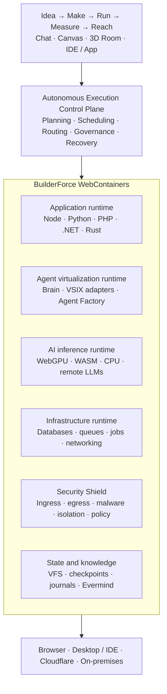

# Strategy

BuilderForce.ai is an **autonomous creation, execution and hosting platform**, not a broad business-management platform that also supports AI agents.

> BuilderForce enables people and autonomous AI workforces to create, execute, test, secure, deploy and operate applications within portable, intelligent execution environments.

`Idea → Make → Run → Measure → Reach` stays as the customer-facing methodology and as the `arc:` tag on every entry. The engineering roadmap is organized by the ten programs below. The WebContainer is the foundational execution environment, and autonomous execution is its primary consumer.

This strategy is a proposal awaiting approval. Its allocations, schedule, architecture extensions and targets must be validated against the baseline ([BASELINES.md](./BASELINES.md)) before they are treated as commitments.

## Why the roadmap changed

The previous roadmap spread effort across recruiting, creative editors, marketing, finance, meetings, marketplaces and knowledge visualization before the execution platform was dependable. The historical figures below are from that roadmap, **not re-measured**; see [BASELINES.md](./BASELINES.md).

| Signal | Historical value |
|---|---|
| Fully autonomous tickets | 0.78% (6 of 767), July 2026 baseline |
| Execution failures | 69% across 6,195 runs, July 2026 baseline |
| Autonomous trigger errors | 282 in the 30 days to October 25 |
| Frontend Worker size | 10.82 MiB against a 10 MiB limit (108.2%), one failed release |

Other gaps: two competing autonomous delivery engines; browser execution that ends with the session; an incomplete application manifest; live container preview disabled; incomplete security enforcement; fleet failover that does not redispatch; no proven golden-path cloud-agent run; CI that can report success despite failed publishing or acceptance tests; no tenant upgrade path.

## Principles

1. **One execution contract.** Browser, IDE, desktop, cloud and on-premises share one logical execution specification, with host-specific adapters.
2. **One autonomous execution engine.** No competing orchestration or delivery engines.
3. **Everything is an environment.** An application, workforce, development workspace or training workload is described by a manifest.
4. **Local-first, cloud-capable.** Execute locally where possible; move to cloud when persistence, availability or capacity requires it.
5. **Security by default.** Every environment has enforced identity, isolation, permissions, resource limits and auditability.
6. **Evidence before completion.** An agent cannot declare work complete without satisfying deterministic verification gates.

## Target architecture

Proposed capabilities, not a description of what ships today.



## Programs

| Program | Priority | File | Objective |
|---|---|---|---|
| WC — WebContainers | P0 | [01](./01-WEBCONTAINERS.md) | Universal execution environment |
| AE — Autonomous Execution | P0 | [02](./02-AUTONOMOUS-EXECUTION.md) | Reliable, independent task completion |
| AVR — Agent Virtualization | P0 | [03](./03-AGENT-VIRTUALIZATION.md) | Self-contained agent workforces |
| SEC — Security Shield | P0 | [04](./04-SECURITY-SHIELD.md) | Secure code and runtime execution |
| REL — Reliability and Release | P0 | [05](./05-RELIABILITY-RELEASE.md) | Verified releases and recoverable runs |
| HOST — Application Hosting | P1 | [06](./06-APPLICATION-HOSTING.md) | Persistent, commercially hosted applications |
| AI — Local AI Runtime | P1 | [07](./07-LOCAL-AI-RUNTIME.md) | Reduce external inference dependency |
| MEM — Evermind and Knowledge | P1 | [08](./08-EVERMIND-KNOWLEDGE.md) | Improve agent intelligence and efficiency |
| UX — Execution Experience | P1 | [09](./09-EXECUTION-EXPERIENCE.md) | Visualize and control environments |
| COM — Commercialization | P1 | [10](./10-COMMERCIALIZATION.md) | Monetize execution and hosting |

Everything else is in [MAINTENANCE.md](./MAINTENANCE.md), [DEFERRED.md](./DEFERRED.md) or [RETIREMENT.md](./RETIREMENT.md). Nothing was deleted: the outstanding technical detail is in [GAP-REGISTER.md](./GAP-REGISTER.md).

## Proposed engineering allocation (next 90 days)

A recommendation, not an existing staffing commitment. 80% of capacity directly supports WebContainers, autonomous execution, security and reliability.

| Area | Share |
|---|---|
| WebContainers and execution infrastructure | 35% |
| Autonomous agents and delivery | 30% |
| Security, reliability and release engineering | 15% |
| Local AI, Evermind and knowledge | 10% |
| Hosting, billing and commercialization | 7% |
| Other product capabilities | 3% |

Other capabilities do not compete for primary engineering resources unless they enable execution, satisfy a contractual obligation or fix a critical security issue.

## Targets beyond the roadmap summary

Proposed, not forecasts. Re-baseline each before it is used as a commitment.

| Metric | 90-day | 180-day |
|---|---|---|
| Prompt tokens per equivalent task | −50% | −70% |
| Local-AI-eligible task execution | ≥25% | ≥50% |

| WebContainer scale benchmark | Target |
|---|---|
| Registered application environments | 10,000 |
| Simultaneously active lightweight applications | 1,000 |
| Agents per workforce | 10–50 |
| Initial nested runtime depth | 3 |
| Warm environment provisioning | ≤2 s |
| Reference Node cold start with cached dependencies | ≤10 s |
| Environment recovery with cached resources | ≤30 s |
| Security policy decision overhead | ≤5 ms p95 |
| Lost acknowledged durable writes in crash tests | 0 |
| Idle environment compute | Scale to zero where supported |

The baseline phase fixes the hardware, workload, concurrency, cache and infrastructure conditions these are measured under.

## Entry format

Every entry is a ` ```yaml roadmap ` block in its program file. `scripts/check-roadmap-entries.mjs` enforces it.

```yaml
id: AE-13
program: autonomous-execution
priority: P0
status: planned
arc: make
source: PRD-09
dependencies:
  - WC-02
objective: Prove end-to-end autonomous software delivery.
acceptance:
  - Dispatch a reference ticket.
evidence:
  - CI acceptance results
blocker: null
```

- **id** `PREFIX-nn` with the program's prefix. **program** the program slug. **status** `planned`, `in-progress`, `blocked` or `done`.
- **blocker** names the blocker for a `blocked` entry and is `null` otherwise. No blocker named means not blocked.
- **P0** required for secure, reliable execution or immediate commercial viability. **P1** extends a proven execution capability. **P2** optimization or differentiation after the foundation is proven. **Maintenance** existing customer obligations and critical defects. **Deferred** no active engineering allocation. **Retired** explicitly approved removal.
- A new feature must show how it improves execution reliability, autonomy, portability, security, economics or commercialization before it receives P0 or P1.
- `acceptance` that reads "Meets the program definition of done" is a placeholder: the entry has not been specified further yet.

## Governance of the files

| File | Role |
|---|---|
| [ROADMAP.md](../../ROADMAP.md) | Executive roadmap |
| [DONE.md](../../DONE.md) | Completed work with evidence |
| `01`–`10` | One file per program, one entry per capability |
| [GAP-REGISTER.md](./GAP-REGISTER.md) | Detailed outstanding technical work from the previous roadmap |
| [BASELINES.md](./BASELINES.md) | Measured values and how to reproduce them |
| [ACCEPTANCE-GATES.md](./ACCEPTANCE-GATES.md) | Release pipeline stages against the jobs that exist |
| [DEPENDENCIES.md](./DEPENDENCIES.md) | Entry-to-entry prerequisites |
| [OPERATOR-DECISIONS.md](./OPERATOR-DECISIONS.md) | Actions only an operator can take |
| [MAINTENANCE.md](./MAINTENANCE.md), [DEFERRED.md](./DEFERRED.md), [RETIREMENT.md](./RETIREMENT.md) | Dispositions of everything outside the ten programs |
