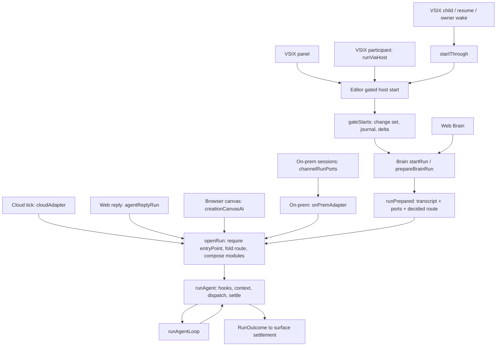
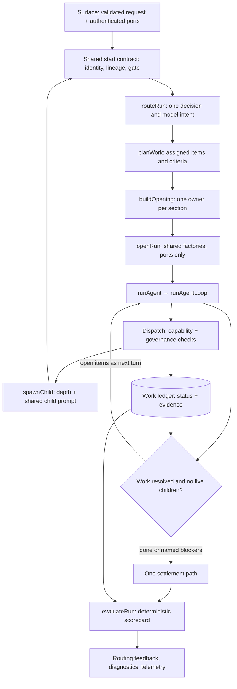

# Agent Pipeline Map

Reviewed against checkout `c56ce694e` on 2026-11-23. Static source inspection; no live runs traced. Working-tree changes verified and extended: shared EntryPoint typing, recorded preflight facts, shared spawnChild across all spawn paths, and Brain history compaction through shared strategy ports. [PRD 50](./50-prd-one-pipeline.md) records the consolidation contract and status. Update both documents as implementation changes ownership or removes a fork.

All inspected production adapters now enter through `openRun → runAgent → runAgentLoop`. Sharing that entry does not yet give every surface the same start gate, routing inputs, prompt, finish ports, or child lifecycle.

## 1. Current execution path

The Brain preamble renders opening data and per-run directives and decides its route using shared `routeRun`. `runPrepared` passes `{ input, decided }` so `openRun` does not decide again. Other callers may supply route facts directly. Full/quick scoring requires `routing`; children are not scored.

The editor host is shared by panel and participant. `brainRunHostPorts.ts` binds `startThrough` to `gated.start`; `brainRunHost.ts` supplies it to `childRunHost`. Children therefore pass the editor start gate. Other surfaces retain their own lifecycle; `openRun` does not create editor journals or cloud execution records.

## 2. Remaining surface differences

| Stage | VSIX panel and participant | Cloud | Web reply | Canvas | On-prem |
| --- | --- | --- | --- | --- | --- |
| Entry | Brain runPrepared → openRun | cloudAdapter → openRun | agentReplyRun → openRun | creationCanvasAi → openRun | openOnPremRun → openRun |
| Label | Explicit vscode from host | cloud | web | canvas | on-prem |
| Start lifecycle | Editor gate, including children | Durable execution | Reply lifecycle | Browser lifecycle | Adapter/session lifecycle |
| Pipeline route | Shared default or editor override, pre-decided once | Shared default with durable decision, pins and review models | Shared default | Shared default | Shared default and existing session model options |
| Policy composition | Factories with native history ports and recorded preflight facts | Factories with compaction, guards, finish, publish ports | Compaction summarizer options | Defaults | Defaults |
| Finish couplings | Live children, linked work, spec coverage, close-out and optional explicit assignments | Cloud finish and ship ports | Default finish | Default finish | Default finish and optional explicit assignments on in-process runs |
| Child start | spawnChild then gated host start | spawnChild then durable admission; prompt persisted for tick | None at entry | None at entry | spawnChild then openRun, or authorized session gateway start |

`BrainRunRequest.entryPoint` is required and no longer defaults. `RunEntryPoint` now aliases the shared telemetry `EntryPoint` type used by `RunPolicy.entryPoint`. Brain conformance cases enumerate `ALL_ENTRY_POINTS` (vscode, web, rovr, canvas, on-prem and cloud); these are label-parity cases through Brain, not proof of host lifecycle parity.

## 3. Resolved findings from the 2026-11-22 map

| Former finding | Current evidence |
| --- | --- |
| Participant owns its run and is labeled web | `clients/vscode/src/participantRun.ts` calls host.start; host supplies vscode. nativeBrainRun.ts and its prompt builder are gone. |
| VSIX children skip the gate | brainRunHostPorts.ts binds startThrough; brainRunHost.ts uses it for children. |
| Adapters call runAgent and replace module sets | They now call `packages/agent-run/src/openRun.ts`, which owns factory composition. Brain now supplies history ports and preflight facts; no hook replacement remains. |
| Full/quick algorithm exists only in Brain | It now lives in `packages/agent-run/src/route/routeRun.ts`; Brain runRoute.ts supplies facts and retains one decision. Configuration parity remains open. |
| startRun directly duplicates deterministic finish | deterministicFinish.ts exposes closeOutPort; openRun invokes it before the finish gate or for unfinished-settlement upkeep. startRun records the outcome. A refused finish may cause another legitimate attempt. |
| Four editor prompt assembly layers | `brain-embedded/src/runStore/openingSections.ts` renders opening data, followed by Brain directives. Former useChatSystemPrompt, host runPreamble, and participant prompt files are gone. |
| Legacy child standing instructions are independently implemented | `agent-runtime/src/agents/subagent-prompt.ts` calls shared subagentSystemPrompt and bounds configured depth by MAX_SUBAGENT_DEPTH. Session additions and separate spawning remain. |
| Kernel header names the wrong caller | `packages/agent-loop/src/loop.ts` now names openRun → runAgent correctly. |

## 4. Open forks and design gaps

1. **Brain policy callbacks removed from the production door.** preflightRecorded.ts supplies data to createModelHook; brainFold.ts supplies native history, summary transport and trace/durable-marker sinks to createCompactionHook. policy/compaction/history.ts owns memo reuse, immutable source history, summary deadline/fallback, saved tokens and fold result construction. The compaction.hook escape hatch is removed. Brain progressGuard, tool pre/post-step policy and continuation remain separate, as excluded by this slice.

2. **Shared spawnChild implemented.** policy/subagents/child.ts validates parent identity, registered entryPoint, nonempty owner/task and CHILD depth 1 through MAX_SUBAGENT_DEPTH. prepareChildStart builds the shared standing prompt with optional persona/base prompt and work references. spawnChild<Result> invokes a scoped host start and preserves its result: VSIX controls observe host completion separately from returning a handle; cloud returns durable admission; on-prem returns a completed report. CloudChildSpec persists prepared standing instructions for its later tick; old payloads use the shared preparer as a compatibility fallback.

3. **Four legacy callers retained behind one adapter.** sessions-spawn-tool.ts, commands-subagents.ts, infra/local-agent-transport.ts and transport/local-adapter.ts still call spawnSubagentDirect. It now authorizes before shared spawnChild, then supplies gateway/session lifecycle ports. buildSubagentSessionPrompt adds session context to the prepared standing prompt. Configured lower depth caps, agent allow-lists, gateway identity, delivery and result registration remain. Retiring the second session runtime is later work, not an uncounted spawn fork.

4. **Routing decision and default configuration are shared.** openRun defaults to the full pipeline. Brain uses the same default, and its editor settings can opt into auto scoring and a quick model. The decision is carried in RunState for resumes and outcome rows. Host model availability, quick-model overrides and gateway cascades still vary.

5. **One runtime opening renderer.** openingRows renders governance and persona, then preserves prepared history and the task row. Brain and channel pass their compiled system text separately from history. Host-specific grounding and directives remain inputs.

6. **Work evidence reaches the shared ledger.** Brain reports linked-ticket and spec evidence from existing scoped reads. In-process on-prem has a scoped assignment port. Cloud and the self-hosted relay record review evidence after PR confirmation. Unresolved completed invocations are excluded from routing feedback. Brain owner wakes recheck child ticket references against the scoped listing. Durable child reconciliation and relay assignments at opening remain.

7. **Shared steering and closing turns.** Tool finishes take late steering and queued follow-ups after tool rows, preserving attachments. The shared driver owns the one closing synthesis. Surface-specific persistence and post-settlement wake queues remain.

8. **One on-prem execution entry.** Tickets, sessions and children call openOnPremRun. The former channel adapter is a session port binding and retains its message bridge.

9. **Shared approval-gate inputs.** Brain now supplies its resolved snapshot. The editor still authorizes the resolved tool and workspace path in its host. Capability and verify inputs remain surface-specific.

10. **The import guard does not establish callback ownership.** `scripts/check-one-execution.mjs --enforce` checks kernel/driver imports and policy reach-ins, not supplied hook bodies. The false enforcement claim has been removed from `SurfacePorts`. `surface.preflight` now accepts a data contract rather than a callback; factory and production-door regressions cover its ownership and single-check/no-duplicate-notice behavior. SurfacePorts.compaction also accepts only factory options now; the production-door regression checks native history ports and absence of a hook override. The import guard does not prove arbitrary port callback semantics.

## 5. Target workflow (not implemented in full)

The start contract must preserve local/durable identity and authorization. Background admission and eventual settlement are separate events. Shared finish policy can only enforce evidence supplied through the host's available ports.

## 6. Implementation checkpoints

- Entry/spawn/policy slice implemented. Finish validation in a fully provisioned checkout and repair the independently reproduced baseline failures; no complete cross-surface runtime pass is claimed.
- Remaining for the full roadmap item: self-hosted relay assignments at opening, durable child reconciliation in the owner ledger, capability and verify inputs, host wake and retry ownership, and full session and cloud integration validation.
- Update this map, PRD status and the [Gap Register](../../ROADMAP.md) with each implementation. Record actual checks and blockers. Named tests are coverage references, not evidence of a pass in this checkout.

## 7. Follow-up implementation (2026-11-23)

The VSIX spawner validates the child before recording admission. Durable cloud child start attaches the handle to the payload returned by authenticated admission. This preserves newly resolved policy gates and the durable executor marker. If a post-admission operation fails, the spawn path attempts to cancel the child and reports cleanup errors. Brain dispatch sizes tool results from the actual serving model and uses the existing shared provider recovery path.

Shared close-out runs on prose finishes as well as finish-tool calls. The Brain retains the original provider error for the UI and records the shared model policy's retry verdict. The shared failure-synthesis marker reaches the Brain turn record.

The follow-up agent-run suite passed 848 tests. Eleven focused Brain suites passed 145 tests, including the run-store regressions, both conformance suites, turn and retry parity, linked-work holds and fold deadlines. Cloud child serialization passed 6 tests, VSIX child and host gate tests passed 14, and on-prem child tests passed 6. Agent-run typecheck and repository execution and package graph checks passed. Brain typecheck still needs the existing bfi-web and web-llm dependencies. The broader cloud child suite still needs @neondatabase/serverless.

## 8. Work ledger and lifecycle follow-up

The shared ledger reads host-scoped evidence. Spec coverage means a ticket was filed for the spec item. It does not mean the spec's implementation passed. A cloud PR is review evidence. It does not mean the change merged. Shared routing feedback excludes completed invocations that still have open or blocked work.

The shared suite passed 851 tests. Focused Brain, editor child and start-gate, cloud serialization and scoring, and on-prem child and outbox tests passed. The channel outcome test requires `@sinclair/typebox`. The cloud tail test requires `@neondatabase/serverless`.

## 9. Earlier slice validation (2026-11-23)

Initial working-tree changes, including runStore/runTypes.ts, were confirmed before editing. Shared focused suites pass: **13 files / 88 tests**, covering spawn validation and native results, history memo/deadline/failure behavior, preflight, routing and conformance. Agent-run typecheck passes with TypeScript 6 and --ignoreDeprecations 6.0. The full earlier agent-run run had 821 passing tests and two failures; both forcedTurns trace-step and failureSynthesis extra-call failures reproduce at c56ce694e in a detached worktree.

Brain recorded-preflight, compactionSaved, fold deadline and production-door suites pass. The two Brain conformance files fail on premature tool dispatch / missing model-window requests; these also fail on c56ce694e (the expanded labels add cases of the same failure). Brain typecheck reports pre-existing TurnRetry, TurnSession.recover and BrainRunContext.progress defects, plus missing @seanhogg/bfi-web and @mlc-ai/web-llm.

VSIX hostStartGate and childRunSpawner pass (13 tests); participant/host integration needs the built @seanhogg/builderforce-brain-embedded package, and typecheck needs vscode types. Repaired malformed newline literals in participantRun.test.ts and runSetup.ts rather than loosening their assertions. Runtime onPremSubagents passes (6 tests, including the standing-instruction assertion); runtime conformance needs @sinclair/typebox and legacy tests need @aws-sdk/client-bedrock. Cloud child tests need @neondatabase/serverless. Runtime typecheck reports unresolved dependency graphs (including @sinclair/typebox and @opentelemetry packages). API typecheck exhausted the default Node heap at about 4 GiB; neither passed.

check-one-execution --enforce, the source-package graph check and git diff --check pass. No live run was traced. See PRD 50 validation for the full accounting. Validation tooling was installed outside repository manifests before the user requested no package installs; no further installs are performed.
