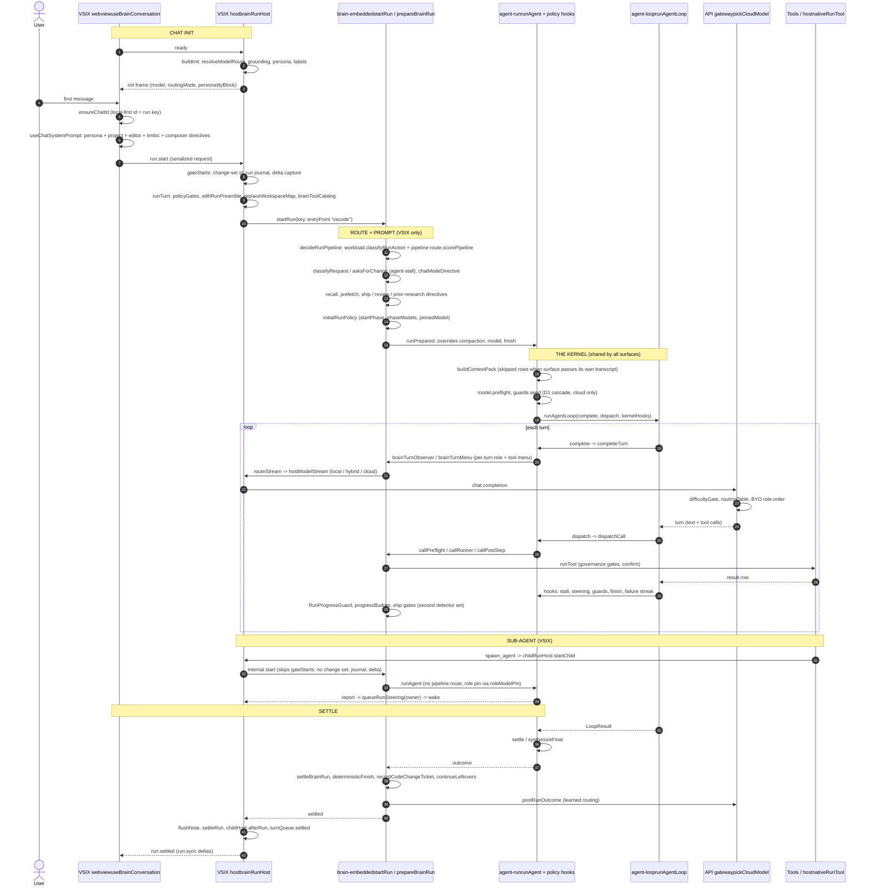
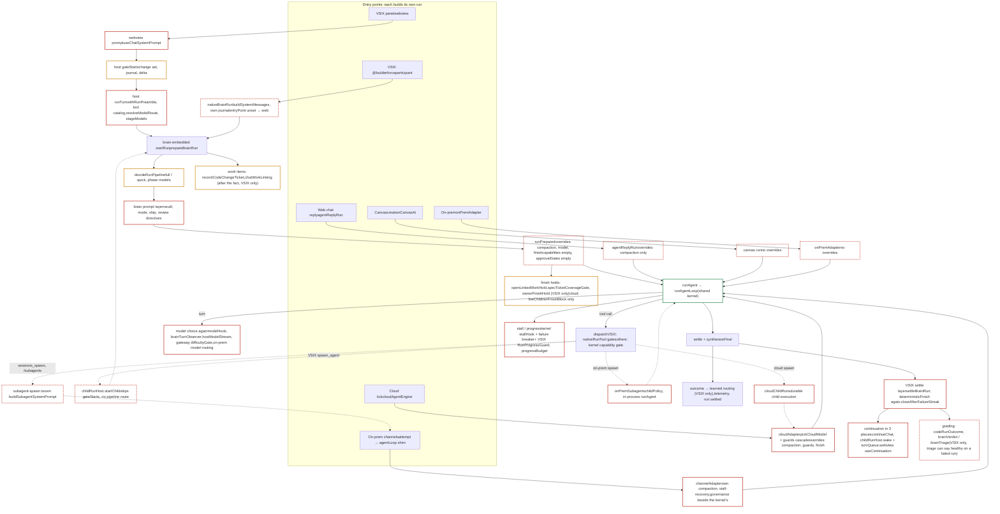
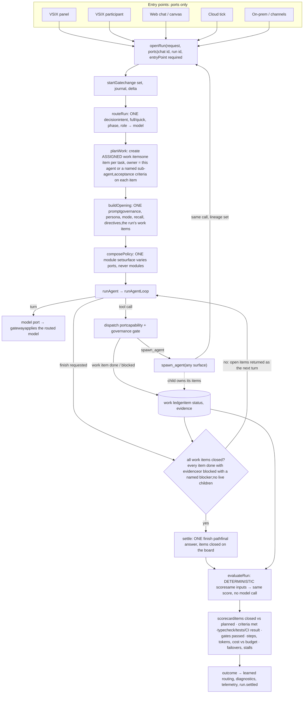

# Agent Pipeline Map

How a chat becomes a run on every surface, as the code stands on 2026-11-22. Every surface does reach the one kernel (`runAgent` → `runAgentLoop`). The splits happen above and around it: each surface sets up the chat differently, routes the model differently, swaps different policy modules, and starts sub-agents by a different mechanism. Static read of the code, no runs traced.

## 1. As built: chat start to settle

The VS Code panel path is drawn in full. The other surfaces join at the kernel, and the notes show where each one forks.

Other surfaces enter at the **runAgent** lane: **Cloud**: cloudAgentEngine → cloudAdapter → runAgent, one step per Durable Object tick **Web chat reply**: agentReplyRun → runAgent **Canvas**: creationCanvasAi → runAgent (in the browser) **On-prem**: onPremAdapter → runAgent, and separately embedded-runner → agentLoop shim → channelAdapter → runAgent **VSIX @builderforce participant**: nativeBrainRun → runBrainLoop (= startRun) with no entry point

## 2. What differs by surface

| Stage | VSIX panel | VSIX participant | Cloud | Web reply | Canvas | On-prem |
| --- | --- | --- | --- | --- | --- | --- |
| Kernel | runAgent | runAgent | runAgent | runAgent | runAgent | runAgent via 2 adapters |
| entryPoint | vscode | unset → "web" | cloud | web | canvas | on-prem |
| Pipeline route (full / quick) | decideRunPipeline | same code, no stage models | none | none | none | none |
| Model choice | host route + stageModels + modelHook + gateway | host route + gateway | pickCloudModel + guards cascade | gateway | gateway | model-routing + candidate-ranking + learned-routing |
| Policy overrides | compaction, model, finish | compaction, model, finish | compaction, guards, finish | compaction | none | none |
| Finish gates | linked-work hold, spec-ticket coverage, ship gates | same | cloudFinishPorts, ship gate on guards | default, no ports | default, no ports | default, no ports |
| Stall / progress | Brain guard + kernel stall hook (A3 off) | same | kernel stall + guards | kernel | kernel | kernel + local stall-recovery.ts |
| Sub-agent spawn | childRunHost.startChild | no spawn tools | durable child execution | none | none | childRunner and spawnSubagentDirect |
| Child prompt | subagentSystemPrompt | n/a | subagentSystemPrompt | n/a | n/a | childPolicy, and separately buildSubagentSystemPrompt |

## 3. Duplication and wrong logic

- wrong**The policy a run gets depends on where the chat started.** `composePolicyHooks` replaces whole modules per surface. The VSIX binds its own finish gates, the cloud binds guards and finish, the web reply binds only compaction, and canvas and on-prem bind none. The same request ends under different gates on each surface. Canvas, web reply and on-prem finish with an unported default finish hook.

  packages/agent-run/src/policy/index.ts:108 · brain-embedded/src/run/runPrepared.ts:90 · api/src/application/runtime/cloudAdapterHooks.ts:104 · api/src/application/brain/agentReplyRun.ts:206
- wrong**Sub-agents are started four different ways.** The VSIX re-enters its host start. The cloud creates a durable child execution. On-prem runs an in-process `runAgent` with `childPolicy`. On-prem also has a second live path, `spawnSubagentDirect`, with its own `buildSubagentSystemPrompt`. The shared `childPolicy / childProvider / childResult` primitives are used only by on-prem.

  clients/vscode/src/childRunHost.ts:139 · api/src/application/runtime/cloudChildRuns.ts:96 · agent-runtime/src/run/onPremSubagents.ts:43 · agent-runtime/src/agents/subagent-spawn.ts:271
- wrong**VSIX children skip the start gate.** `startChild` calls the host's inner start, so a child gets no change-set identity, run-journal start or delta capture. A child that writes files is invisible to the change-set record and to crash recovery.

  clients/vscode/src/brainRunHostPorts.ts:346 (gateStarts) · clients/vscode/src/childRunHost.ts:139
- wrong**The @builderforce participant runs as "web".** `nativeBrainRun` sets no `entryPoint`, and `runPrepared` defaults to `'web'`. Telemetry, entry-point attribution and any entry-specific policy get the wrong surface. The participant also has no sub-agents or steering, and its own run-journal code.

  brain-embedded/src/run/runPrepared.ts:38 · clients/vscode/src/nativeBrainRun.ts
- wrong**Routing is decided in at least five places, and only the VSIX routes the pipeline.** Full vs quick (`decideRunPipeline`) runs only in brain-embedded, so cloud, canvas and on-prem runs never get a quick path or phase models. Model choice is split across the VSIX host, stage models, role pins, the kernel's model hook and guards cascade, the API gateway, and on-prem's own model-routing and learned-routing. Sub-agents are never routed.

  brain-embedded/src/runStore/pipelineRoute.ts:24 · clients/vscode/src/modelRouting.ts:90 · clients/vscode/src/stageModels.ts:74 · clients/vscode/src/roleModelPin.ts:59 · api/src/application/llm/pickCloudModel.ts · agent-runtime/src/agents/model-routing.ts
- duplicate**Two stall and progress systems run in the VSIX.** Brain `RunProgressGuard` and `progressBudget` run beside the kernel's `stallHook`, the run-guards progress detector, `autoContinueGuard` and the kernel failure-streak breaker. The kernel's A3 detector is switched off in the VSIX to avoid a clash, so the two surfaces stall differently.

  brain-embedded/src/runStore/progressGuard.ts:58 · packages/agent-run/src/policy/stall/index.ts:129 · brain-embedded/src/run/webAdapter.ts
- duplicate**Finish runs twice, and continuation lives in three places.** `deterministicFinish` is called directly from `startRun` and also wraps the finish hook. Failure close is both `closeAfterFailureStreak` and the kernel's `synthesizeFinal`. Continuation is `continueChat` (cap 5), host `childRunHost.wake` plus `turnQueue`, and the webview's `useContinuation` and interrupted resume.

  brain-embedded/src/runStore/startRun.ts · brain-embedded/src/runStore/continueChat.ts:245 · packages/agent-run/src/runAgent.ts:176
- duplicate**The system prompt is built in four layers.** Webview `useChatSystemPrompt`, host `withRunPreamble`, brain-embedded `prepareBrainRun`, and the participant's `buildSystemMessages`. When a surface hands its own transcript, the kernel's `openingRows` (governance and persona) are bypassed, so the kernel cannot guarantee the opening is the same on every surface.

  packages/agent-run/src/runAgent.ts:84 · brain-embedded/src/runStore/runPreamble.ts · clients/vscode/src/runPreamble.ts · clients/vscode/src/prompt.ts
- duplicate**On-prem enters the kernel through two adapters.** `onPremAdapter` and the channel path (`runEmbeddedAttempt` → `createAgentSession` → `agentLoop` shim → `runChannelAgent`). The channel path also keeps its own compaction, stall-recovery and run-governance beside the kernel's.

  agent-runtime/src/run/onPremAdapter.ts:30 · agent-runtime/src/run/channelAdapter.ts:21 · agent-runtime/src/builderforce/agent-loop/
- gap**The VSIX kernel gates are empty.** `runPrepared` passes `capabilities: new Set()`, `approvalGates: []` and `verify: 'none'`. Capability and governance checks happen in the host tool instead, so the kernel's call-time capability gate does nothing in the VSIX.

  brain-embedded/src/run/runPrepared.ts · brain-embedded/src/run/webAdapter.ts:117 · clients/vscode/src/localCapabilities.ts
- stale**The kernel's header is wrong.** `loop.ts` says every surface drives `runAgentLoop`. Only `runAgent` imports it, which is correct, but the comment misleads.

  packages/agent-loop/src/loop.ts:4

## 4. Current-state workflow

The same view as the target below, drawn as the code stands today. Red boxes are logic that exists in two or more places or is wrong. Amber boxes run on one surface only. Dashed lines are sub-agent paths.

**Solid red**: duplicated logic **Dashed red**: wrong or missing (empty gates, wrong entry point, skipped start gate) **Amber**: runs on one surface only **Green**: shared by every surface

## 5. Target workflow: one pipeline for every modality

A surface supplies ports only. Everything that decides behaviour sits once, below the entry, and a sub-agent re-enters at the same place as a user's chat.

Consolidation order: (1) require `entryPoint` and route the participant through the panel's host start; (2) one `spawnChild` built on `childPolicy`, called by every surface, entering at `openRun` so children pass the start gate; (3) move `decideRunPipeline` and model choice into one `routeRun` below the entry; (4) `planWork` creates the run's assigned work items up front, and one finish gate refuses to settle while any item is open or a child is live, on every surface. Today that exists only in the VS Code path (`openLinkedWorkHold`, `specTicketCoverageGate`, `recordCodeChangeTicket`), and items there are recorded after the work instead of planned before it; (5) one `evaluateRun` that scores every run from the work ledger and the trace with no model call, replacing `codeRunOutcome`, `brainVerdict` and `brainTriage`, and feeding learned routing and diagnostics; (6) one stall module set with ports per surface; (7) retire the second on-prem adapter and `spawnSubagentDirect`.