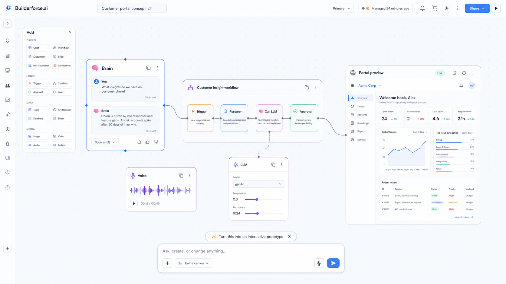
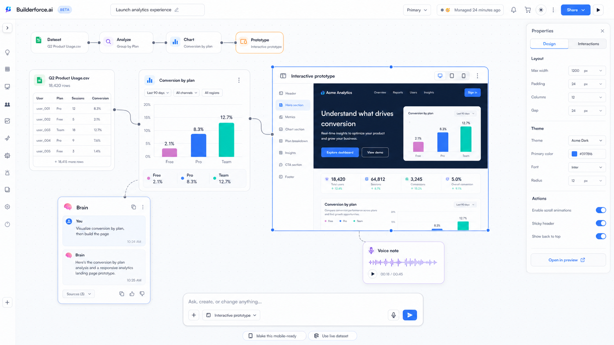
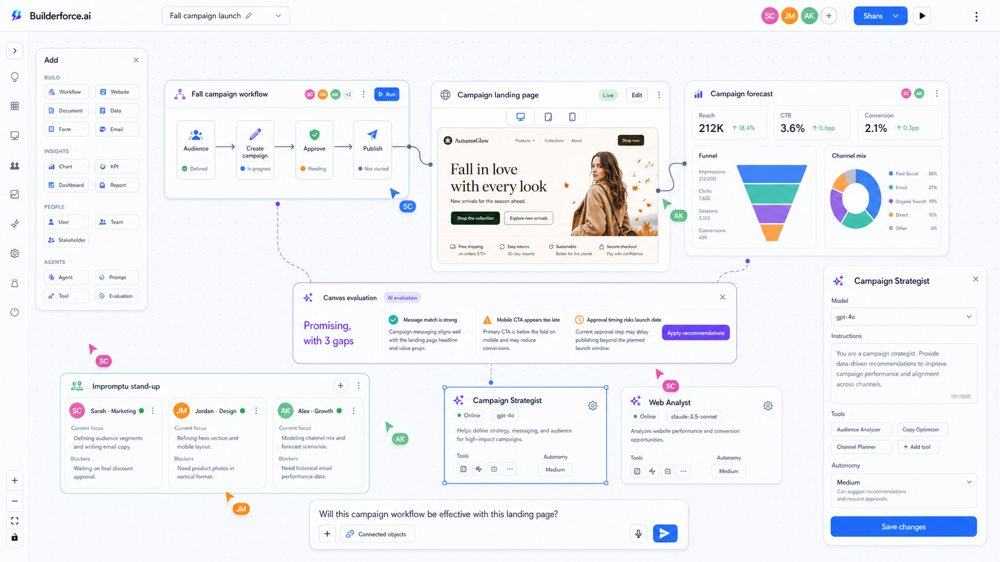

# 💡 Idea — Read · Prove

> **Domain PRD — open work only.** Consolidated 2026-11-17 from the per-PRD specs that used to live in
> `docs/specs/NN-*.md`; every section was verified against the code that day. This file holds only
> what is left to build. Finished sections are archived word for word in `DONE.md` ("✅ RESOLVED 2026-11-17 — PRD NN:
> finished sections archived on consolidation"), with their § numbers kept, so a citation such as
> `PRD 38 §4.3` resolves to the `## PRD 38` section here (open) or to DONE.md (shipped).
> A gap in a PRD's numbering is a shipped section. Outstanding work is tracked in `ROADMAP.md` under **💡 Idea**.

**Holds:** Ideas, sessions, briefs, creation-canvas sessions, experiments as proof forms, surveys.

## Contents

- [Design — Creation Canvas](#design--creation-canvas)

---

## Design — Creation Canvas

> Consolidated 2026-11-18 from `docs/design/creation-canvas/README.md`, `docs/design/creation-canvas/DELIVERY-ARCHITECTURE.md` and `docs/design/creation-canvas/OPERATIONS.md`. Verified against code 2026-11-18: shipped, with three open telemetry/routing gaps; the delivery contract and the operations runbook are kept below as reference.
> Finished README and DELIVERY-ARCHITECTURE sections were archived word for word in DONE.md on 2026-11-17 ("Design: Creation Canvas — finished sections archived on consolidation"); the finished OPERATIONS sections are archived in DONE.md ("Creation Canvas: finished sections archived on consolidation (2026-11-18)"). The release-evidence contract stays a file: [`../design/creation-canvas/evidence/README.md`](../design/creation-canvas/evidence/README.md) (named by `qa-e2e/src/canvas-release-audit.ts:51`).

### Recommendation — legacy entry points

| Existing entry | New behavior |
| --- | --- |
| `/workflows` | List sessions filtered to those containing Workflow objects |

**Remaining (verified 2026-11-18):**
- `/workflows` still renders its own `WorkflowsContent` list (`frontend/src/app/workflows/WorkflowsPageBody.tsx:3,12`) instead of the Create library filtered to Workflow objects.
- The library already narrows by object kind: `CreationLibraryPanel` reads `?filter=<kind>` and keeps only boards whose `kinds` include it (`frontend/src/components/creation-sessions/CreationLibraryPanel.tsx:69-76`). So the fix is a forward to `/create?filter=workflow`, the same way `/ide` forwards to `/create?filter=build` (`frontend/src/middleware.ts:224-229`).
- The other legacy entries already forward into Create: `/workflows/builder` (`frontend/src/app/workflows/builder/WorkflowBuilderCanvasRedirect.tsx:13`), `/brainstorm` (`frontend/src/app/brainstorm/BrainstormCanvasRedirect.tsx:18`) and `/ide*` (`frontend/src/middleware.ts:224-234`).

### Delivery sequence — Phase 4 Route consolidation

- Redirect legacy URLs only after migration telemetry shows saved links and session ownership are reliable.

**Remaining (verified 2026-11-18):**
- The redirects shipped, but the telemetry they were meant to wait for was never emitted. `creation_legacy_route_adapted` has no emitter: `git grep` finds it only in this doc's source, not in `frontend/src`, `api/src` or `packages`.
- Either emit it (through `trackActivity`, `frontend/src/lib/activity/tracker.ts:30`) from the three redirect clients and the middleware branch, or drop the event from the product-event family below.
- The rest of Phase 4 is done: Create is the primary navigation group and already matches `/brainstorm` and `/workflows` (`frontend/src/lib/navGroups.ts:142`).

### Operations — Observe (product-event family)

- Track the PRD product-event family (`creation_session_*`, `creation_prompt_submitted`, `creation_object_*`, `creation_connection_added`, `creation_project*`, `creation_ai_evaluation_completed`, `creation_change_set_applied`, `creation_artifact_delivered`, `creation_agent_assigned`, `creation_tutorial_step_completed`, and `creation_legacy_route_adapted`) without recording prompt or object content.

**Remaining (verified 2026-11-18):**
- `creation_tutorial_step_completed` and `creation_legacy_route_adapted` are never emitted. The canvas tutorial is the section tour (`frontend/src/components/creation-canvas/CreationCanvas.tsx:779`, `onTutorial={sectionTour.openOffer}`), and it records no step event.
- The rest of the family is emitted. Examples: `creation_session_opened` (`frontend/src/components/creation-canvas/hooks/useCanvasSession.ts:100,142`), `creation_prompt_submitted` (`hooks/useCanvasBrainTurn.ts:131`), `creation_artifact_delivered` and `creation_agent_assigned` (`hooks/useCanvasProjectActions.ts:264,267`).

### Delivery architecture (reference)

The execution and artifact handoff contract. It lives with the canvas because every adapter in it is a canvas object/action adapter (`frontend/src/lib/creationDeliverables.ts`, `frontend/src/domains/canvas/domain/canvasChange.ts`), not a run-kernel or hosting concern.

The product flow is **Imagine → Create → Deliver**. A Creation Session owns the conversation and graph; Projects are optional context; canonical services own execution and published artifacts.

#### Agent conversation

1. The Chat object is lazily linked to a canonical Brain chat (`chat:<id>`).
2. Agent objects linked to Chat must carry a canonical workforce ref (`agent:<ref>`) to participate as deployed agents.
3. The current user turn is persisted in that chat before any agent runs.
4. `@AgentName` addresses one participant. Unaddressed and “ask all” turns address every connected agent.
5. Agent replies run concurrently through `/api/brain/chats/:id/agent-reply`. That path supplies the triggering user's permissions, the agent's configured model/tools, usage accounting, trace, audit provenance, and project Evermind behavior.
6. Canvas Brain receives the attributed replies as synthesis context and owns the final graph change set.

Guest Canvas personas may assist with local ideation, but they are explicitly not canonical workforce participants.

#### Deliverable contract

Every executed output appends a `CreationDeliverable` to its source object's `deliverables` array. The record has:

- stable `id`, `action`, and `artifactKind`;
- `running | delivered | failed` terminal lifecycle;
- provider and canonical resource reference;
- URL/file metadata where applicable;
- validation result and bounded operational metadata;
- correlated Creation outcome events (`started` plus a terminal phase).

Adapters live outside the Canvas component in `frontend/src/lib/creationDeliverables.ts`. Canvas coordinates selection, permissions, locks, and UI state; the adapter builds or calls the actual artifact service.

The authoritative list of connected actions is `CONNECTED_CANVAS_ACTIONS` in `frontend/src/domains/canvas/domain/canvasChange.ts:59`; a kind/action not in it is never advertised. The original delivery adapters are:

| Canvas object/action | Canonical execution | Delivered result |
| --- | --- | --- |
| Website / publish | IDE static-site publish | versioned live URL, path URL, asset proof |
| Video / generate | published Evermind media model | generated frame sequence, first-frame preview, model/usage proof |
| Workflow / build, run | canonical workflow runtime | workflow run id and terminal status |
| Mockup / deliver | canonical project task | task resource linked to project/agent |
| Document / Word | Office export service | downloaded `.docx` |
| Slides / PowerPoint | Office export service | downloaded `.pptx` |
| Idea → Real proof (`demo-video`, `clickable-prototype`, `smoke-test`, `wizard-of-oz`, `poc`, `pilot`, `phone-line`, `live-system`) / publish | IDE static-site publish (`website.publish` → `artifact.publish`) | versioned live URL, path URL, asset proof |

Marketed proofs land as Website / publish via `realizationCanvasDelivery` in `@builderforce/creation-canvas-contract`. `canvas_realize` puts a WYSIWYG site (plus the generated runbook) on the board; it does not call `POST /api/realizations/:id/build` — that stays the human-reviewed step. Journey test: `api/src/application/outcomes/proofJourney.test.ts` (`marketed artifact %s reaches graded proof`).

New operational actions are not complete until they have a real adapter, a terminal deliverable record, an outcome correlation, and a journey test.

*Verified 2026-11-18:* `CreationDeliverable` and its `running | delivered | failed` status at `frontend/src/lib/creationDeliverables.ts:9-28`; the Chat link `chat:<id>` at `frontend/src/components/creation-canvas/brainTurn/runCanvasGroupTurn.ts:79`; the agent-reply route at `api/src/presentation/routes/brainRoutes.ts:684` (client `frontend/src/lib/builderforceApi.ts:525`); `realizationCanvasDelivery` at `packages/creation-canvas-contract/src/realizationDelivery.ts`; `canvas_realize` at `frontend/src/components/creation-canvas/actions/realization.ts:158`; the journey test at `api/src/application/outcomes/proofJourney.test.ts:147`. **Drift fixed:** the table used to be headed "Currently connected delivery adapters" and read as the full list. `CONNECTED_CANVAS_ACTIONS` now also connects dataset, project, mockup set, stand-up, Evermind, poll, form, idea, the creative kinds (image, animation, podcast, comic, game, CAD, 3D model, resume, template), the QA kinds, investor update, invoice, pay run, the assessment kinds, cap table, equity grant, convertible and offer, and Workflow has `build` as well as `run` (`canvasChange.ts:59-132`).

### Operations runbook (reference)

Production deployment, observation, and rollback guidance for Creation Canvas.

#### Deploy

1. Back up the production database and record the current API/frontend/VSIX versions.
2. From `api`, run `npm run check:migrations`, `npm run check:schema`, `npm run check:tenant-scope`, and `npm run type-check`.
3. Run `npm run db:migrate` before deploying the API. It applies every pending migration in order. The Creation Canvas set is `0388` through `0393`: these fix older environments that lack collaboration columns, add completion/search/limit state, create hashed expiring invitations, and install the Session-owned conversation timeline.
4. Deploy the API, then the frontend, then package/publish the VSIX. The older clients remain compatible with the additive schema.
5. Smoke-test anonymous homepage prompt → local canvas → sign-in claim, server autosave, invitation/presence, history restore, project expansion, Agent delivery, and the native VSIX editor against one disposable session.
6. Smoke-test the advanced collaboration gate: Marketplace pack placement, freehand drawing, custom-frame save/reuse, presentation mode, collaborator follow, named checkpoint, branch creation, reviewed merge, and recovery from a deliberately stale parent revision.
7. Verify the public `/creation-canvas` specification page and the launch/use-case articles tagged `creation-canvas` are present in the generated sitemap and social metadata.

#### Observe

- Alert on creation-session 5xx, command conflicts/rejections, permission denials, snapshot growth, presence/WebSocket failures, wrapper failures, and delivery duplication.
- Verify `/create/:sessionId` is served by the Edge runtime and that `last_seen_at`, snapshot, viewport, cursor, selection, typing, and pinned columns exist.
- Track legacy wrapper success before removing fallback code.
- Track the PRD product-event family without recording prompt or object content. The family, and the two events in it that are not emitted yet, are listed under "Operations — Observe (product-event family)" above.
- Alert when a branch merge returns a revision conflict; the reviewer must refresh and repeat object resolution rather than silently overwriting the parent.

#### Rollout gates

1. Internal tenants: two-week daily-use soak with command/data-loss rate below 0.1%, wrapper-session success ≥ 99%, and no P0/P1 tenant-isolation, data-loss, command-idempotency, accessibility, or presence defect.
2. Opt-in tenants: at least 50 tenant Sessions and five multiplayer Sessions; session API 5xx < 0.5%, command rejection/conflict within the established baseline, and no sustained preview queue or presence lag alert.
3. Legacy menu removal: keep compatibility URLs and rollback controls for at least one full supported client window.

Release evidence for these gates is recorded through the contract in [`../design/creation-canvas/evidence/README.md`](../design/creation-canvas/evidence/README.md). From `qa-e2e`, `pnpm canvas:release`, `pnpm canvas:capacity` and `pnpm canvas:audit -- <evidence.json>` produce and audit it (`qa-e2e/package.json:13-15`).

#### Support playbook

- **Canvas/Brain issue:** open **Diagnostics** in the Session actions, or **Copy diagnostics** in the Brain panel header. The pasteable report includes UI/API build, Session/revision/realtime/access state, graph counts, selection, Brain scope/pending changes, and the bounded recent transcript. The global floating Brain is intentionally absent on `/create/*`; the Canvas composer is the authoritative Session conversation and uses the shared Brain transport and MCP catalog.

- **Guest draft does not claim:** preserve the local-storage snapshot, confirm a tenant token exists, retry claim with the same idempotency key, and never clear the guest key until the saved session opens successfully.
- **Session reports missing `last_seen_at`:** confirm migrations 0388–0393 were applied in order—especially the forward-compatible `0389` repair—and run schema checks before restarting presence traffic.
- **Conversation is missing after Chat removal:** confirm `0393_creation_session_timeline.sql` is applied, verify `/api/creation-sessions/:id/timeline`, and do not reconstruct the authoritative transcript from Chat Object content.
- **Realtime disconnect:** keep local geometry edits queued, display reconnecting state, and reconcile against the latest server revision before resuming autosave.
- **Referenced object is redacted:** verify both session membership and the canonical resource permission. Never broaden resource access merely because the session was shared.
- **Merge conflict:** reopen the parent, rerun comparison, and require a fresh object-by-object review. Do not force a stale graph replacement.
- **Large session performance:** collapse heavy live objects, organize them into frames, or branch/split into a linked session; preserve canonical artifact references rather than embedding large payloads.

#### Roll back

- Roll back clients/API first; the migrations are additive and remain safe for older code.
- Do not drop Creation Session tables or columns during an incident. Preserve sessions, snapshots, comments, and event history for recovery.
- If command writes are unhealthy, disable the Creation navigation rollout and use legacy compatibility surfaces while retaining read access to existing sessions.
- Restore the database only for verified corruption or data loss, never for an ordinary application rollback.

*Verified 2026-11-18:* the four check scripts and `db:migrate` are in `api/package.json:8,15,19,26,41`; migrations `api/migrations/0388_creation_sessions.sql` … `0393_creation_session_timeline.sql` exist, and both 0388 (`:74`) and 0389 (`:6`, `ADD COLUMN IF NOT EXISTS`) define `last_seen_at`; `/create/[sessionId]` declares `runtime = 'edge'` (`frontend/src/app/create/[sessionId]/page.tsx:4`); `/creation-canvas` is in the sitemap (`frontend/src/app/sitemap.ts:39`); the timeline route is `api/src/presentation/routes/creationSessionRoutes.ts:1413,1434`; Diagnostics is a session action (`frontend/src/components/creation-canvas/CanvasSessionActions.tsx:77`) and Copy diagnostics sits in the Brain header (`BrainSurfaceActions.tsx:67`). **Drift fixed:**
- Deploy step 3 said `db:migrate` applies 0388–0393. It applies every pending migration (three passes: plain, `--transactional`, `--apps`).
- Deploy step 7 said "all five" articles. 45 index entries now carry the `creation-canvas` tag (`frontend/src/lib/blogIndex.generated.json`).
- Rollout gate 3, "enable `creation_sessions_nav`", is gone. No such flag exists and Create is already the default nav group (`frontend/src/lib/navGroups.ts:142`); the gate is archived in DONE.md.
- The support playbook said "Diagnostics in the Session header or Conversation → Copy diagnostics". Copy diagnostics is in the Brain panel header.
- The 2026-08-02 release-candidate evidence snapshot is history and moved to DONE.md; the pointer to the evidence contract it carried is kept under Rollout gates.

### Mockups (reference)

These are direction-setting mockups. Exact UI copy and object chrome should be implemented with the existing design tokens and localization system.

---
