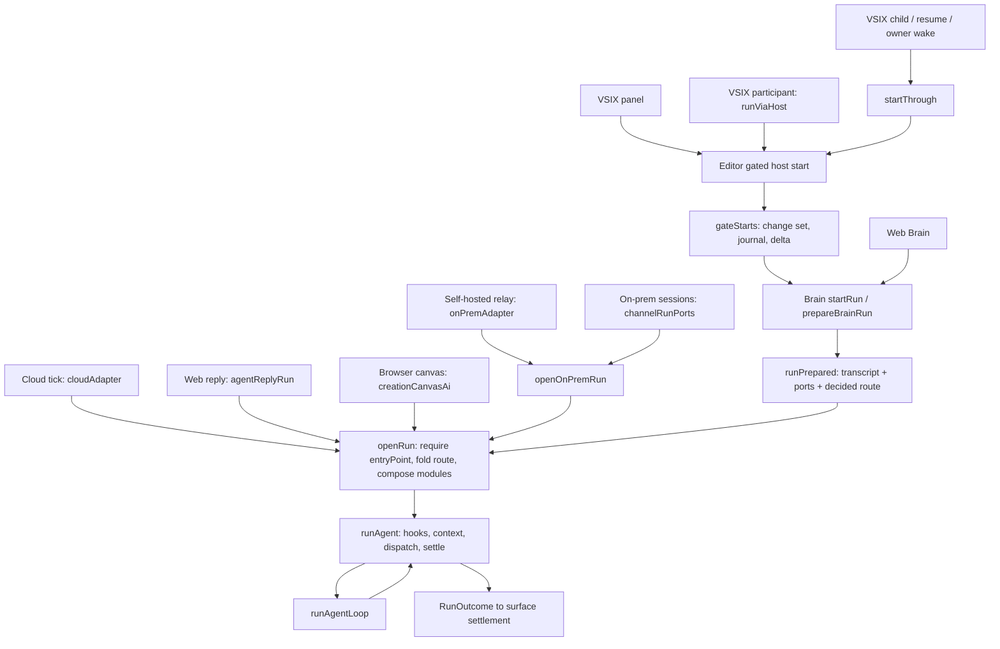
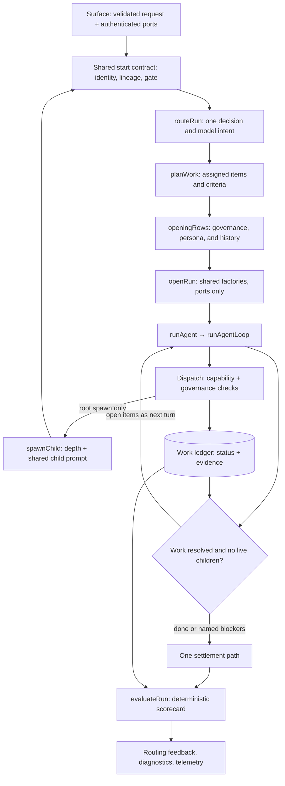

# 🔨 Make — Build

> **Domain PRD — open work only.** Consolidated 2026-11-17 from the per-PRD specs that used to live in
> `docs/specs/NN-*.md`; every section was verified against the code that day. This file holds only
> what is left to build. Finished sections are archived word for word in `DONE.md` ("✅ RESOLVED 2026-11-17 — PRD NN:
> finished sections archived on consolidation"), with their § numbers kept, so a citation such as
> `PRD 38 §4.3` resolves to the `## PRD 38` section here (open) or to DONE.md (shipped).
> A gap in a PRD's numbering is a shipped section. Outstanding work is tracked in `ROADMAP.md` under **🔨 Make**.

**Holds:** Agent runs and the one kernel, cloud/IDE runtime, autonomous delivery, knowledge graph / packs / local-first, canvas runtimes and studio, previews, hosting and the customer app platform.

## Contents

- [PRD 50 — One-pipeline validation and diagnostic gaps](#prd-50--one-pipeline-validation-and-diagnostic-gaps)
- [Design — Agent pipeline map](#design--agent-pipeline-map)
- [Tasks / Deliverables — review 2026-11-21](#tasks--deliverables--review-2026-11-21)
- [PRD 09 — Cloud Agent Validation & Hardening](#prd-09--cloud-agent-validation--hardening)
- [PRD 23 — Manager PR Review, Acceptance Evidence, and Ticket Recovery](#prd-23--manager-pr-review-acceptance-evidence-and-ticket-recovery)
- [PRD 37 — Coordinated Role Participation & Execution Verification](#prd-37--coordinated-role-participation--execution-verification)
- [PRD 45 — Deterministic run gates and loop economics](#prd-45--deterministic-run-gates-and-loop-economics)
- [PRD 49 — Methodology personas and the `.builderforce/` workspace layout (TIP Code parity)](#prd-49--methodology-personas-and-the-builderforce-workspace-layout-tip-code-parity)
  - [PRD 49 end-state design](#prd-49-end-state-design)
- [Agent framework registrations — legacy table contract step](#agent-framework-registrations--legacy-table-contract-step)
- [PRD 41 — Offline understanding and the run delta](#prd-41--offline-understanding-and-the-run-delta)
- [Design — Local-first closure: G03, G21 + G23, G27](#design--local-first-closure-g03-g21--g23-g27)
- [Design — Web, Rovr, and VSIX local-first architecture and batch sync review](#design--web-rovr-and-vsix-local-first-architecture-and-batch-sync-review)
- [Design — Studio local-first](#design--studio-local-first)
- [Design — Deterministic knowledge index (LEANN-style)](#design--deterministic-knowledge-index-leann-style)
- [Design — Deterministic-first PreFetch](#design--deterministic-first-prefetch)
- [PRD 38 — The knowledge graph (any directory; code and docs first)](#prd-38--the-knowledge-graph-any-directory-code-and-docs-first)
- [PRD 43 — One 3D stage for every knowledge camera](#prd-43--one-3d-stage-for-every-knowledge-camera)
- [Design — Floorplan review: features for the visualizer](#design--floorplan-review-features-for-the-visualizer)
- [PRD 31 — Build, run and ship a real app on Builderforce](#prd-31--build-run-and-ship-a-real-app-on-builderforce)
  - [W11 contract — the app manifest ai resource](#w11-contract--the-app-manifest-ai-resource)
- [PRD 18 — hired.video → Builderforce.ai port (Canvas runtimes and the Studio → Canvas port)](#prd-18--hiredvideo--builderforceai-port-canvas-runtimes-and-the-studio--canvas-port)

---

## PRD 50 — One-pipeline validation and diagnostic gaps

> Completed on 2026-11-23. Editor, on-prem, and durable cloud use the shared execution entry and policy. Hosts supply their authorized catalogs and actual verification evidence. The runtime harnesses cover editor wake recovery, on-prem continuation and settlement, and durable cloud resume and settlement. See the [pipeline map](#design--agent-pipeline-map) and [DONE.md](../../DONE.md).
> This slice stops at the kernel. `runAgent` (`packages/agent-run/src/runAgent.ts:67`) calling `runAgentLoop` (`packages/agent-loop/src/loop.ts`) stays. Nothing inside that call is redesigned here.
> The original design below describes the first slice above `runAgent`. The follow-up records the completed workflow.

### Executable acceptance checks

Run these commands independently from the listed directories, which are relative to the repository root. The validation run reads this block from the PRD and matches completed tool results by command and directory. A nonzero exit is a failed check. A missing command or unfinished job leaves its check unverified.

```builderforce-acceptance
[
  { "cwd": ".", "command": "node scripts/check-one-execution.mjs --enforce" },
  { "cwd": ".", "command": "node scripts/check-source-package-graph.mjs" },
  { "cwd": "packages/agent-run", "command": "pnpm exec vitest run --maxWorkers=3 --pool=threads" },
  { "cwd": "brain-embedded", "command": "pnpm exec vitest run src/crossAdapterConformance.test.ts src/run/runPrepared.door.test.ts src/runStore/openingSections.test.ts src/triageReport.regression.test.ts src/chatDiagnosticsReport.test.ts --maxWorkers=2 --pool=threads" },
  { "cwd": "clients/vscode", "command": "pnpm exec vitest run src/participantRun.test.ts src/brainRunHost.entryPoint.test.ts src/hostStartGate.test.ts src/childRunSpawner.test.ts --maxWorkers=2 --pool=threads" },
  { "cwd": "agent-runtime", "command": "pnpm exec vitest run src/conformance/crossAdapter.test.ts src/run/onPremSubagents.openRun.test.ts src/run/channelAdapter.test.ts src/run/channelOutcome.test.ts --maxWorkers=2 --pool=threads" },
  { "cwd": "api", "command": "pnpm exec vitest run src/application/llm/chatDiagnosticsToolCatalog.test.ts src/application/runtime/cloudChildSpec.test.ts src/application/runtime/cloudChildRuns.test.ts src/application/runtime/cloudAdapter.sharedTask.test.ts --maxWorkers=2 --pool=threads" }
]
```

The November 24 implementation adds these executable checks and records their results in Brain diagnostics. Local verification and capture requirements for the installed hosts are tracked in [Make](#prd-50--one-pipeline-validation-and-diagnostic-gaps).

This is the first `builderforce-acceptance` block in make.md; spec validation binds only the first block within the first 12,000 characters, so keep this section first and add no other block above it.

> Re-reviewed 2026-11-23 against checkout `7bdcdfb8f` and the user-supplied VSIX chat #175701 / server #300 report (client `2026.10.209+9b457dacff78`, API `2026.10.106`). That installed build is a separate artifact from this checkout. This section supersedes the earlier make.md claim that chat #300 validated all six contracts or proved a commit/push. [PRD 50 slice contract (archived)](../../DONE.md) and the [pipeline map](#design--agent-pipeline-map) contain both current workflow notes and historical slice results; earlier missing-dependency lists and test counts are not fresh results.

### Remaining acceptance work

The implementation has a shared `openRun → runAgent → runAgentLoop` path. `runPrepared` forwards the required entry label; `openRun` rejects missing/unregistered labels and composes factories from surface ports. The participant calls `host.start`; editor children use `startThrough → gated.start`. The four surface spawn adapters call shared `spawnChild`. Separately, the four gateway compatibility callers still use `spawnSubagentDirect`, which delegates to shared `spawnChild`; these are two different groups of callers.

Shared full-routing defaults, persisted resume decisions and `openingRows` governance-before-history assembly exist. Treat their old slice exclusions as historical. Host authorization, storage, native tools, verification evidence and durable admission/completion remain host responsibilities. Finding an import or a deleted function name alone proves neither these behaviors nor policy-body ownership. A current source review also cannot prove that an earlier implementation left the kernel unchanged without its baseline diff.

**Remaining live acceptance (MK-50-PIPELINE).** Capture a fresh validation in the installed VSIX and reconstruct authenticated on-prem and cloud runs on the updated builds. Record their build IDs and check outcomes. The supplied chat #300 diagnostic remains evidence for its installed build. The implementation and regression coverage for MK-50-PERSIST, MK-50-TRACE, MK-50-DIAG and MK-50-SELFVAL are recorded in [DONE.md](../../DONE.md).

### Supplied VSIX run: what it establishes

- Seven model turns, 16 tool calls and zero recorded tool errors; four tool results were trimmed, with a 44,951-token prompt peak. There was one successful edit and no dispatch. Local execution is legitimate; zero cloud runs is not a pipeline defect.
- `builtin_chats_diagnostics` returned an empty stored-capture list. That means no captures were returned, not that no failure or pressure occurred. The transcript ran searches and an outline, but no test, typecheck or execution guard before claiming all six contracts passed. Importing `spawnChild` does not validate ports-only policy ownership, and removing `runNativeBrain` does not establish participant host behavior.
- The warning predicts a premium entitlement rejection/fallback even though provenance says `servedBy: own`, all seven turns used the selected local model, and no provider failure/failover was recorded. `brain-embedded/src/chatDiagnostics.ts` emits that warning from configured funding and plan entitlement without considering observed own-account provenance. Correct the conclusion; this report does not establish a gateway entitlement failure.
- The healthy verdict says “no context pressure” while `contextPressureOnly` is true and the next paragraph reports trimming. `brainDiagnosticsText.ts` supplies the unconditional healthy sentence. Trimming alone is not evidence of a broken run, but the two statements must agree.
- `staffingSummary.ts:sessionShippedInTrace` counts successful edits as well as commits/pushes. Therefore `sessionShipped: 1` is evidence of local work, not delivery. The supplied transcript contains no explicit `git_commit` or `git_push` call and no commit/push receipt. The earlier MK-45-SHIP sentence overstated the evidence. *(Journal, 2026-11-24: the supplied transcript stopped at step 5. Step 6 did commit, as `7bdcdfb8f` / rewritten `82dcf2bd6`, and nothing was pushed. See MK-45-SHIP.)*
- Step 4's self-review `git_diff` returned `(no output)` for a file it had just edited. The agent spent step 5 re-checking through `run_command`. Root cause: with an explicit `repo`, `runInRepoScope` (`packages/agent-tools/src/git-repo-scope.ts`) passed the workspace-relative path `Builderforce.ai/docs/specs/make.md` to `git diff` unchanged, with the repo as cwd. That pathspec matches nothing, so git exits 0 with empty output. `git_history` had the same defect, and `git_diff` also omitted staged changes. Fixed in this pass (see DONE.md, 2026-11-24).
- Ticket creation returned task #7050 and a chat link, while the report's ticket list and execution-history snapshot show zero linked runnable tickets. Reconcile snapshot timing/local-to-server identity before diagnosing lost linkage; the report alone does not establish the cause. Likewise, seven model turns alongside zero loaded run steps is an observability discrepancy, not proof that no run occurred.

### Prior local validation (2026-11-23)

Commands use existing installs only; no package installation or assertion changes. This review changes documentation only.

| Check | Result on this checkout |
| --- | --- |
| `packages/agent-run`: `pnpm exec vitest run` | **97 files / 859 tests pass.** |
| `packages/agent-run`: `pnpm exec tsc --noEmit -p tsconfig.json` | **Pass.** |
| `brain-embedded`: `pnpm exec tsc --noEmit -p tsconfig.json` | **Pass.** Earlier missing-dependency blockers did not reproduce. |
| Brain: crossAdapterConformance, run/runPrepared.door, runStore/openingSections, diagnosticsVersions (`--maxWorkers=1 --pool=threads`) | **4 files / 39 tests pass.** Initial fork startup timed out before assertions; the thread rerun completed. |
| Brain: chatDiagnosticsReport and triageReport.regression (`--maxWorkers=1 --pool=threads`) | **2 files / 25 tests pass.** Existing coverage does not close the contradictory report cases above. |
| VSIX: participantRun, brainRunHost.entryPoint, hostStartGate, childRunSpawner | **37 pass / 1 fail.** Participant `#file` persistence assertion fails at line 296; isolated single-thread rerun: 21 pass / same 1 fail. |
| VSIX: `pnpm exec tsc --noEmit -p tsconfig.json` | **Fail.** `participantRun.test.ts:254` implicit-any `spec`; line 327 missing required `BrainRunRequest.entryPoint`. The earlier missing-vscode-types blocker did not reproduce. |
| On-prem: conformance/crossAdapter and onPremSubagents.openRun | **3 pass / 2 fail.** Both conformance traces contain an additional `run.routed`; child suite passes. Both failures also reproduce in an isolated single-thread rerun. |
| API: cloudChildSpec and cloudChildRuns | **2 files / 9 tests pass.** Earlier Neon load blocker did not reproduce for these files. This is not a full cloud-host validation. |
| `node scripts/check-one-execution.mjs --enforce` | **Pass.** Import guard only; does not prove arbitrary port callback ownership. |
| `node scripts/check-source-package-graph.mjs` | **Pass.** 48 packages, 50 edges, 32 tsconfig projects. |
| `git diff --check` | **Pass.** |

Focused suites above were run with `pnpm exec vitest run` and the named test paths in their respective package directories. Passing shared tests and source guards support the architecture; the reproducible host failures prevent an all-green PRD 50 verdict. No live deployment, editor UI, authenticated cloud lifecycle or push was exercised by this review.

### Full workflow follow-up (current status)

The entry slice has been extended. openRun and the Brain preamble share routing defaults. The persisted run state carries the decision across durable ticks. Full routing is the default. Existing editor settings and explicit host configuration can opt into auto routing. Shared opening assembly renders governing instructions ahead of history. Brain and channel use that opening rather than assembling separate transcript prefixes.

planWork and evaluateRun support host-scoped assignments. The shared runtime keeps IDs and criteria in run state, presents them on turns, checks evidence in a batch on finish, and reports work counts. Brain records ticket and spec evidence. Cloud and relay bind assignments at opening, cloud owners reconcile durable child evidence, and PR confirmation supplies review evidence. Unresolved work stays out of successful routing samples.

The follow-up fixes early VSIX admission before shared validation, cloud admission stamps overwritten by the rebuilt child payload, Brain calling removed progress and retry hooks, a missing Brain failure-synthesis marker, and prose finishes skipping close-out. The detailed current status lives in the pipeline map. Historical slice text below describes the initial contract.

Children carry scoped assignments on all three hosts. The shared steering path takes queued follow-ups after finish-tool results. Brain defers native approval until the editor resolves the tool and workspace path, and it records the driver's sole closing synthesis. On-prem sessions, tickets, and children share an execution entry. Native catalogs supply the tools they can dispatch, and shared settlement records checks that actually ran. Hosts retain their own storage, approval presentation, and worktree lifecycle.

Explicit questions use the ask-only classifier and take the quick route unless the ask requests the full pipeline. The shared guard carries their answer budget across ticks. Brain applies the classification to shipping policy and uses the latest run outcome and findings for diagnostics. The [pipeline map](#design--agent-pipeline-map) records the preflight and execution details.

The shared history policy uses Memory 2026.10.84 to fold growing narration restatements while retaining new evidence. Brain's repeated-narration finding uses the same fold.

### Independent re-validation (2026-11-24, checkout `82dcf2bd6`)

The source was re-read claim by claim without relying on PRD 50's status table, and the named suites were re-run. Results:

| PRD 50 claim | Result | Evidence |
| --- | --- | --- |
| §2.1 required `entryPoint`, no `'web'` default | **Holds** | `runStore/runTypes.ts:441` is required; `run/runPrepared.ts:40` passes `req.entryPoint`; `openRun.ts:145–146` rejects a missing or unregistered label. Zero `?? 'web'` / `\|\| 'web'` in brain-embedded, clients/vscode and agent-run sources. The test-harness default in `test/brainRunHarness.ts:50` is test-only. `cloudChildSpec.ts:82` keeps `?? 'cloud'` only so older stored child payloads still parse, and it can resolve only to the cloud label. |
| §2.2 participant through panel host | **Holds** | `participantRun.ts:41` `runViaHost` → `:81` `host.start`; the host stamps `entryPoint: "vscode"` (`brainRunHost.ts:321`). `nativeBrainRun.ts` is gone; no `runBrainLoop` / `runAgent` call in clients/vscode/src. |
| §2.3 ports, not hook bodies | **Holds** | `SurfacePorts` (`openRun.ts:31–47`) takes `CompactionHookOptions` and `RecordedModelPreflight` data; only `composeModules` builds hooks. No production `modules:` / `cloudPolicyModules` outside agent-run. |
| §2.4 shared `spawnChild` | **Holds** | `policy/subagents/child.ts:30/64/82`; validation `:52–60`. Callers: `childRunHost.ts:143`, `cloudLiveOrchestration.ts:138`, `cloudChildSpec.ts:81` (skipped when a persisted `standingPrompt` exists), `onPremSubagents.ts:53` (`depth: 1` is correct, since `childProvider` strips `orchestration`), `subagent-spawn.ts:160`. |
| Four `spawnSubagentDirect` callers | **Holds** | `sessions-spawn-tool.ts:53`, `commands-subagents.ts:668`, `local-agent-transport.ts:126`, `local-adapter.ts:60`. |
| Single prompt and depth sources | **Holds** | `agent-loop/src/subagent.ts:29` / `:173` only; `buildSubagentSystemPrompt` survives only as a test alias. |
| Kernel untouched (`runAgent` sole `runAgentLoop` importer) | **Holds** | `runAgent.ts:38`, called at `:135`. |
| §7 "no deletion of `channelAdapter`, `useChatSystemPrompt`" | **Superseded** | `useChatSystemPrompt.ts` was deleted in `c56ce694e`, and `channelAdapter.ts` was renamed to `channelRunPorts.ts` (its test keeps the old name). Both came from later slices; §7 now carries a note. |
| Suites | **Same as above** | agent-run 11 files / 86 pass; Brain 3 files / 15 pass; VSIX 27/28 (the `participantRun.test.ts:296` persistence assertion, MK-50-PERSIST); on-prem 10/12 (two extra `run.routed` traces, MK-50-TRACE); `check-one-execution --enforce` and the source-package graph pass. |

**Fixed on the prior 2026-11-24 checkout (DONE.md):** MK-50-PERSIST, MK-50-TRACE, and the canvas, web-reply and cloud conformance tests that used the wrong golden trace. A re-run gave agent-tools 93/93, API 27/27, VSIX 41/41, on-prem 12/12, agent-run 58/58, Brain 6/6, and canvas 1/1.

**Prior diagnostic re-check (2026-11-24, chat #300).** The stored-capture tool returned three VSIX snapshots (ids 200–202), each marked healthy and stopped running. That reading preceded the diagnostic tool update and did not expose pressure details. The prior checkout passed 867 shared tests and the Brain production-entry check.

### Acceptance and diagnostic changes (2026-11-24)

- **MK-50-SELFVAL.** A validation request records observed command exits after authorized dispatch. PRD 50 declares its executable checks at the top of the spec. The runtime matches commands and working directories, carries pending jobs over durable ticks, and records missing requirements or failed exits in the terminal outcome. The agent gets the evidence alongside its instructions to map each claim to a check.
- **MK-50-DIAG.** The stored-capture tool returns snapshot timing, context pressure, model provenance, and a distinct empty-capture result. The report distinguishes observed provider behavior from plan eligibility, local work from confirmed delivery, and loaded history and ticket data from recorded trace evidence. Capture schema v3 separates work calls from base-branch delivery evidence.

| Local check | Result |
| --- | --- |
| Shared agent runtime | 98 files, 871 tests passed. |
| Brain entry, conformance, opening, triage and diagnostic report | 5 files, 42 tests passed. |
| Brain reporting, loaded trace and delivery evidence | 6 files, 177 tests passed. |
| VSIX participant and host gates | 4 files, 41 tests passed. |
| On-prem ticket and channel conformance, child admission and settlement | 4 files, 9 tests passed. |
| Cloud adapter and child runs, diagnostic capture tool | 4 files, 15 tests passed. |
| Shared runtime, Brain and VSIX typechecks | Passed. |
| Full API typecheck | Blocked in the app manifest catalog and its test by missing `@seanhogg/builderforce-webcontainers-core/manifest` types. The focused API suite passed. |
| Repository guards and locale catalog test | Execution, source-package graph and tenant-scope guards passed. The frontend locale catalog test passed 110 tests. |

### Validation run (2026-11-24, chat #300, checkout `5eb3411d6`)

All seven PRD 50 executable acceptance checks were executed on the current tree, not read from the status table:

| PRD 50 check | Result (observed exit) |
| --- | --- |
| `node scripts/check-one-execution.mjs --enforce` (root) | **Pass** — 0 non-baseline importers of `runAgentLoop`; the one execution path is `runAgent`. |
| `node scripts/check-source-package-graph.mjs` (root) | **Pass** — 48 source-only packages, 50 edges, 32 tsconfig projects. |
| `pnpm exec vitest run` (packages/agent-run) | **98 files / 871 tests pass.** |
| Brain acceptance suites: crossAdapterConformance, runPrepared.door, openingSections, triageReport.regression, chatDiagnosticsReport | **5 files / 42 tests pass.** |
| Brain diagnostic suites: chatDiagnostics (52), gatherChatDiagnostics (10), triageReport.regression (17), runPrepared.door (2) | **81 tests pass.** |
| VSIX: participantRun, brainRunHost.entryPoint, hostStartGate, childRunSpawner | **4 files / 41 tests pass.** |
| agent-runtime: crossAdapter, onPremSubagents.openRun, channelAdapter, channelOutcome | **4 files / 9 tests pass.** |
| api: chatDiagnosticsToolCatalog, cloudChildSpec, cloudChildRuns, cloudAdapter.sharedTask | **4 files / 15 tests pass.** |
| `tsc --noEmit` (agent-run, brain-embedded) | **Both pass.** |

Every PRD 50 §2 contract and §7 acceptance criterion now has an executed check on this checkout; no claim in this section rests on a name search. This run is the MK-50-SELFVAL method applied to itself.

**Own-agent diagnostic check (this run).** `builtin_chats_diagnostics(chatId 300)` returns five stored captures (ids 198–202): two `run-in-progress` (198, 199) and three `healthy` (200–202), all surface VS Code (VSIX), newest at 04:02:21 — none for the current run yet, since captures are written at run end. The tool now returns distinct empty / in-progress / healthy results, so the MK-50-DIAG fix is observable in its output shape; the list view still truncates capture bodies, so per-capture `contextPressureOnly` agreement with the healthy sentence remains unverified from this surface.

---

## Design — Agent pipeline map

Implementation and runtime harnesses verified on 2026-11-23. [PRD 50](#prd-50--one-pipeline-validation-and-diagnostic-gaps) records the consolidation contract and [DONE.md](../../DONE.md) records the completed roadmap item.

All inspected production adapters enter through `openRun → runAgent → runAgentLoop`. Each host supplies its authorization, tool capabilities, verified evidence, and storage through ports.

### 1. Current execution path



The Brain preamble renders opening data and per-run directives and decides its route using shared `routeRun`. `runPrepared` passes `{ input, decided }` so `openRun` does not decide again. Other callers may supply route facts directly. A delegated brief goes through the same full/quick decision as any task, with the host's routing settings and stage models.

The request classifier separates the ask from pasted context. An explicit question uses the quick route unless it asks to run the full pipeline. Brain leaves work from a question run uncommitted. The shared guard preserves the question's tool-round count across continuation and offers a final answer after six rounds.

Shared history compaction and Brain's repeated-narration finding use Memory's canonical fold. The published Memory 2026.10.84 build folds matching lead sentences in the model transcript, keeps new evidence, and preserves the stored history.

Brain starts independent preflight probes alongside deterministic lookup, bounds the read-only probes, and records elapsed time in `run.preflight`. Symbol search can serve a stale workspace snapshot while refreshing it. Tool side-effect metadata supplies the read batching rule. Brain diagnostics v2 reports stopped and unanswered question runs, counts gateway failovers, and incorporates run findings.

The editor host is shared by panel and participant. `brainRunHostPorts.ts` binds `startThrough` to `gated.start`; `brainRunHost.ts` supplies it to `childRunHost`. Children therefore pass the editor start gate. Other surfaces retain their own lifecycle; `openRun` does not create editor journals or cloud execution records.

### 2. Host bindings

| Stage | VSIX panel and participant | Cloud | Web reply | Canvas | On-prem |
| --- | --- | --- | --- | --- | --- |
| Entry | Brain runPrepared → openRun | cloudAdapter → openRun | agentReplyRun → openRun | creationCanvasAi → openRun | openOnPremRun → openRun |
| Label | Explicit vscode from host | cloud | web | canvas | on-prem |
| Start lifecycle | Editor gate, including children | Durable execution | Reply lifecycle | Browser lifecycle | Adapter/session lifecycle |
| Pipeline route | Shared default or editor override, pre-decided once | Shared default with durable decision, pins and review models | Shared default | Shared default | Shared default and existing session model options |
| Policy composition | Factories with native history ports and recorded preflight facts | Factories with compaction, guards, finish, publish ports | Compaction summarizer options | Defaults | Defaults |
| Finish couplings | Live children, linked work, spec coverage, close-out and optional explicit assignments | Cloud finish and ship ports | Default finish | Default finish | Default finish and optional explicit assignments on in-process runs |
| Child start | spawnChild then gated host start | spawnChild then durable admission; prompt persisted for tick | None at entry | None at entry | spawnChild then openRun, or authorized session gateway start |

`BrainRunRequest.entryPoint` is required and no longer defaults. `RunEntryPoint` now aliases the shared telemetry `EntryPoint` type used by `RunPolicy.entryPoint`. Brain conformance cases enumerate `ALL_ENTRY_POINTS` (vscode, web, rovr, canvas, on-prem and cloud); these are label-parity cases through Brain, not proof of host lifecycle parity.

### 3. Resolved findings from the 2026-11-22 map

| Former finding | Current evidence |
| --- | --- |
| Participant owns its run and is labeled web | `clients/vscode/src/participantRun.ts` calls host.start; host supplies vscode. nativeBrainRun.ts and its prompt builder are gone. |
| VSIX children skip the gate | brainRunHostPorts.ts binds startThrough; brainRunHost.ts uses it for children. |
| Adapters call runAgent and replace module sets | They now call `packages/agent-run/src/openRun.ts`, which owns factory composition. Brain now supplies history ports and preflight facts; no hook replacement remains. |
| Full/quick algorithm exists only in Brain | It now lives in `packages/agent-run/src/route/routeRun.ts`; Brain runRoute.ts supplies facts and retains one decision. Configuration parity remains open. |
| startRun directly duplicates deterministic finish | deterministicFinish.ts exposes closeOutPort; openRun invokes it before the finish gate or for unfinished-settlement upkeep. startRun records the outcome. A refused finish may cause another legitimate attempt. |
| Four editor prompt assembly layers | `brain-embedded/src/runStore/openingSections.ts` renders opening data, followed by Brain directives. Former useChatSystemPrompt, host runPreamble, and participant prompt files are gone. |
| Legacy child standing instructions are independently implemented | `agent-runtime/src/agents/subagent-prompt.ts` calls shared subagentSystemPrompt and adds session context. The gateway validates the caller's session before invoking shared admission. |
| Kernel header names the wrong caller | `packages/agent-loop/src/loop.ts` now names openRun → runAgent correctly. |

### 4. Consolidated policies and host responsibilities

1. **Brain policy callbacks removed from the production door.** preflightRecorded.ts supplies data to createModelHook; brainFold.ts supplies native history, summary transport and trace/durable-marker sinks to createCompactionHook. policy/compaction/history.ts owns memo reuse, immutable source history, summary deadline/fallback, saved tokens and fold result construction. The compaction.hook escape hatch is removed. Brain progressGuard, tool pre/post-step policy and continuation remain separate, as excluded by this slice.

2. **Shared spawnChild implemented.** `spawnChild` admits direct children of root runs through a scoped host start. `prepareChildStart` validates identity and the registered entry point, then builds the standing prompt and work references. Cloud persists those instructions for a later tick and uses the shared preparer for older payloads that lack them. `prepareChildStart` accepts previously admitted deeper lineage so existing payloads can resume. VSIX and cloud return admission handles, and the in-process relay returns a completed report.

3. **Gateway child starts use the shared admission contract.** sessions-spawn-tool.ts, commands-subagents.ts, infra/local-agent-transport.ts and transport/local-adapter.ts call spawnSubagentDirect. It authorizes before shared spawnChild and supplies gateway/session lifecycle ports. buildSubagentSessionPrompt adds session context. The shared admission policy enforces root-only spawning. The gateway owns agent allow-lists, identity, delivery and result registration.

4. **Routing decision and default configuration are shared.** openRun defaults to the full pipeline. Brain uses the same default, and its editor settings can opt into auto scoring and a quick model. The decision is carried in RunState for resumes and outcome rows. Host model availability, quick-model overrides and gateway cascades still vary.

5. **One runtime opening renderer.** openingRows renders governance and persona, then preserves prepared history and the task row. Brain and channel pass their compiled system text separately from history. Host-specific grounding and directives remain inputs.

6. **Work evidence reaches the shared ledger.** Brain reports linked-ticket and spec evidence from existing scoped reads. Relay change tickets and cloud ticket assignments enter the plan before execution. Brain owner wakes recheck child ticket references against the scoped listing. Durable children record write evidence before terminal landing, and the owner reads it in one scoped query. Cloud and relay review evidence is added after PR confirmation. Unresolved completed invocations are excluded from routing feedback.

7. **Shared steering and closing turns.** Tool finishes take late steering and queued follow-ups after tool rows, preserving attachments. The editor checks Stop before waking its inbox and requeues a wake that failed before admission. Brain picks up explicit directions received during successful close-out. Cloud and relay share the durable dispatcher, and the scheduled sweep retries explicitly requeued directions on terminal executions.

8. **One on-prem execution entry.** Tickets, sessions and children call openOnPremRun. The former channel adapter is a session port binding and retains its message bridge.

9. **Shared approval, catalog, and verification inputs.** Brain supplies its resolved gate snapshot and the editor authorizes the resolved tool and workspace path. A closed native catalog is a complete capability source. Shared settlement records existing Brain verifier evidence and completed on-prem package checks from the authorized tool path. Subsequent mutations invalidate on-prem evidence. Configured prose and tool finishes use the same verifier, and skips stay ungraded.

10. **The import guard does not establish callback ownership.** `scripts/check-one-execution.mjs --enforce` checks kernel/driver imports and policy reach-ins, not supplied hook bodies. The false enforcement claim has been removed from `SurfacePorts`. `surface.preflight` now accepts a data contract rather than a callback; factory and production-door regressions cover its ownership and single-check/no-duplicate-notice behavior. SurfacePorts.compaction also accepts only factory options now; the production-door regression checks native history ports and absence of a hook override. The import guard does not prove arbitrary port callback semantics.

### 5. Implemented workflow



The start contract must preserve local/durable identity and authorization. Background admission and eventual settlement are separate events. Shared finish policy can only enforce evidence supplied through the host's available ports.

#### Sub-agent execution

Children use the shared routing, opening, tool dispatch, verification, finish gates and settlement. The editor supplies the same pipeline settings, phase models and model preflight to its children. The in-process relay carries the owner's workspace, context and verification policy. The cloud derives the outcome's parent ID from the persisted child spec. Child-specific prompt, lineage, scoped capabilities, and report delivery remain inputs and outputs of that workflow. The owner handles publication and sign-off for the combined changes.

The shared driver removes spawn tools from a child's catalog and refuses direct dispatch of those names. Editor, cloud and gateway admission also reject a child acting as a spawner. Previously admitted child runs retain their saved state and route on resume.

Local validation on 2026-11-24 passed the shared runtime suite (869 tests) and focused Brain (12), VSIX (52), cloud (23), relay and gateway admission (18), gateway catalog and prompt (60), and standing instruction (19) tests. Shared runtime, Brain, VSIX and relay typechecks passed. The execution import, source-package, and tenant-scope checks passed. Installed-host verification remains tracked in PRD 50.

#### Workflow diagnostics metrics (2026-11-24)

The coverage audit added nested timings for context pack assembly, individual model attempts and forced synthesis, governance and platform checks, human and approval waits, state saves, memory write-back, and shared and Brain close-out. These are listed separately from their parent span. A parked approval records the time to park. Time spent waiting between invocations is outside that measurement.

`Copy diagnostics` now includes a `workflow.metrics` table; the same measurements are stored in `run.workflow` in the JSON capture. The canonical stage IDs live in `packages/agent-run/src/telemetry/workflowMetrics.ts`. They are protocol fields, so exports retain their exact names.

| Diagram step / metric ID | Measured boundary and available facts |
| --- | --- |
| Surface / `surface` | Brain preparation: catalog, grounding, preflight and prepared request. Host authentication before Brain entry is outside this span. |
| Shared start / `start` | `openRun` entry-point and catalog validation. Editor journals, change-set admission and remote authentication remain host-owned; this duration does not claim to measure them. |
| Routing / `route` | The actual route decision, including quick/full counters. Brain measures its pre-decided route in the preamble; `openRun` does not count intake as a second decision. A resumed route is reused, not remeasured. |
| Work plan / `work` | Initial `planWork`: assigned-item and criterion counts. |
| Opening / `opening` | Initial `openingRows`: assembled message count. A resumed tick reuses the opening and does not add another sample. |
| Composition / `compose` | Shared policy factory composition. Actual composition happens before `runAgent` constructs its work plan and opening; the diagram describes logical responsibilities rather than strict call order. |
| Kernel / `kernel` | Each `runAgentLoop` invocation, with steps and the latest cumulative tool-call, tool-error and token counters. A yielded tick is an invocation completion, not a terminal run. |
| Dispatch / `dispatch` | Actual dispatch, including the registry's capability resolution and tool execution. Earlier kernel/platform preflight and approval waits are outside this span. |
| Child dispatch / `spawn` | A recognized spawn tool's dispatch interval. Some hosts return admission handles and others return completed reports; this interval is not universally child lifetime. Children report their own execution stages separately. |
| Work ledger / `ledger` | The finish policy's scoped evidence refresh and open-work check; latest assigned/done/blocked/in-review/open counts. |
| Finish / `finish` | Finish-tool gates, prose settle checks and live-child checks, with distinct blocked and failed attempts. Policy defaults completing are not evidence that an absent host verifier ran. |
| Settlement / `settle` | Shared settlement, including memory write-back, state save and terminal-row handling. This excludes later host-specific settlement and inbox draining. |
| Evaluation / `grade` | Deterministic outcome/scorecard construction and its assigned/done/blocked/in-review/open counts. |
| Feedback / `outcome` | The host outcome callback, when bound. Callback completion is not proof of remote ingestion, routing training or deployment. |

Every row reports observed attempts, completed/failed/blocked/cancelled counts, unclosed spans, total measured milliseconds and maximum measured milliseconds. `latestCounters` are snapshots, not additive counters. Timing uses explicit start/end observations, never the gap between unrelated events. Parent spans include nested spans, so summing the rows is not end-to-end latency. A measured 0 ms is valid at the clock's resolution; `null` means unmeasured. `completed` means that invocation returned, not that work was accepted or shipped.

Uninstrumented steps and old captures are `not_observed`, with null duration. A start without a matching completion is `incomplete`, not a success or proof that the stage is still running. The report summarizes the trace available at capture time, potentially across multiple runs; `runIds` identifies observed runs. Truncated history can therefore provide partial evidence. Start/end samples have distinct trace identities even when their timestamps are equal, and merged live/durable copies count once.

Measurements use the optional `EventSink.workflow` channel, separate from semantic `RunEvent` conformance traces. Brain persists that channel into diagnostic steps for the VSIX, web and other Brain-backed surfaces. Non-Brain hosts must bind the channel to their own telemetry store before their captures can claim stage coverage. Metrics failures never block execution, and metric payloads contain IDs, outcomes and numeric counters rather than prompts or tool arguments.

Remaining coverage gaps include VSIX admission and journaling before Brain starts, the delay between child admission and execution, dedicated verification timings, and the final transcript outbox flush. Model request spans cover calls made by the shared driver. Provider retries hidden inside a transport contribute to its request duration without a separate attempt count. A copied report can show which stages it observed, while end-to-end delivery requires receipts from the host and telemetry destinations.

### 6. Integration verification (2026-11-23)

- The full shared suite passed 857 tests. Focused Brain continuation, close-out, and gates passed 68 tests. Editor host steering, child spawn, and start gates passed 30 tests using the current Brain source. On-prem channel conformance, native outcome, child, and outbox suites passed 23 tests.
- Cloud adapter conformance, terminal settlement, child evidence, late steering, and Durable Object recovery passed 39 tests. Tests use injected database and gateway fixtures.
- Shared TypeScript checking and repository execution, source-package, tenant-scope, and whitespace checks passed. Full Brain and VSIX typechecks still require their missing build dependencies. No live deployment was exercised or packages installed.

### 7. Follow-up implementation (2026-11-23)

The VSIX spawner validates the child before recording admission. Durable cloud child start attaches the handle to the payload returned by authenticated admission. This preserves newly resolved policy gates and the durable executor marker. If a post-admission operation fails, the spawn path attempts to cancel the child and reports cleanup errors. Brain dispatch sizes tool results from the actual serving model and uses the existing shared provider recovery path.

Shared close-out runs on prose finishes as well as finish-tool calls. The Brain retains the original provider error for the UI and records the shared model policy's retry verdict. The shared failure-synthesis marker reaches the Brain turn record.

The follow-up agent-run suite passed 848 tests. Eleven focused Brain suites passed 145 tests, including the run-store regressions, both conformance suites, turn and retry parity, linked-work holds and fold deadlines. Cloud child serialization passed 6 tests, VSIX child and host gate tests passed 14, and on-prem child tests passed 6. Agent-run typecheck and repository execution and package graph checks passed. Brain typecheck still needs the existing bfi-web and web-llm dependencies. The broader cloud child suite still needs @neondatabase/serverless.

### 8. Work ledger and lifecycle follow-up

The shared ledger reads host-scoped evidence. Spec coverage means a ticket was filed for the spec item. It does not mean the spec's implementation passed. A cloud PR is review evidence. It does not mean the change merged. Shared routing feedback excludes completed invocations that still have open or blocked work.

The shared suite passed 851 tests. Focused Brain, editor child and start-gate, cloud serialization and scoring, and on-prem child and outbox tests passed. The channel outcome test requires `@sinclair/typebox`. The cloud tail test requires `@neondatabase/serverless`.

### 9. Assignment, verification, and retry validation (2026-11-23)

- Runtime tests passed for the full shared package (856), focused Brain continuation and close-out (66), focused API child evidence, outcome, late steering, and Durable Object recovery (44), on-prem child and outbox (19), and VSIX child and start gate (15).
- Shared TypeScript checking and the execution, package-graph, tenant-scope, and whitespace checks passed. VSIX typechecking is blocked by missing `vscode` type definitions. Brain typechecking is blocked by missing `@seanhogg/bfi-web` and `@mlc-ai/web-llm`.
- The editor wake integration needs the built `@seanhogg/builderforce-brain-embedded` package. The on-prem channel outcome test needs `@sinclair/typebox`. Cloud adapter conformance and tail integration need `@neondatabase/serverless`. No packages were installed.

### 10. Earlier slice validation (2026-11-23)

Initial working-tree changes, including runStore/runTypes.ts, were confirmed before editing. Shared focused suites pass: **13 files / 88 tests**, covering spawn validation and native results, history memo/deadline/failure behavior, preflight, routing and conformance. Agent-run typecheck passes with TypeScript 6 and --ignoreDeprecations 6.0. The full earlier agent-run run had 821 passing tests and two failures; both forcedTurns trace-step and failureSynthesis extra-call failures reproduce at c56ce694e in a detached worktree.

Brain recorded-preflight, compactionSaved, fold deadline and production-door suites pass. The two Brain conformance files fail on premature tool dispatch / missing model-window requests; these also fail on c56ce694e (the expanded labels add cases of the same failure). Brain typecheck reports pre-existing TurnRetry, TurnSession.recover and BrainRunContext.progress defects, plus missing @seanhogg/bfi-web and @mlc-ai/web-llm.

VSIX hostStartGate and childRunSpawner pass (13 tests); participant/host integration needs the built @seanhogg/builderforce-brain-embedded package, and typecheck needs vscode types. Repaired malformed newline literals in participantRun.test.ts and runSetup.ts rather than loosening their assertions. Runtime onPremSubagents passes (6 tests, including the standing-instruction assertion); runtime conformance needs @sinclair/typebox and legacy tests need @aws-sdk/client-bedrock. Cloud child tests need @neondatabase/serverless. Runtime typecheck reports unresolved dependency graphs (including @sinclair/typebox and @opentelemetry packages). API typecheck exhausted the default Node heap at about 4 GiB; neither passed.

check-one-execution --enforce, the source-package graph check and git diff --check pass. No live run was traced. See PRD 50 validation for the full accounting. Validation tooling was installed outside repository manifests before the user requested no package installs; no further installs are performed.

### 11. Executable PRD validation and diagnostics (2026-11-24)

The shared runtime observes check results after authorized dispatch. A validation request reads the named spec, matches its declared commands and directories to completed exits, and carries background job evidence across durable ticks. Settlement emits `run.spec_validation` with completion, failure, pending and unverified counts. Brain records this event in the trace and diagnostic report. The stored-capture tool returns evidence from saved snapshots, including their age and whether the run was still in progress.

See the current [acceptance record](#prd-50--one-pipeline-validation-and-diagnostic-gaps) for local results and the remaining installed-host checks.

---

## Tasks / Deliverables — review 2026-11-21

> Work order after reviewing this file against the code it cites. Each row is a ticket on Brain chat #278, filed under the epic **Make — deliverables after 2026-11-21 review**.
> Spot-checks the same day confirmed the four PRD 09 claims below. Every other row carries the verification date already written on its section; it was not re-audited file by file this pass.
> A row marked **operator** or **other repo** is filed here and cannot be finished from this workspace alone. Do not mark it done from a code change.

### Re-verified this pass

| Claim | Result |
|---|---|
| Empty-diff finalize skips the PR | Confirmed. `cloudFinalize.ts` opens a PR only when `writtenPaths.size > 0`. |
| Execution marked `no_changes` | **Open (MK-09-W5).** `ExecutionStatus` and `execution_status` are `pending` / `submitted` / `running` / `completed` / `failed` / `cancelled` / `paused`. No `no_changes`. A no-output run is stamped `produced: false` via `runProducedOutput` and otherwise completes. |
| `pr_skipped: no_repository` on every no-repo run | **Open (MK-09-D4).** `pr_skipped` carries free text, and only when files were written and `repoCtx` is null. A no-repo run that writes nothing emits no event. `no_repository` has 0 hits under `api/src/application/runtime`. The run is already not failed (`prFailed` requires `repoCtx`) and there is no `needs_host` status. |
| Start-timeout for a recorded-but-never-ticked handoff | **Open (MK-09-D2).** The only deadline is `QUEUED_DEADLINE_MS` (15 min) in `staleExecutionReaper.ts`. |
| Typed `provider_auth_failed` | **Open (MK-09-W7).** 0 hits under `api/src/application/runtime`. |

### Deliverables

| Id | Pri | Deliverable | Acceptance | Kind |
|---|---|---|---|---|
| MK-09-D2 | P0 | Start-timeout plus a test for the dispatch → `CloudRunnerDO` drop between "recorded" and "first tick" (PRD 09 §4 GAP-D2, §5 step 2). | A recorded run that never ticks fails closed inside the start-timeout, with a test that drives the race. The 15-min reaper deadline is not that test. | code |
| MK-09-W5 | P1 | Empty-diff finalize marks the execution `no_changes` and still opens no PR (PRD 09 §4 GAP-W5, §5 step 6). | `writtenPaths.size === 0` and not cancelled → no PR, status `no_changes`, not `completed`. | code |
| MK-09-W6 | P1 | Surface mergeability on the execution when a PR is opened or updated (PRD 09 §4 GAP-W6). | The execution records whether the PR merges cleanly against its base. Nothing in `api/src/application/runtime` reads mergeability today. | code |
| MK-09-W7 | P1 | A revoked or expired provider token becomes typed `provider_auth_failed` with a re-auth prompt (PRD 09 §4 GAP-W7). | 401/403 from `repos/githubClient.ts` maps to that outcome, not a raw provider error. | code |
| MK-09-W9 | P2 | Repo-size ceiling checked before the clone (PRD 09 §4 GAP-W9, decision W9). | `api/container/sandboxGit.mjs` refuses an over-ceiling repo with a typed error before cloning full history. | code |
| MK-09-W10 | P1 | `builderforce/task-<taskId>` collision handling (PRD 09 §4 GAP-W10). | A human-created branch of that name is detected and suffixed, or refused with a clear message. | code |
| MK-09-W12 | P2 | Assert the sandbox workspace lives outside the checkout (PRD 09 §4 GAP-W12). | A test fails if the per-execution workspace (`api/container/server.mjs`) can be committed. | code |
| MK-09-D4 | P1 | Every no-repository run ends `pr_skipped: no_repository`, never a failure and never `needs_host` (PRD 09 §4 GAP-D4, decision D4). | The event's reason is the typed `no_repository` even when nothing was written. A test covers the terminal path. | code |
| MK-09-E6 | P1 | Pre-flight model-entitlement check (PRD 09 §4 GAP-E6). | Dispatch refuses an unentitled model before the run starts. `ENTITLEMENT_REFUSALS` has no model entitlement today. | code |
| MK-09-B1 | P0 | Cumulative per-cloud-agent budget ceiling (PRD 09 §4 GAP-B1). | A cloud agent stops being dispatched when its own ceiling is spent, independent of the tenant plan and the per-run cap. | code |
| MK-09-G1 | P0 | Operator-facing isolation model plus a red-team checklist (PRD 09 §4 GAP-G1, decision E2). | The non-root container, egress allowlist and Worker-held credentials are documented as the boundary. Turning `SANDBOX_EGRESS_ENFORCE` on, and running the checklist against a deployed sandbox, is **operator**. | docs + operator |
| MK-09-V1 | P0 | §5 golden-path E2E under `qa-e2e/`, and `pnpm qa:cloud-agents` green three times (PRD 09 §3–§5 GAP-V1). | Scripted throwaway ticket, dispatch, clone, file change, mid-run steer, PR or `no_changes`, telemetry reconstructable, teardown. **Operator** — needs a live sandbox. No cloud-agent spec exists under `qa-e2e/tests`. | operator |
| MK-23-DOCS | P1 | A PRD-only run opens no PR; completion evidence distinguishes source, test, config, migration and documentation (PRD 23 §5.3, §8). | Finalize routes written paths through `classifyDeliverablePaths` before opening a PR. The classifier grows source/test/config/migration. | code |
| MK-23-RECON | P1 | Reconciliation creates work, not labels (PRD 23 §5.4). | A shared infrastructure failure opens one incident and groups the affected PRs. `queue_infrastructure` / `quarantine_investigate` are not the end state. | code |
| MK-23-CRED | P1 | Credential and rate-limit recovery (PRD 23 §5.5). | HTTP 401/403 opens or updates one credential incident and enters the existing cooldown. The breaker exposes `blocked_reason`, `next_retry_at` and the operator action. | code |
| MK-23-CANARY | P1 | Manager canary: one green PR lifecycle before project-wide enablement (PRD 23 §7 steps 4–10, §8). | Reviewer dispatch → signoff → acceptance → merge → ticket close, with auto-merge and auto-close off. **Operator** go-live. The flag exists and is off. | operator |
| MK-37-AGG | P2 | Cross-incident accountability aggregation (PRD 37 §5.10). | A read model answers which stage's sign-offs correlate with incidents, and durable findings can enter project memory. Per-ticket gaps already exist. | code |
| MK-37-HANDOFF | P2 | MCP `kanban.handoff` (PRD 37 §8). | The tool records a hand-off. Today hand-offs are emitted only by `manager/coordinateTicket.ts`. | code |
| MK-37-CONV | P2 | Manifest is the single source of truth for task-status flow (PRD 37 §13). | `SwimlaneCoordinator` / `ticket_runs` is no longer a second engine beside the lifecycle-managed path. | code |
| MK-45-SHIP | P1 | Ship-directive wording matches PRD 48 (PRD 45 §4.5). | `brain-embedded/src/selfReviewShip.ts` no longer tells the author it is the reviewer or to record `builtin_reviews_record` `complete` itself. `shipGates.ts` already refuses that. Chat #300's supplied transcript proves an edit, not commit/push: `sessionShipped: 1` counts a successful edit; no explicit commit or push tool call is shown. Require repository revision and push evidence before claiming shipment. **Journal correction 2026-11-24:** the supplied transcript was cut before step 6. The local journal shows step 6 called `git_commit`, producing `7bdcdfb8f` (rewritten to `82dcf2bd6`), with no push (`main` ahead of origin). The committed row had already claimed `git_commit`/`git_push` before either ran: the agent wrote prospective evidence into the record. Close-out must cite a receipt, never a planned call. | code |
| MK-50-PIPELINE | P1 | Capture live acceptance evidence from the current host builds. | Obtain a versioned VSIX diagnostic from a fresh PRD 50 validation and reconstruct authenticated on-prem and cloud runs from their traces. The captures should show completed, failed, or unverified checks and observed outcomes. The implementation fixes and local verification are recorded below and in DONE.md. | operator |
| MK-45-W9 | P2 | Score the §8 targets on a fresh post-gate run (PRD 45 §7–§8). | Either a chat-scoped telemetry reader, or the existing `api/scripts/chat-replay-baseline.cjs` run against a fresh post-gate journal, with the four targets recorded. | code |
| MK-49-PERSONA | P1 | Methodology persona entries, gates and next-role offer (PRD 49 §2, done-checks 1–3). | Engineer with no `prd.md` posts the gate and makes no model call. Analyst writes `.builderforce/methodology/prd.md` and offers Designer. A write outside the role's `writeScope` is refused by the tool layer. Done 2026-11-24: the shared gate (`agent-tools` `methodology.ts`), chat persona state and the host `personaRun` with role write scope. Open: the composer role picker and `run.start` role wiring (sequence 3.1). | code |
| MK-49-ONNX | P2 | 4-bit ONNX Bonsai builds beside GGUF (PRD 49 §4, done-check 6). | Both formats answer a local research question through the same routing. bfi keeps provisioning GGUF. Open: no registered runtime loads ONNX, so the catalog rows stay held back. *Blocker: an ONNX-capable runtime.* | blocked |
| MK-49-LAYOUT | P1 | `.builderforce/` is the standard layout (PRD 49 §6–§7, done-check 8). | Manifest read/write is `.builderforce/builderforce.json` (webcontainers package ships first). A root manifest is read with a deprecation note and never written. `logs: "../x"` is rejected. One `workspacePaths` resolver. Done 2026-11-24: the `workspacePaths` resolver (route report in `.builderforce/diagnostics/`). Open: the manifest move. *Blocker: builderforce-webcontainers ROADMAP item 28.* | blocked |
| MK-49-PACK | P2 | Methodology artifacts are recalled as a codebase knowledge pack (PRD 49 §2.5, done-check 4). | A later run recalls a sentence from `prd.md` through the existing BFKP pipeline. The pack is active only while some live chat has a role on. Open: no pack builder reads `workspacePaths().methodology` yet. | code |
| MK-REG-DROP | P2 | Drop legacy `agents` / `skills` foreign keys (agent framework registrations). | **Blocked** until production has no execution/dispatch row lacking `agent_registration_id` and released clients use `/api/agent-registrations`. Sunset header is already `Wed, 31 Dec 2026`. Do not write the drop migration before that. | blocked |
| MK-41-WS | P1 | PRD 41 open workstreams WS4, WS5, WS8, WS9, L3, WS13, WS17, WS21, WS22 and the §8 done-checks still open. | Each workstream's remaining note in §7 is closed, then the ship row (typecheck, split `RD/contract.ts`, release note). WS18 stays blocked on ≥500 labels. | code |
| MK-41-MEASURE | P2 | Emit `offline.session`, `delta.card_opened`, `delta.finding_action` (PRD 41 §10). | Use and Value metrics and the 8-week kill condition can be evaluated. | code |
| MK-G27 | P0 | One network-denial scenario, three packaged drivers, CI gate (local-first closure §3, sequencing step 4). | VSIX, Rovr and Web drivers pass, and each fails on an injected platform request. `publish-extension` and `deploy-frontend` need the job. Do not keep a second VSIX harness beside the one scenario. | code |
| MK-LF-G02 | P0 | Shared platform transport policy before any platform request (local-first G02). | Host, webview, streams and sockets honour it, including custom base URLs and redirects. | code |
| MK-LF-G04 | P0 | Stable client entity UUIDs and durable client-to-server mappings (local-first G04). | A live run key does not change when its record receives a server ID. | code |
| MK-LF-G05 | P0 | Durable local project/ticket repositories (local-first G05). | Signed-out VSIX can create a project and bind it later. Task CRUD is not a remote-only operation. | code |
| MK-LF-G20 | P1 | Versioned offline snapshots for project memory, model pins and insights (local-first G20). | Offline recall and fact operations work from the snapshot. Learning is deduped by completed run, not by historical turn ingestion. | code |
| MK-MEM | P1 | Memory-repo gaps M07, M08, M10, M11 (shared offline memory scope). | **Other repo** (`builderforce-memory`). L1 semantic cache is not an in-process list with a remote L2; an offline asset resolver exists; the package does not carry its own agent/bridges. | other repo |
| MK-LF-CHATTER | P1 | Residual API chatter, delivery step 6, and the still-open acceptance gates. | The inventory's open rows are closed and the acceptance gates in that design section pass. | code |
| MK-LEANN | P2 | Deterministic knowledge-index done-checks still open, plus open decision 2. | The remaining done-checks under that design section pass. | code |
| MK-PREFETCH | P2 | Deterministic-first PreFetch done-checks still open. | The remaining done-checks under that design section pass. | code |
| MK-38 | P1 | PRD 38 acceptance still open: workspace knowledge review, visualizer Option B+, predicted-measure badges, data pack, §7 measure. | Each remaining note under PRD 38 is closed. | code |
| MK-43 | P1 | PRD 43 remaining: Part A, renderer, worker long tasks, retired-on-parity, test migration, done-checks, re-extraction. | Each remaining note under PRD 43 is closed. Editing stays deferred. | code |
| MK-31-W9 | P1 | PRD 31 W9 browser-run exit tests and the ^2026.11.4 runtime bump (Python/PHP/FastAPI/Slim, .NET/Rust workers, training boot). | The open phase notes under W9 are closed. Do not market free-tier browser runs as protected until W10 phase 4's exit holds. | code |
| MK-31-W10 | P0 | Security Shield W10 phases 0–4 in builderforce-webcontainers, then the Builderforce ingest route, index migration, finding-kind seam and `runtime-shield` detection source. | **Other repo** for the runtime phases. Nothing of W10 exists in the runtime yet (verified 2026-11-18). | other repo + code |
| MK-31-W11 | P1 | Manifest v1 phases 1–8, then phase 9 `DeploymentTarget` (PRD 31 W11). | Each phase ships with its automated exit test. Phase 9 needs a test Cloudflare account (**operator**). | code + operator |
| MK-31-W12 | P0 | Agent Environment W12 phases 1–6 (PRD 31 W12). | Done 2026-11-24: phases 1–6, the define-agents UI and the W11 phase 5 scheduler pass; phases 3 and 5 shipped release notes 1365/1366 and their Idea-to-Real posts. | done |
| MK-31-REST | P1 | PRD 31 W1–W8 remaining notes and the §5 sequencing blockers still open. | Each remaining note under those workstreams is closed. Decisions still owed in §2 stay decisions, not code. | code |
| MK-18 | P1 | PRD 18 canvas-runtime and Studio-port rows still marked remaining (verified 2026-11-17). | The open rows under §1.3, T4 and §8.4–§8.10 are closed or explicitly deferred in this file. | code |

### This session

Started here, because the review confirmed them and they do not depend on an operator or another repo: **MK-09-D4**, **MK-09-W5**, **MK-45-SHIP**, **MK-09-W10**, **MK-09-W9**, **MK-37-HANDOFF**. The rest are filed and sequenced; a row marked operator, other repo, or blocked is not claimed in progress as code.

---

## PRD 09 — Cloud Agent Validation & Hardening

> Consolidated 2026-11-17 from `docs/specs/09-prd-cloud-agent-validation.md`. Verified against code 2026-11-17: Mostly built.
> Finished sections are archived in DONE.md ("PRD 09: finished sections archived on consolidation");
> section numbers are kept, so a gap in numbering is a shipped section.

### §2.2 Operator decisions (2026-11-08) — still binding

| Id | Decision |
|----|----------|
| E2 | The per-execution non-root container plus the egress allowlist is the command boundary. There is no command allowlist. The `/sandbox/fs` path guard (G3) is defence in depth UNDER this boundary. |
| E3 | No step cap on cloud runs. A runaway is bounded by the kernel failure-streak breaker, the stall ladder and the per-run spend cap. |
| D4 | A run with no bound repository is legitimate (research and docs deliverables). It ends with `pr_skipped: no_repository`; there is no `needs_host` status. |
| W9 | Full clone stays (agents need history). A repo-size ceiling with a clear error is required. |

### §3 Validation matrix
Each cell must produce a green run AND a reconstructable telemetry trail on the ONE cloud engine: Dispatch · Clone + branch · Produce file changes · Live steering mid-run · Cancellation · Finalize → push → PR (or `pr_skipped: no_repository`) · Teardown · Telemetry reconstructable. None is yet proven by a live run (needs §5).

### §4 Open gaps

1. **GAP-D2 (P0)** — The dispatch → `CloudRunnerDO` handoff has no assertion for a drop between "recorded" and "first tick". *Acceptance:* a start-timeout plus a test for the dropped-handoff race.
   **Remaining (verified 2026-11-17):**
   - The only start-timeout is the reaper's 15-min `QUEUED_DEADLINE_MS` (`api/src/application/runtime/staleExecutionReaper.ts:85`); no test drives the recorded-but-never-ticked race.
5. **GAP-W5 (P1)** — An empty-diff finalize must not open an empty PR. *Acceptance:* skip the PR and mark the execution `no_changes`.
   **Remaining (verified 2026-11-17):**
   - The PR is already skipped (`cloudFinalize.ts:94` opens only when `writtenPaths.size > 0`); the execution is not marked `no_changes` (0 hits).
6. **GAP-W6 (P1)** — PR open/update has no merge-base check. *Acceptance:* surface mergeability on the execution.
   **Remaining (verified 2026-11-17):**
   - Nothing in `api/src/application/runtime` reads mergeability; nearest PR code `openOrAdoptRunPr.ts`.
7. **GAP-W7 (P1)** — A revoked or expired provider token surfaces as a raw provider error. *Acceptance:* typed `provider_auth_failed` with a re-auth prompt.
   **Remaining (verified 2026-11-17):**
   - `repos/githubClient.ts:67` classifies 401/403 as `unauthorized` and `:131` retries an App token once; nothing maps that to a typed execution outcome or a re-auth prompt.
8. **GAP-W9 (P2)** — A huge repo can exhaust the sandbox. *Acceptance:* a repo-size ceiling checked before the clone, failing with a clear, typed error.
   **Remaining (verified 2026-11-17):**
   - `api/container/sandboxGit.mjs:169-186` clones full history with no size check.
9. **GAP-W10 (P1)** — `builderforce/task-<taskId>` has no collision handling if a human created that branch. *Acceptance:* detect and suffix, or refuse with a clear message.
   **Remaining (verified 2026-11-17):**
   - No collision check near `ticketBranchName` (`api/src/application/repos/commitFileAsPendingChange.ts`).
10. **GAP-W12 (P2)** — Assert the workspace lives outside the checkout so it can never be committed.
    **Remaining (verified 2026-11-17):**
    - Workspaces are per-execution dirs (`api/container/server.mjs:302-308`) but nothing asserts or tests it.
11. **GAP-D4 (P1)** — A run with no bound repository ends `pr_skipped: no_repository` (emitted by `cloudFinalize.ts`), never a failure and never `needs_host`. *Acceptance:* test for the no-repository terminal path.
    **Remaining (verified 2026-11-17):**
    - `cloudFinalize.ts:178-182,259-266` records a `pr_skipped` event with a free-text reason, and only when files were written; make the reason the typed `no_repository` on every no-repo run and add the test.
12. **GAP-E6 (P1)** — No model-selection validation up front. *Acceptance:* pre-flight model-entitlement check.
    **Remaining (verified 2026-11-17):**
    - `ENTITLEMENT_REFUSALS` (`dispatchCloudRun.ts:136`) has no model entitlement; `domain/tenant/premiumModelAccess.test.ts` has no source module.
18. **GAP-B1 (P0)** — Cloud execution uses tenant plan limits, not a per-cloud-agent ceiling. *Acceptance:* per-cloud-agent budget ceiling.
    **Remaining (verified 2026-11-17):**
    - The per-run spend cap exists (`agentIdentity/agentRunIdentity.ts:74-78`, `domain/containment/runLimits.ts`); a cumulative per-cloud-agent ceiling does not.
20. **GAP-G1 (P0)** — The isolation model (non-root container, egress allowlist, credentials in the Worker) must be documented as the operator-facing boundary and red-teamed. *Acceptance:* a documented isolation model plus a red-team checklist run against a deployed sandbox.
    **Remaining (verified 2026-11-17):**
    - No isolation doc in `docs/`. Egress allowlist is built but off: `SANDBOX_EGRESS_ENFORCE` (`sandbox/egressAllowlist.ts:20`) is unset in every `wrangler*.toml`; turn on after a live probe (raw TCP/DNS blocked, HTTPS via proxy to an allowed registry).
21. **GAP-V1 (P0)** — `pnpm qa:cloud-agents` (in `api/`) runs the offline suite; the §5 golden path is OPEN.
    **Remaining (verified 2026-11-17):**
    - No cloud-agent spec under `qa-e2e/tests`.

### §5 Golden-path E2E (the operator's self-validation button)

A scripted run under `qa-e2e/` that:

1. Creates a throwaway ticket bound to a sandbox repo (and a variant with no repository: expects `pr_skipped: no_repository`).
2. `POST /executions`; asserts dispatch and the tick loop starting (GAP-D2).
3. Asserts the clone and branch.
4. Waits for at least one `file.change`; asserts attribution to the cloud agent.
5. Sends a steering message mid-run and asserts it lands; then steers after completion and asserts a follow-up run starts.
6. Lets it finish; asserts PR opened or `no_changes` (GAP-W5).
7. Reconstructs the run from telemetry by `execution_id`; asserts ledger == snapshot.
8. Asserts workspace teardown, including a forced-cancel variant.

**Acceptance for GA:** every P0 gap closed, the §3 matrix all-green, and `pnpm qa:cloud-agents` passing three consecutive times.

---

## PRD 23 — Manager PR Review, Acceptance Evidence, and Ticket Recovery

> Consolidated 2026-11-17 from `docs/specs/23-prd-manager-pr-ticket-recovery.md`. Verified against code 2026-11-17: Mostly built (dry-run; not live).
> Finished sections are archived in DONE.md ("PRD 23: finished sections archived on consolidation");
> section numbers are kept, so a gap in numbering is a shipped section.

### §0 The rule
A ticket is not complete because an agent stopped, a PR exists, or a narrative says the work is done. It is complete only when the requested outcome is present, the change is verified, required reviewers have recorded evidence, and the PR has reached its policy-approved terminal state.

### §5.3 PRD and implementation accounting
3. A PR must not open when the run produced only a PRD or documentation unless the ticket is explicitly classified as documentation work.
5. Completion evidence distinguishes source, test, configuration, migration, and documentation changes.

**Remaining (verified 2026-11-17):**
- `api/src/application/runtime/cloudFinalize.ts:94` (via `openOrAdoptRunPr.ts`) opens a PR for any written path; route it through `delivery/deliverableEvidence.ts` `classifyDeliverablePaths` (already used by `manager/evaluateTicketReadiness.ts:209`).
- `deliverableEvidence.ts` knows none/docs_only/implementation only; add source/test/config/migration.
- Task PRDs live at `docs/specs/tasks/task-<id>.md` (`repos/commitPrdToRepo.ts:23`), not `specs/tasks/`.

### §5.4 Reconciliation must create work, not labels
| Classification | Required action |
|---|---|
| Shared infrastructure failure | Quarantine under one infrastructure incident; do not blame every PR |
| No check evidence / unlinked | Quarantine for human investigation |

**Remaining (verified 2026-11-17):**
- `reconciliation/prReconciliationService.ts:214-226` only journals `queue_infrastructure` / `quarantine_investigate`; no incident is opened and nothing groups shared failures.

### §5.5 Error recovery
- HTTP 401/403 credential failures open or update one credential incident and enter a cooldown.
- HTTP 429 honors provider reset/retry metadata and does not spend the entire dispatch ceiling on one ticket or model.
- Shared CI failures fan into one infrastructure repair item.
- A circuit breaker exposes `blocked_reason`, `next_retry_at`, and the operator action required.

**Remaining (verified 2026-11-17):**
- The cooldown exists (`reconciliation/githubCredentialCooldown.ts`); no credential incident (0 hits).
- `blockedReason`/`nextRetryAt` exist in manager triage (`manager/triageStage.ts`, `returnToImplementation.ts`) but not on the reconciliation/credential breaker.

### §7 Rollout sequence (steps 4–10 open)
4. Enable one canary Manager sweep with auto-merge and auto-close disabled.
5. Prove one green PR: reviewer dispatch → exact signoff → acceptance → merge → ticket close.
6. Process the green PRs.
7. Repair conflicted/failed PRs one stable head at a time.
8. Consolidate and close the high-confidence backlog candidates.
9. Resolve shared infrastructure failures once, then re-evaluate affected PRs.
10. Enable policy-approved merge/closure only after the dry-run and canary agree.

**Remaining (verified 2026-11-17):**
- Canary flag built (`manager/managerCanary.ts`), off everywhere; dispositions are computed nightly (`cronSweeps.ts:511`) and applied only via `POST /api/admin/backlog-dispositions/apply` (`backlogDispositionRoutes.ts`). Operator go-live decision.

### §8 Acceptance criteria (open)
- [ ] A PRD-only implementation run opens no PR.
- [ ] Internal PR state reconciles to GitHub with no stale-open surplus.
- [ ] Every non-Done ticket has a keep, close, consolidate, or quarantine disposition with evidence (computed; not yet applied).
- [ ] Manager canary completes one end-to-end PR/ticket lifecycle before project-wide enablement.

### §9 Out of scope (working rules)
- Merging red, conflicted, or unreviewed PRs merely to reduce the count.
- Marking abandoned work "Done" to improve completion metrics.
- Closing unlinked tickets because they are old.

---

## PRD 37 — Coordinated Role Participation & Execution Verification

> Consolidated 2026-11-17 from `docs/specs/37-prd-coordinated-role-participation.md`. Verified against code 2026-11-17: Shipped, three small gaps.
> Finished sections are archived in DONE.md ("PRD 37: finished sections archived on consolidation");
> section numbers are kept, so a gap in numbering is a shipped section.

### §5.10 Incident-management linkage — process-improvement loop
Aggregate accountability gaps across incidents (e.g. via the existing quality/DORA lenses) to answer "which stage's sign-offs correlate with incidents?". Feed durable findings into project memory / Evermind lessons so future runs of that ticket type tighten the gate.

**Remaining (verified 2026-11-17):**
- Per-ticket gaps exist (`api/src/application/kanban/accountabilityGaps.ts`) and incidents link implicated tickets (`incident/IncidentService.ts:599-615`); no cross-incident aggregation read model exists.

### §8 API + MCP surface
- MCP: add `kanban.handoff` (record a hand-off).

**Remaining (verified 2026-11-17):**
- `builtinMcpService.ts:3886-3894` has no `kanban.handoff`; hand-offs are emitted only by `manager/coordinateTicket.ts` (`ticket.handoff`). Build it or drop the requirement.

### §13 Phase 5 — convergence
Reconcile the task-status flow and `SwimlaneCoordinator`/`ticket_runs` around the manifest as the single source of truth.

**Remaining (verified 2026-11-17):**
- `swimlane/evaluateAutoRun.ts:801-885` routes `lifecycleManaged` boards through the Coordinator, but `swimlane/SwimlaneCoordinator.ts` / `ticket_runs` is still a separate engine.

---

## PRD 45 — Deterministic run gates and loop economics

> Consolidated 2026-11-17 from `docs/specs/45-prd-deterministic-run-gates.md` (and its triage log `45-triage-backlog-2026-11-13.md`). Verified against code 2026-11-17: Mostly built.
> Finished sections are archived in DONE.md ("PRD 45: finished sections archived on consolidation");
> section numbers are kept, so a gap in numbering is a shipped section.

### §4.5 Directive
Superseded 2026-11-19 by [PRD 48 §2](../../DONE.md) (shipped, archived in DONE.md): `selfReviewShipDirective` and `unshippedChangeNudge` are replaced by `shipDirective(policy)` / `shipNudge(policy)`, and the wording fix below lands there. `VERIFY_STEP` stays shared and unchanged.

**Remaining (verified 2026-11-17):**
- `brain-embedded/src/selfReviewShip.ts:56-58` still says "in this session YOU are its reviewer" and tells the author to record `builtin_reviews_record` `complete` itself, which `shipGates.ts:336` now refuses without an approved independent review (OD-1).

### §7 W9 Measure
Replay/measure #214 and #216 again; §8 targets met; results in §8.

### §8 Success measures (open targets)
| Measure | Target |
|---|---|
| #216: prompt tokens | ≤ 1.0M |
| #216: code turns for the same edits | ≤ 5 |
| Median tool calls per turn (VSIX, 7-day telemetry) | ≥ 2.5 |
| Readiness claims followed by ≥ 2 read-only turns | ≤ 1 |

A replay of the pre-gate journals re-derives the W0 baseline only; the targets are scored on a fresh post-gate run of the same task.

**Remaining (verified 2026-11-17):**
- No chat-scoped telemetry trace reader exists (triage item 6596): only the local-journal replay `api/scripts/chat-replay-baseline.cjs`. Either build the reader or score W9 with the replay script against a fresh post-gate run (6595).

---

## PRD 49 — Methodology personas and the `.builderforce/` workspace layout (TIP Code parity)

> Opened 2026-11-21 from a comparison brief against a competitor VS Code extension ("Universal Code" / TIP Code), the
> second after the cost-lever parity audit (archived in DONE.md, 2026-11-18). The brief was checked against our code
> the same day; this PRD holds only the behaviour we lack, mapped onto our own seams. TIP's file paths are not ours and
> are not cited as targets. Not adopted: the brief's delivery rules (reload-window prompt, `vendor/tip-portal`, a patch
> bump per change), which describe TIP's own development loop; PRD 48's ship policy governs delivery here.
> Design the end state (contracts, codemap, done-checks) and review it before code.

### §1 What already exists (build on it; do not duplicate)

| Brief asks for | We already have |
|---|---|
| A persona picker in the prompt footer | `PersonaPicker` in `clients/vscode/webview/src/chat/VsCodeComposer.tsx` (`BrainPersonaChoice`, persona agents) |
| A persona registry | `PersonaRegistry` in `agent-runtime/src/builderforce/personas.ts`: built-in, user-global, project-local (`.builderforce/personas/*.yaml`), marketplace and assigned layers |
| Single answer vs full pipeline routing | `@builderforce/pipeline-route` (`scorePipeline`), stage models (`clients/vscode/src/editorRunSettings.ts`), `builderforce.pipelineRouteReport` |
| A `.builderforce/` workspace folder | rules, `hooks.json`, `memory/<date>.md`, `symbols.json`, `cache/subagents/`, `delta.json` (`clients/vscode/src/codebaseScan.ts`, `grounding.ts`, `hooks/hookConfig.ts`) |
| Compressed knowledge packs | BFKP packs built with `CompressionStream` (`clients/vscode/src/knowledge/packs/`) |
| `read_compressed` | LLMLingua-2 *prose* compression (`packages/agent-tools`), not reading compressed *files* |
| Local Bonsai models | Bonsai **GGUF** files provisioned through bfi (`clients/vscode/src/hostBfi/modelFiles.ts`, `provision.ts`) |

### §2 Methodology personas

The user picks a persona in the existing footer picker. The persona then drives the run, and the artifacts it writes
become the project's memory and knowledge. A methodology role is a **built-in entry in the existing `PersonaRegistry`**,
not a second registry and not a branch in the run code: adding a role means adding one entry.

**§2.1 Entry contract.** The fields below are added to `PersonaPlugin` as optional, so existing personas are unaffected:
- `colour`: the prompt area gets a `persona-<colour>` class, drawn from theme tokens in both themes.
- `model`: `plan` | `pipeline` | `quick`. See §3.
- `knowledge`: `context` (knowledge passages are added to the question) | `first` (answer from knowledge first, read-only).
- `requires`: the artifacts that must exist before the role runs. This is the **gate**.
- `produces`: the artifacts the role writes.
- `recordsRun`: whether the run's result is written to the methodology folder.
- `next`: the role the methodology continues with.
- `work`: standing instructions appended to each stage's instructions.
- `writeScope`: the folder the role may write under (§2.4).

**§2.2 The four roles, in methodology order.**

| Role | Model | Requires | Produces |
|---|---|---|---|
| **Analyst** | plan | nothing | `prd.md`: problem, goals, users, scope, functional and non-functional requirements, business rules, a mermaid context diagram and workflows, open questions. It starts from the README and code (`local_research`, `repo_map`), then the knowledge passages, and summarises attached files and `sources/`. |
| **Designer** | plan | `prd.md` | `design/design.md` (architecture, data flow, and mermaid sequence, class/UML and state diagrams), at least one uncompressed `.drawio` file, and a high-fidelity, self-contained HTML mockup. The mockup is the exit-gate artifact. |
| **Engineer** | pipeline | `prd.md` and the mockup | Implementation, CI/CD, infrastructure as code, security, quality and tests. Each change cites the PRD rule or design section it satisfies. `recordsRun` is on. |
| **Support** | plan | nothing | Answers from the knowledge packs first and cites the pack or file. On request, or when the support folder is missing, it writes `README.md`, `architecture.md`, `operations.md`, `diagnostics.md` and `runbook.md` (symptom → check → fix). |

**§2.3 Behaviours.**
- **Gates.** Before a role runs, check its `requires` artifacts. If any are missing, post a chat message such as
  "**Engineer** needs the PRD and mockup first. Run the role that writes them, or turn Role off." `producerOf(artifact)`
  names the writer: the earliest role that doesn't require the artifact but whose successor does. Gate checks are
  deterministic (file existence), with no model call.
- **Offer the next role.** When a role's work opens the next role's gate, post "Gate passed. Continue as **<Next>** on
  the same request?" with a button. Accepting replays the last request with a handoff prefix that names the new role.
  This uses the ONE composer send path; it is not a separate flow.
- **Per-chat state.** The active persona is stored on the conversation (the run store's chat record). The picker shows
  each role with the artifacts it still needs, refreshed whenever the gates are re-checked. A failed gate check is
  reported in the chat and the previous hints stay; it is never swallowed.
- **Knowledge-first.** When a run answers purely from knowledge, the role is switched off for that chat.
- **Prompt line.** The run's prompt and its chat line name the active role.
- **No bypass.** A persona chooses the model and the instructions. It never bypasses preflight, slash actions, the
  rule gates (PRD 45) or the ship policy (PRD 48).
- All new strings go through `vscode.l10n` and the webview label modules (`chatLabels.ts`).

**§2.4 Write scope.** Each role writes only under its `writeScope`. The Analyst and Designer write only under the
methodology folder. Support writes only under the support folder, never under `docs/` or the source. Only the Engineer
writes source. The scope is enforced by the tool layer (a write outside it is refused with a reason), not by prompt text.

**§2.5 Artifacts become memory and knowledge.** The methodology folder is indexed into a **codebase knowledge pack**,
so `prd.md`, `design/`, the run records and `support/` are recalled as knowledge by later runs and by other roles. That
pack is active only while some live chat has a role on. The pack uses the existing BFKP pack pipeline; it is not a new
format.

### §3 Model routing for personas (both policies)

- **Default: our role routing.** `plan` maps to the plan stage model, `pipeline` to the full plan → code → review
  route through `@builderforce/pipeline-route` (forced full), and `quick` to the quick stage model. Order stays
  server-owned (BYO routing by role: plan and review use the strongest model, code the best-value coder, build and
  test the cheapest).
- **Optional: TIP policy.** A setting (for example `builderforce.models.policy: "role" | "tip"`, default `"role"`)
  selects TIP's fixed policy: Fable is swapped for Opus, Opus plans, implements and reviews, Sonnet runs builds and
  tests, and Haiku and the local models search. It is one entry in the stage-model resolver (`stageModels`), not a
  branch at each call site. The route report and the usage ledger record which policy a run used.

### §4 Local models (both formats)

- bfi keeps provisioning the Bonsai **GGUF** builds.
- Add the **4-bit ONNX Bonsai builds** as a second local source: `Bonsai-8B-q4f16-ONNX`, `Bonsai-4B-q4f16-ONNX` and
  `Bonsai-1.7B-q4-ONNX` (batched-prefill q4 graphs of the portal's 1-bit Bonsai models). They are registered in the
  same local-model catalog and selected by the same routing as GGUF. The catalog records each entry's format, and the
  engine is picked per format.
- Routing guidance: use Bonsai 4B or 1.7B at 4 bits for free local research, and keep local questions small and
  focused, because throughput on consumer hardware can drop below 1 token/s.

### §5 Compressed knowledge packs, readable by the agent

- Knowledge packs are written **gzip-compressed by default** (`.gz`), including the codebase pack in §2.5.
- The agent can **read compressed files**: `read_file` (and `search_code` where practical) transparently decompresses
  `.gz` input and reports that it did. This is separate from `read_compressed` (prose compression), which keeps its
  name and meaning.
- One decompression helper is shared by every reader; there is no per-tool copy.

### §6 Workspace layout: `.builderforce/` is the standard

- **Methodology folder.** `prd.md`, `design/`, `support/`, `sources/` and run records live in
  `.builderforce/methodology/`, never at the project root.
- **App manifest.** It lives at `.builderforce/builderforce.json`. Starters and `/preview` write and read it there.
  Neither `builderforce.json` nor `bfwc.app.json` is written at the root. A root file left by an older version is
  read as a fallback with a deprecation note, and is never written. This changes the manifest reader in
  `@seanhogg/builderforce-webcontainers` (`./manifest`, `bfwc-launch`), which must ship first.
- **Debug output and logs** default to one subfolder per kind: `.builderforce/logs/` (launcher and service logs),
  `.builderforce/diagnostics/` (diagnostics reports, preview load reports, route reports). Model memory stays where it is.
- **Overrides.** The manifest may set the folders: `{ "paths": { "methodology": "…", "logs": "…", "diagnostics": "…" } }`.
  Each override must be a project-relative path. It is resolved against the workspace root, checked to stay inside it
  (no `..`, no absolute paths) and created if missing. An invalid override is reported and falls back to the default.
- **One resolver.** A single `workspacePaths(root, manifest)` resolver is used by every writer. No path is built at a
  call site.
- **Git.** `.builderforce/.gitignore` keeps machine-local logs, diagnostics and caches out of git. The manifest, rules,
  hooks and methodology artifacts stay committable.

### §7 Diagnostics

- The diagnostics report, preview load reports and route reports are written to the §6 diagnostics folder, as well as
  being copyable from the chat.
- A **preview load report** is posted by the preview page (phase timings, requests by origin, CSP blocks, service
  states). It consumes `runtime.diagnostics()` once that ships (builderforce-webcontainers ROADMAP item 27) and does not
  build its own collector.

### §8 Browser LLMs (`./ml` in builderforce-webcontainers): reference and scope

The VSIX's own chat runs local models through bfi (§4). `./ml` only helps apps running inside `/preview`. Facts:
- Inference only: `createInferenceClient`, `createModelCache` (IndexedDB `bfwc-inference-models`),
  `probeRuntimeCapabilities`. Backends: `createOnnxBackend`, `createWllamaBackend` (GGUF via WASM),
  `createWebLlmBackend` (needs WebGPU), `createMockBackend`. `createKnowledgeMemory` provides RAG (chunk, embed,
  retrieve). `createLearner`/`ucb1` is a bandit that tunes execution settings and never changes weights.
- It cannot create or train a model. Fine-tune or LoRA outside the container, export to GGUF or ONNX, host the file and
  point `source.url` at it, or use RAG.
- The default worker registers only the mock backend, so it emits fake tokens. Real output needs an app-shipped worker
  that calls `runInferenceWorker([createWllamaBackend(...), createMockBackend()])`, with the backend runtime pinned.
- `source` supports only `kind: 'url'`. About 1–3B parameters at q4 is realistic in a browser. The preview CSP may
  block weight hosts such as huggingface.co.
- **Open:** manifest v1 has no models section, so a generated app cannot declare a model. Adding one (model id, URL,
  and the weight host added to preview egress) is a manifest v2 decision, made in builderforce-webcontainers.

### §9 Done-checks

1. Picking **Engineer** in a project with no `prd.md` posts the gate message naming the Analyst, and makes no model call.
2. An Analyst run writes `.builderforce/methodology/prd.md`, then offers "Continue as **Designer**", and accepting
   replays the request with the handoff prefix.
3. An Analyst or Designer write outside the methodology folder is refused by the tool layer.
4. A later run recalls a sentence from `prd.md` through the codebase knowledge pack.
5. `builderforce.models.policy: "tip"` routes the code stage to Opus. The default routes it by role. The route report
   shows both.
6. An ONNX q4 Bonsai and a GGUF Bonsai both answer a local research question through the same routing.
7. A new knowledge pack is written as `.gz`, and `read_file` reads a `.gz` file as text.
8. The manifest is read from `.builderforce/builderforce.json`. A root manifest is read with a deprecation note and is
   never written. Logs and diagnostics land in their default folders. A `"logs": "../x"` override is rejected,
   reported and falls back.

### PRD 49 end-state design

> Status: reviewed (QA + CTO, approve with changes). Contracts below include those changes. Implementation follows this section, not the earlier draft.
> This section names the contracts, the file that owns each behaviour, the sequences, and the test that proves each §9 done-check.

#### 0. Seams confirmed against the code (2026-11-21)

| Brief said | Code actually has | Consequence |
|---|---|---|
| `clients/vscode/src/editorRunSettings.ts` (`stageModels`) | `clients/vscode/src/stageModels.ts` exports `stageModels(settings, envPins = {})` (L41), `StageModels` (L19), `StageModelSettings` (L30). Stages are `plan`, `code`, `review`, `subagent`, `quick` only. | Policy is resolved inside `stageModels`. `envPins` stays. There is no build, test, or search stage. |
| `@builderforce/pipeline-route` (`scorePipeline`) | `packages/pipeline-route/src/score.ts:146`. `forceFull: true` already forces the full route. | Persona `route: 'pipeline'` sets `forceFull`. No new router branch. |
| `builderforce.pipelineRouteReport` | `clients/vscode/src/pipelineRouteReport.ts`. | WS-D owns this file: path migration and the policy column. WS-B does not edit it. |
| `PersonaRegistry` / `PersonaPlugin` | `agent-runtime/src/builderforce/personas.ts`. `PersonaPlugin = AgentRole & { source, pluginMetadata?, filePath?, active? }` (`types.ts:457`). `AgentRole` already has `model?: string` (a model id). `registerBuiltins(roles: AgentRole[])` (`personas.ts:68`) copies each role with `source: "builtin"` and indexes by **`role.name`**. Personas have no `id`. | Methodology fields are a nested `methodology?` object, never a second `model`. Registry key is `name`. |
| Footer picker | `clients/vscode/webview/src/chat/VsCodeComposer.tsx` (`PersonaPicker`, `BrainPersonaChoice`); labels in `webview/src/chat/chatLabels.ts`. | Gate hints are data on the choice. |
| Prompt role line | `buildPersonaSystemBlock` in `agent-runtime/src/builderforce/personas.ts` already emits `Role: ${name}`. | `methodology.work` is appended there. No second prompt path. |
| Local models | Catalog consumed by `clients/vscode/src/modelRouting.ts`. File store: `clients/vscode/src/hostBfi/modelFiles.ts`. | ONNX entries join the catalog `modelRouting` already reads, with a `format` field. |
| Knowledge packs | `clients/vscode/src/knowledge/packs/` (BFKP, `CompressionStream`). | Gzip is a writer option, not a new format. |
| `read_file` | `packages/agent-tools/src/fileRead.ts`. The package is free of `node:*` (it runs in the Worker, the browser and Node). `read_compressed` is LLMLingua-2 (`read-compressed-tool.ts`) and keeps that meaning. | Gzip inflate uses `DecompressionStream`, not `node:zlib`. |
| Write tools | `packages/agent-tools/src/core-tools.ts` `write_file` (L168) and `edit_file` (L235). | `writeAllowed` is called there, before the write. Any VSIX path that writes without those tools (`write_file` / `edit_file` / `delete_file` in `clients/vscode`) calls the same function. |
| Manifest reader | `builderforce-webcontainers/packages/browser/src/launcher/server/launchInfo.ts:38` `readManifest`. `buildLaunchInfo` reports `manifestPath` and `manifestSource`. `import.meta.url`: `launcherAssets.ts:43`, `dotnetBundle.ts:47`. | `locateManifest` feeds both fields. `manifestSource: 'legacy'` when the root fallback was read. |
| Webcontainers dependency | `clients/vscode/package.json` already depends on `@seanhogg/builderforce-webcontainers` and `@seanhogg/builderforce-webcontainers-core` at `^2026.11.7`. | Not a new dependency. A version bump once WS-A publishes. The pure check is imported from the core `./manifest` subpath, which has no Node `fs`. |
| Usage ledger | `clients/vscode/src/runUsageLedgerPorts.ts` (`recordUsage`). The route report reads it. | The ledger row gains `policy`. The report groups by it. |

#### 1. Contracts

##### 1.1 Path validation (core, pure — ships first)

Lives in `builderforce-webcontainers/packages/core/src/manifest/paths.ts`. Exported from `@seanhogg/builderforce-webcontainers-core/manifest`. No `node:*`, no `fs`.

```ts
export type WorkspacePathKey = 'logs' | 'diagnostics' | 'methodology';

export interface ManifestPaths {
  logs?: string;
  diagnostics?: string;
  methodology?: string;
}

export type PathIssueCode =
  | 'path-absolute'   // starts with / or a drive prefix
  | 'path-parent'     // contains a .. segment
  | 'path-empty';

export interface PathIssue {
  code: PathIssueCode;
  key: WorkspacePathKey;
  value: string;
}

/** Pure. Rejects absolute paths and any `..` segment. Does not touch the filesystem. */
export function validateWorkspacePath(value: string): PathIssueCode | null;
```

A symlink that resolves outside the root is not a separate code. The spec only requires blocking `..` and absolute paths.

Defaults, applied when an override is absent or invalid:

| Key | Default (relative to the workspace root) |
|---|---|
| `methodology` | `.builderforce/methodology` |
| `logs` | `.builderforce/logs` |
| `diagnostics` | `.builderforce/diagnostics` |

`AppManifest` (`packages/core/src/manifest/types.ts`) gains optional `paths?: ManifestPaths`. The JSON Schema and README gain the same field. Root-manifest examples are removed.

##### 1.2 Manifest location (browser package)

`packages/browser/src/manifest/locate.ts`. Uses Node `fs` to read. Does not import the launcher server. Re-exported from a new `@seanhogg/builderforce-webcontainers/manifest` subpath so a host that bundles the launcher does not pull this in by accident, and so the VSIX never imports `./launcher/server`.

```ts
export interface ManifestLocation {
  file: string;
  legacy: boolean;
}

export interface LocatedManifest {
  location: ManifestLocation;
  manifest: AppManifest;
  /** Invalid path overrides are omitted from `manifest.paths` and listed here. */
  issues: Array<PathIssue | { code: 'legacy-manifest'; file: string }>;
}

/**
 * Read order: `.builderforce/builderforce.json`, then root `builderforce.json`,
 * then root `bfwc.app.json`. A root file sets `legacy: true` and adds
 * `legacy-manifest`. Nothing here writes.
 */
export function locateManifest(root: string): Promise<LocatedManifest | null>;
```

`launchInfo.ts` `readManifest` calls `locateManifest`. `buildLaunchInfo` sets:

- `manifestPath` = `location.file`
- `manifestSource` = `'file'` when `legacy` is false, `'legacy'` when true, `'missing'` when null

A legacy read is therefore visible. The deprecation note required by §6 is that `manifestSource`.

##### 1.3 Launcher options (item 29)

Added to `LocalLauncherOptions` in `packages/browser/src/launcher/server/launcher.ts`. `assetsDir` is the primary asset source for `launcherAssets.ts` and `dotnetBundle.ts`. `import.meta.url` remains only when `assetsDir` is omitted (dev). Bind stays `127.0.0.1`.

```ts
assetsDir?: string;
frameAncestors?: string;                 // default 'self'
apiIngress?: { prefix: '/api'; target: string };
setup?: string[];
startPage?: string;
reportToken?: string;                    // absent = POST /__bf/report is not mounted
onReport?(report: PreviewReport): void;
onLog?(line: string): void;
onError?(error: unknown): void;
egress?: string[];                       // each entry must be a host; else a typed issue
cdnPins?: string[];
ignoredDirs?: string[];                  // file API and live sync skip these
```

Open as of 2026-11-24: of these, only `frameAncestors` (as a single string) and the existing `dotnetBundleDir` override are in source. The rest is still to build, with these constraints:

- `assetsDir` (already accepted as an alias for `distDir`): resolve explicit paths and check realpath containment for every served asset, the same way `dotnetBundle.ts` does. Prove it through a bundled host, not only `import.meta.url` dev resolution. Keep `distDir` compatible, and test the `dotnetBundleDir` override and its package fallback before changing either.
- `frameAncestors` becomes a validated allowlist of `https:` or `vscode-webview:` origins. It always includes the launcher page origin.
- `ignoredDirs` needs tests on both the file API and live sync.
- `egress` is validated once, by the same read-only-origin rule as the signed web worker policy (ROADMAP, "Apps cannot declare external APIs"). The AI relay does not depend on it. It uses the host path in the W11 ai-resource contract.
- `apiIngress`: first confirm a same-origin launcher `/api` proxy is still needed, given the shipped service-worker ingress. If it is, reuse `ApplicationSpec.ingress` and its narrowing guarantees rather than a second router.
- `POST /__bf/report` is separate from the existing preview report route. It writes under `paths.diagnostics`.

`POST /__bf/report` (`launcher/server/reportRoute.ts`) checks `reportToken`, then writes the body under the diagnostics folder from §1.1. Starters and `/preview` write `.builderforce/builderforce.json` and never a root manifest.

##### 1.4 The one resolver (VSIX)

`clients/vscode/src/workspace/workspacePaths.ts`. Pure: no filesystem writes.

```ts
import { validateWorkspacePath } from '@seanhogg/builderforce-webcontainers-core/manifest';

export interface WorkspacePaths {
  root: string;          // <workspace>/.builderforce
  methodology: string;
  logs: string;
  diagnostics: string;
  rules: string;         // <workspace>/.builderforce/rules       (not overridable)
  hooks: string;         // <workspace>/.builderforce/hooks.json  (not overridable)
  personas: string;      // <workspace>/.builderforce/personas    (not overridable)
  cache: string;         // <workspace>/.builderforce/cache       (gitignored)
}

export function workspacePaths(root: string, located: LocatedManifest | null): WorkspacePaths;
```

`workspacePaths` does not create folders and does not write `.gitignore`.

```ts
/**
 * The one I/O step. Every writer calls this before it writes.
 * Creates methodology, logs, diagnostics, rules, personas, cache when missing.
 * Writes `<workspace>/.builderforce/.gitignore` containing `logs/`, `diagnostics/`, `cache/`.
 * Does not list the manifest, rules, hooks, or methodology.
 */
export function ensureWorkspaceDirs(paths: WorkspacePaths): void;
```

##### 1.5 Persona contract

`AgentRole.model?: string` stays a model id. Methodology is nested so it cannot collide, and so `buildPersonaSystemBlock` does not treat a route as a model id.

```ts
export type PersonaColour = 'analyst' | 'designer' | 'engineer' | 'support';
export type PersonaRoute = 'plan' | 'pipeline' | 'quick';
export type PersonaKnowledge = 'context' | 'first';

export type ArtifactId = 'prd' | 'design' | 'mockup' | 'diagram' | 'support';

export interface PersonaMethodology {
  colour?: PersonaColour;
  /** Route kind. Not AgentRole.model. */
  route?: PersonaRoute;
  knowledge?: PersonaKnowledge;
  requires?: ArtifactId[];
  produces?: ArtifactId[];
  recordsRun?: boolean;
  /** Registry `name` of the next role. Successor means this field, not table order and not listAll() sort. */
  next?: string;
  /** Appended by buildPersonaSystemBlock after the Role line. */
  work?: string;
  /**
   * Resolved through workspacePaths(), never a literal workspace-relative string.
   * 'root' is the workspace root (the Engineer).
   * A sub path is a folder under the resolved key (`support` under methodology).
   * No `..`.
   */
  writeScope?: Array<
    | { key: 'root' }
    | { key: WorkspacePathKey; sub?: string }
  >;
}

/** Absent methodology means every write is allowed, so existing personas keep working. */
export type PersonaPlugin = AgentRole & {
  source: 'builtin' | 'user' | 'project';
  methodology?: PersonaMethodology;
  /* existing pluginMetadata, filePath, active unchanged */
};
```

`registerBuiltins` widens to `Array<AgentRole & { methodology?: PersonaMethodology }>`. It copies `methodology` onto the plugin. The registry key remains `name`.

A user or project persona with the same `name` replaces the built-in, which is existing registry behaviour. The gate reads the **resolved** plugin. An override that omits `methodology` has no `requires` (the gate passes). An override that wants the gates must include `methodology`.

Artifact files, resolved against `workspacePaths().methodology`:

| id | path |
|---|---|
| `prd` | `prd.md` |
| `design` | `design/design.md` |
| `mockup` | `design/*.html` (the Designer exit gate; other HTML in `design/` also matches — accepted) |
| `diagram` | `design/*.drawio` |
| `support` | `support/*.md` |

Run records are not an `ArtifactId`. Constant `RUN_RECORD_DIR = 'runs'`. A run record is `methodology/runs/<runId>.md`.

##### 1.6 The four built-ins

One `registerBuiltins` call. Keyed by `name`. Data, not branches.

| name | route | knowledge | requires | produces | recordsRun | next | writeScope |
|---|---|---|---|---|---|---|---|
| `analyst` | `plan` | `context` | — | `prd` | false | `designer` | `[{ key: 'methodology' }]` |
| `designer` | `plan` | `context` | `[prd]` | `design`, `diagram`, `mockup` | false | `engineer` | `[{ key: 'methodology' }]` |
| `engineer` | `pipeline` | `context` | `[prd, mockup]` | — | true | — | `[{ key: 'root' }]` |
| `support` | `plan` | `first` | — | `support` | false | — | `[{ key: 'methodology', sub: 'support' }]` |

`producerOf` primary lookup: the first role in **methodology order** (the table above: analyst, designer, engineer, support — not `listAll()` alphabetical order) whose `produces` includes the artifact.

Cross-check, which agrees for the two artifacts the spec's rule names: the earliest role that does not require the artifact and whose `next` role does. "Successor" means `next`, not sort order.

| Artifact | Producer |
|---|---|
| `prd` | `analyst` |
| `mockup` | `designer` |
| `design`, `diagram` | `designer` |
| `support` | `support` |

##### 1.7 Gate checker (pure)

```ts
export interface GateResult {
  role: string;                       // persona name
  missing: ArtifactId[];
  producers: Partial<Record<ArtifactId, string>>;  // producer names
  passed: boolean;
}

export function checkGate(
  role: PersonaPlugin,
  methodologyDir: string,
  exists: (path: string) => boolean,
): GateResult;

export function producerOf(artifact: ArtifactId, roles: readonly PersonaPlugin[]): string | null;
```

`exists` throwing is an I/O failure, not a blocked gate. The caller keeps the previous hints and posts the error. A blocked gate (`passed: false`) is a successful check: hints are updated.

No model call on this path.

##### 1.8 Chat state

```ts
export interface ChatPersonaState {
  /** Active role name, or null when the role is off. */
  role: string | null;
  lastRequest: string | null;
  /** Missing artifacts per role name, from the last successful check of every role. */
  hints: Record<string, ArtifactId[]>;
}
```

Storage: the local chat record behind `BrainPersistenceAdapter` (`@seanhogg/builderforce-brain-embedded`). Field `persona?: ChatPersonaState` on that record. The only reader and writer is `clients/vscode/src/persona/chatPersona.ts`. A record with no `persona` field loads as `{ role: null, lastRequest: null, hints: {} }` (role off). Not workspace settings. Not a global.

The implementation attaches the field to the existing chat record type. It does not add a second store.

##### 1.9 Write scope (tool layer)

`packages/agent-tools` must not import `agent-runtime` types.

```ts
export interface WriteScopeDecision {
  allowed: boolean;
  reason?: string;
}

export type WriteScopeEntry =
  | { key: 'root' }
  | { key: 'logs' | 'diagnostics' | 'methodology'; sub?: string };

/**
 * `scope` undefined → allowed (no methodology block).
 * Otherwise the target must stay inside a resolved scope folder.
 * `paths` comes from workspacePaths(); this function does not compute paths itself.
 */
export function writeAllowed(
  scope: readonly WriteScopeEntry[] | undefined,
  paths: { root: string; methodology: string; logs: string; diagnostics: string },
  target: string,
  roleName: string,
): WriteScopeDecision;
```

Callers, before the write:

- `packages/agent-tools/src/core-tools.ts` `write_file` and `edit_file` (and `delete_file` if that tool writes)
- any `clients/vscode` tool handler for `write_file`, `edit_file`, or `delete_file` that does not go through those

The active role's resolved `methodology.writeScope` and `name` are passed in. No persona type crosses the package boundary.

##### 1.10 Model policy

```ts
export type ModelPolicy = 'role' | 'tip';

export function stageModels(
  settings: StageModelSettings & { policy?: ModelPolicy },
  envPins: StageModels = {},
): StageModels;
```

`envPins` always win, for both policies. Call sites do not branch on `policy`.

TIP maps onto the stages that exist. There is no build, test, or search stage, so the spec's "build and test = Sonnet; search = Haiku or local" is expressed as:

| Stage | `tip` model |
|---|---|
| `plan`, `code`, `review` | the catalog's Opus id (Fable, when that is the plan default, is swapped for this id) |
| `subagent` | the catalog's Sonnet id (build and test run as subagent work) |
| `quick` | the catalog's Haiku id, or the provisioned local model when one is selected (search runs as quick) |

`role` (default, and when `policy` is omitted) keeps today's resolution, then persona `route` selects which stage the run uses:

| `route` | Effect under `role` |
|---|---|
| `plan` | plan stage |
| `pipeline` | `scorePipeline(..., { forceFull: true })` — plan, then code, then review, server-owned order |
| `quick` | quick stage |
| omitted | today's behaviour |

Opus, Sonnet, and Haiku are concrete catalog ids in one table in `stageModels.ts` (`TIP_MODELS`). They are not display names. A test asserts each id is in the model catalog.

The usage-ledger row (`recordUsage`) gains `policy: ModelPolicy`. `renderRouteReport` groups by it.

##### 1.11 Local catalog

```ts
export type LocalModelFormat = 'gguf' | 'onnx';

export interface LocalModelEntry {
  id: string;
  format: LocalModelFormat;
  file: string;
}

export const ENGINE_BY_FORMAT: Record<LocalModelFormat, 'bfi' | 'onnx'>;
```

Entries are added to the catalog `modelRouting` already consults (if that list lives in `localModels.ts` rather than `modelFiles.ts`, that file is the owner; `modelFiles.ts` stays the file store and does not grow a second list). Existing GGUF entries gain `format: 'gguf'`. New entries: `Bonsai-8B-q4f16-ONNX`, `Bonsai-4B-q4f16-ONNX`, `Bonsai-1.7B-q4-ONNX`, `format: 'onnx'`.

bfi provisioning keeps handling `gguf` only. `modelRouting` sends `onnx` to the ONNX engine through `ENGINE_BY_FORMAT`. One function, both formats.

##### 1.12 Gzip

```ts
/** The one inflater. DecompressionStream('gzip'). No node:zlib. */
export async function readGzipText(bytes: Uint8Array): Promise<string>;
```

`fileRead.ts` calls it for a `.gz` path and reports `decompressed: true` on the tool result. `search_code` uses the same helper for `.gz` inputs. `read_compressed` is untouched.

The BFKP writer takes `compress: boolean`, default `true`, and appends `.gz`. The methodology pack is a codebase pack over `workspacePaths().methodology`, built by the existing pipeline. It is attached only while some live chat has `persona.role !== null`. That check reads `ChatPersonaState` (WS-C); WS-F does not invent a second flag.

#### 2. Codemap — one owner per behaviour

| Behaviour | Owner | Notes |
|---|---|---|
| `validateWorkspacePath`, `ManifestPaths` | `builderforce-webcontainers/packages/core/src/manifest/paths.ts` | Pure. Exported from core `./manifest`. |
| `locateManifest` | `builderforce-webcontainers/packages/browser/src/manifest/locate.ts` | `launchInfo.ts` calls it. Feeds `manifestPath` and `manifestSource`. |
| Schema, README, starters | core schema + browser README + starter templates | `paths` added. Starters write `.builderforce/builderforce.json`. |
| Launcher options | `packages/browser/src/launcher/server/launcher.ts` | `assetsDir` consumed by `launcherAssets.ts` and `dotnetBundle.ts`. |
| `POST /__bf/report` | `packages/browser/src/launcher/server/reportRoute.ts` | Token, then diagnostics folder. |
| `workspacePaths` | `clients/vscode/src/workspace/workspacePaths.ts` | Pure. Imports `validateWorkspacePath` from core. |
| `ensureWorkspaceDirs`, `.gitignore` | same file | The only I/O. Writers call it. |
| Writer path migration | each existing writer, except the files named under WS-D and WS-F | Grep `.builderforce/` in `clients/vscode/src` at the start of WS-B. Confirmed: `childDataFile.ts` → `cache`. `pipelineRouteReport.ts` is WS-D's, including its path. Pack writer is WS-F's. |
| Persona fields | `agent-runtime/src/builderforce/types.ts` | Nested `methodology?`. `registerBuiltins` widened in `personas.ts`. |
| Four built-ins | `agent-runtime/src/builderforce/methodologyPersonas.ts` | Data table. Registered through the widened `registerBuiltins`. |
| Gate, `producerOf` | `agent-runtime/src/builderforce/methodologyGate.ts` | Pure. |
| Run record | `clients/vscode/src/persona/personaRun.ts` | When `recordsRun` is true, writes `methodology/runs/<runId>.md` through the write tool (so scope applies). |
| Write scope | `packages/agent-tools/src/writeScope.ts` | Called from `core-tools.ts` `write_file` / `edit_file` and any VSIX writer that bypasses them. |
| Chat persona state | `clients/vscode/src/persona/chatPersona.ts` | Field `persona` on the existing local chat record. |
| Gate message, next-role offer | `clients/vscode/src/persona/personaRun.ts` | The button calls the existing composer send with an explicit `role` argument. It does not put a prefix in the user text. |
| Picker hints | `VsCodeComposer.tsx` | `BrainPersonaChoice` gains `missing: string[]`. Labels in `chatLabels.ts`. |
| Prompt role line and `work` | `buildPersonaSystemBlock` (`personas.ts`) | One prompt path. |
| `persona-<colour>` | `clients/vscode/webview` composer stylesheet | Theme tokens (`--bf-persona-analyst` and the other three) defined for both themes. |
| Policy | `clients/vscode/src/stageModels.ts` | `TIP_MODELS` table. `envPins` kept. |
| Ledger + route report | usage ledger row; `pipelineRouteReport.ts` | WS-D owns the report file, including moving its output under `paths.diagnostics`. |
| ONNX catalog | the catalog `modelRouting.ts` reads; engine map beside it | One routing function. |
| Gzip helper | `packages/agent-tools/src/gzipText.ts` | `fileRead.ts` and the search reader call it. |
| Pack gzip + methodology pack | `clients/vscode/src/knowledge/packs/` | `compress` default on. Attached only while a role is on. |
| Strings | `chatLabels.ts` and `vscode.l10n` | No literal in a component. |

##### Workstream file ownership

| Workstream | Files | Depends on |
|---|---|---|
| WS-A | `builderforce-webcontainers/**` only | nothing; ships first |
| WS-B | `clients/vscode/src/workspace/**`, and the path literal inside each existing writer **except** `pipelineRouteReport.ts` and `clients/vscode/src/knowledge/packs/**` | WS-A's `validateWorkspacePath` export. Version bump of core; the dependency already exists. |
| WS-C | `agent-runtime/src/builderforce/methodology*.ts`, `types.ts`, `personas.ts` (`registerBuiltins` + `buildPersonaSystemBlock`), `packages/agent-tools/src/writeScope.ts`, `core-tools.ts` (the call only), `clients/vscode/src/persona/**`, `webview` composer + labels | WS-B for the methodology folder |
| WS-D | `stageModels.ts`, the usage-ledger row, `pipelineRouteReport.ts` (path **and** policy column) | none. Does not wait for WS-B. |
| WS-E | the local-model catalog `modelRouting.ts` reads, plus `modelRouting.ts` | none |
| WS-F | `packages/agent-tools/src/gzipText.ts`, `fileRead.ts`, the search reader, `clients/vscode/src/knowledge/packs/**` | WS-B for the folder; WS-C for `ChatPersonaState` (timing, not a shared file) |

WS-C and WS-F both touch `packages/agent-tools` but not the same files (`writeScope.ts` + the call in `core-tools.ts` vs `gzipText.ts` + `fileRead.ts`). They are still sequenced so a `core-tools.ts` edit cannot collide with a `fileRead.ts` edit in one package publish. WS-A, WS-D, and WS-E share no files and start together.

Before WS-B starts it lists every `.builderforce/` writer and checks that list against WS-D and WS-F. A writer not in that exclusion list is WS-B's.

#### 3. Sequences

##### 3.1 Gate check → run → next-role offer

```
user picks Engineer (name: engineer)
        │
        ▼
personaRun.start(chat, 'engineer', request)
        │
        ├─ checkGate(resolved engineer, methodologyDir, exists)     ← pure, no model call
        │       missing: [prd, mockup]
        │       producers: { prd: analyst, mockup: designer }
        │
        ├─ hints updated for every role (a blocked gate is a successful check)
        │
        ├─ post chatLabels.gateBlocked
        │     names the producers: Analyst writes the PRD, Designer writes the mockup
        │
        └─ return. No model call, no stage, no ledger row.

exists() throws
        │
        ├─ hints are NOT updated
        └─ post the error. No model call.
```

```
user picks Analyst; prd.md is absent
        │
        ▼
checkGate → passed
        │
        ├─ hints updated for every role
        ├─ buildPersonaSystemBlock appends methodology.work after "Role: Analyst"
        ├─ stageModels(settings, envPins) with the role policy     ← resolved inside stageModels
        ├─ run executes
        │       writeAllowed(scope, paths, target, 'analyst') refuses a path outside methodology/
        ├─ recordsRun is false, so no run record
        └─ post chatLabels.gatePassed ("Continue as Designer on the same request?") + button
                │
                ▼ accept
          composer.send({ text: lastRequest, role: 'designer' })
                │
                └─ the ONE composer send path. The role is an argument.
                   User text that starts with a handoff-shaped prefix does not switch roles.
```

The Engineer, when `recordsRun` is true, writes `methodology/runs/<runId>.md` through the write tool after the run.

##### 3.2 Knowledge-first switch-off

Support only. Other roles do not switch off this way.

```
support run answers entirely from pack passages (no file read, no tool write)
        └─ personaRun sets persona.role = null for that chat and posts that the role is off
```

##### 3.3 Manifest resolution

```
locateManifest(root)
   ├─ .builderforce/builderforce.json → legacy = false, manifestSource = 'file'
   ├─ else root builderforce.json     → legacy = true,  manifestSource = 'legacy', issue legacy-manifest
   ├─ else root bfwc.app.json         → legacy = true,  manifestSource = 'legacy', issue legacy-manifest
   └─ else null, manifestSource = 'missing'

paths.logs = "../x" → issue { code: 'path-parent', key: 'logs' }, override dropped,
                      workspacePaths returns .builderforce/logs
```

No branch writes a root manifest.

#### 4. §9 done-checks → tests

| # | Check | Test |
|---|---|---|
| 1 | Engineer with no `prd.md` posts the gate naming the Analyst, no model call | `methodologyGate.test.ts`: `missing` is `prd` and `mockup`, `producers.prd` is `analyst`. `personaRun.test.ts`: the message equals `chatLabels.gateBlocked`; the model invoker spy is not called. |
| 2 | Analyst writes `methodology/prd.md`, offers Continue as Designer; accepting replays the same request as Designer | `personaRun.test.ts`: the offer equals `chatLabels.gatePassed`. The button calls the composer send spy with `{ text: lastRequest, role: 'designer' }` and nothing else. |
| 3 | A write outside the methodology folder is refused by the tool layer | `writeScope.test.ts`: analyst scope refuses `src/a.ts` with a reason and allows `methodology/prd.md`; engineer `root` scope allows `src/a.ts`; omitted scope allows everything. `core-tools` write test: the spy on `writeAllowed` is consulted before the file is written. |
| 4 | A later run recalls a sentence from `prd.md` through the codebase pack | `methodologyPack.test.ts`: seed a sentence in `prd.md`, build the pack, query it, and get that sentence back. The pack is attached when a chat has `persona.role` set, and absent when every chat has the role off. |
| 5 | `policy: 'tip'` routes code to the Opus catalog id; the default routes by role; the report shows both | `stageModels.test.ts`: default code stage is unchanged; `policy: 'tip'` code stage equals `TIP_MODELS.opus`, which is in the catalog; `envPins.code` wins over both. `pipelineRouteReport.test.ts`: rows group by `policy`. |
| 6 | ONNX q4 and GGUF both answer through the same routing | `modelRouting.test.ts`: one `modelRouting` call resolves an ONNX catalog entry to the ONNX engine and a GGUF entry to bfi. A catalog-only assertion is not this test. |
| 7 | A new pack is `.gz`; `read_file` reads a `.gz` as text | Writer test: default path ends `.gz` and inflates to the original. `fileRead.test.ts`: a gzipped fixture returns the text with `decompressed: true`. A `search_code` fixture over a `.gz` file matches a string inside it. `read_compressed` tests are unchanged. |
| 8 | Manifest read from `.builderforce/builderforce.json`; a root file is read with `manifestSource: 'legacy'` and never written; logs and diagnostics land in their defaults; `../x` is rejected | `locate.test.ts`: read order and `legacy-manifest`. `launchInfo` test: `manifestSource` is `'legacy'` for a root file. A starter (or `/preview`) write-target test: the path is `.builderforce/builderforce.json`. `workspacePaths.test.ts`: `../x` yields the default and the issue. A writer test: the route report (or launcher log) is written under `paths.diagnostics` / `paths.logs`. |

Hints: `personaRun.test.ts` includes a case where `exists` throws. Previous hints are unchanged and the error is posted. A blocked Engineer check updates hints.

A live check is recorded only for the packaged VSIX version and the picker rendering the gate hint in both themes. Everything in §9 is a unit test.

#### 5. Decisions

1. **`stageModels` is in `clients/vscode/src/stageModels.ts`.** The brief's `editorRunSettings.ts` does not exist. `envPins` stays the second argument.
2. **`forceFull` already exists.** Persona `route: 'pipeline'` uses it.
3. **`produces` is the primary producer lookup.** The spec's successor rule is the cross-check. They agree for `prd` and `mockup`. Successor means `next`.
4. **The Engineer writes the workspace root** (`{ key: 'root' }`), because source, CI, infrastructure, and tests are not one folder.
5. **LAN access is not implemented.** Bind stays `127.0.0.1`.
6. **Manifest v2 models section is out of scope.**
7. **The VSIX already depends on webcontainers core.** WS-A adds `validateWorkspacePath` to the existing pure `./manifest` export and bumps the package version. WS-B bumps the version range. It does not add a dependency and does not copy the function.
8. **TIP has no build, test, or search stage.** Those map onto `subagent` (Sonnet) and `quick` (Haiku or local). Plan, code, and review are the Opus catalog id. Fable is swapped for that id.
9. **A blocked gate updates hints.** Only an `exists` throw keeps the previous hints.
10. **Handoff is a `role` argument on the existing send.** A prefix in user text does not switch roles.
11. **`writeAllowed` takes scope entries, not `PersonaPlugin`.** `agent-tools` does not depend on `agent-runtime`.
12. **`workspacePaths` is pure.** `ensureWorkspaceDirs` is the one I/O step and the only `.gitignore` writer.

#### 6. Not in this design

- No second persona registry, no persona branch in the run loop, no per-tool gzip copy, no root manifest writer, no prompt-text enforcement of write scope.
- PRD 45 rule gates and PRD 48 ship policy are not touched. A persona never bypasses either.
- Publish of the webcontainers packages (tag and push) is a release step. This chat's publish hold leaves that uncommitted until the hold is lifted.

---

## Agent framework registrations — legacy table contract step

> Consolidated 2026-11-17 from `docs/specs/agent-framework-registrations.md` (a reference doc; registrations are shipped). Only the contract step is open.

Do not drop `agents`, `skills`, or their old foreign-key columns until production contains no execution/dispatch row that lacks `agent_registration_id` and all released clients use `/api/agent-registrations`.

**Remaining (verified 2026-11-17):**
- Legacy routes return 410 with `Sunset: Wed, 31 Dec 2026` (`api/src/presentation/routes/agentRoutes.ts:18-36`); the drop migration (expand/contract push 2) is not written.

---

## PRD 41 — Offline understanding and the run delta

> Consolidated 2026-11-17 from `docs/specs/41-prd-offline-understanding-and-run-delta.md`. Verified against code 2026-11-17: Mostly built.
> Finished sections are archived in DONE.md ("PRD 41 — finished sections, archived 2026-11-17", plus the earlier PRD 41 entries of 2026-11-07/08/10); section numbers are kept, so a gap in numbering is a shipped section.
> Paths: `MEM` = `builderforce-memory/packages/memory/src`, `RD` = `Builderforce.ai/packages/run-delta/src`, `VS` = `Builderforce.ai/clients/vscode/src`.

### §A6 Packaged acceptance (extends G27)

The packaged VSIX is tested in a VS Code instance whose network namespace (Linux CI) or
firewall rule (Windows) denies all egress:

1. Fresh install, no secrets.
2. Open a fixture repo with about 2,000 files in 4 languages.
3. Assert:
   - L0–L3 complete;
   - the visualizer renders the graph;
   - one agent run completes on the bundled small local model fixture;
   - a run delta appears;
   - **zero requests reached any BuilderForce origin and zero reached npm**. Every attempt is
     counted by the host fetch guard and an OS-level socket counter.

This test is the gate for claiming offline in release notes.

**Remaining (verified 2026-11-17):**
- The harness exists (`qa-e2e/tests/vsix-offline-acceptance.spec.ts`, `qa-e2e/src/vsix-offline/{egress,launch,ns-listen}.ts`, d6ba59ae2) but no workflow runs it: `.github/workflows` has no `vsix-offline` / `offline-acceptance` job, so it gates nothing.
- No recorded passing run.

### §A7 The visualizer draws from the local projection — acceptance only

**Accept.**
- On a linked workspace of about 2,000 files, the map with network denied equals the map online: the same stations, lines and badge coverage, compared by a digest of the drawn model.
- With the API pinned to an older build, the map is unchanged.
- A review that hits a 429 on every sync request finishes, and the map opens.

**Remaining (verified 2026-11-17):**
- The replica stack and local drawing are built (`packages/agent-tools/src/knowledge/replicatedStore.ts`, `replicaPump.ts`; `VS/knowledge/knowledgeNotHere.ts`), but no drawn-model digest test with network denied exists (no `mapDigest`/`knowledgeLinkedDenied` test in `clients/vscode`).

### §B2 Change detection — targets

**Target:** a warm plan of the `agentic` tree in under 3 s; a cold plan in git under 30 s.

**Remaining (verified 2026-11-17):**
- Built (`MEM/knowledge/{contentHash,merkle,statManifest}.ts`); no perf test measures these targets.

### §B3 Extraction: one extractor per language, tree-sitter in Node hosts

- **Incremental parse.** Within an editing session, the extension keeps tree-sitter trees for
  open documents and applies `tree.edit()` on each change, so re-extracting a typed-in file
  costs only the edited region.
- **Grammar versions.** As built (WS4): the grammars come from ONE package, `tree-sitter-wasms`, so its
  version (with the `web-tree-sitter` runtime's) is every language's grammar version.
- **Threading.** The two builds of one grammar version must produce identical facts; the B8 oracle checks this.

**Remaining (verified 2026-11-17):**
- No `tree.edit()` incremental parse of open documents (no non-test `.edit(` in `packages/agent-tools/src/node-tree-sitter.ts` or `VS/knowledge`).
- WS4 (FileFacts v3 in `packages/agent-tools/src/knowledge/facts/fileFactsOf.ts`, `VS/knowledge/factIndex.ts`): finish the `FactIndex.restore()` candidate fix (`factIndex.restoreCandidates.test.ts`), then an Opus re-review (storage).
- `EXTRACTOR_VERSION = 7` (`MEM/knowledge/sources.ts:28`) is not released; release it in the next memory version and bump consumers.

### §B7 Analyzers — L3 tier residue

**Failure is recorded, never swallowed.** (built.) The L3 cache key includes the scope, and the result is cached in THE L3 result cache that the indexer's own L3 pass shares.

**Remaining (verified 2026-11-17):**
- L3 tier (`packages/agent-tools/src/delta/adapters/{l3Cache,sarifTools}.ts`, `VS/runDelta/l3*`): a tree-hash equality test, the `interrupted` label, checking the CodeQL flags against the docs, and a re-review.

### §B8 Determinism rules — rule 6, the oracle test

For a fixture repo and random sequences of edits, renames and deletes (property-based, seeded), the **canonical dump** of the store must be byte-identical across:
- the store after the incremental updates;
- a from-scratch build;
- a from-scratch build on a second OS in CI, with the fixture checked out with autocrlf on Windows.

This test gates every workstream in Part B.

**Remaining (verified 2026-11-17):**
- Single-OS oracles exist (`MEM/knowledge/rules/factGraph.oracle.test.ts`, `VS/knowledge/factIndex.oracle.test.ts`). No CI job compares the dump across Windows (autocrlf) and Linux over 500 seeded sequences.

### §B9 Consolidation: one understanding

- **`codebaseScan.ts` becomes a projection of the fact store.** `project-map.md`,
  `architecture.md` and `context.yaml` render from L0–L2 facts. `scan.json` and its
  whole-workspace `versionToken` are deleted. The narrative overview is an L4 query cached by
  the hash of its input facts.
- Its existing consumers (`setGroundingSummary`, `afterWorkspaceScan` →
  `workspaceFactsSync`) read the projection. Their tests run unchanged as the parity oracle.
- **`repo-map` stays the Worker host's extractor.** Its `FileFacts` shape converges on the
  B3 shape so a Worker-built graph and a VSIX-built graph differ only in the `extractor` tag.
  The VSIX stops importing repo-map's regex extract.

**Remaining (verified 2026-11-17):**
- Not started (WS5). `VS/codebaseScan.ts:262-270` still writes `scan.json` keyed by a whole-workspace `versionToken` (`:50`); the generated README (`:329`) still documents it.
- repo-map `FileFacts` convergence not done; `kind: 'consolidation'` has no producer.

### §B10 Who reads it

| Reader | Reads |
|---|---|
| Agent context pack / preSearch | L1–L2 facts. Deterministic answers ("where is X defined", "who calls X", "what layer") register as PREFETCH answer actions. |

**Remaining (verified 2026-11-17):**
- No PREFETCH answer action reads L1–L2 facts (nothing in `packages/prefetch/src`).

### §C1 / §C4 — contract size

**Remaining (verified 2026-11-17):**
- `RD/contract.ts` is 490 lines; split it (code-map cap ~400 lines).

### §C5 Dimension: Security (WS8)

The security dimension's rules, registries, taint-lite, capability delta, osv/gitleaks adapters, config rules and STRIDE template are on main (`RD/rules/*`, `RD/registry/stride.ts`, `packages/agent-tools/src/delta/adapters/{osv,gitleaks}.ts`); routes come from FileFacts through `RD/rules/support/routeDelta.ts:22`.

**Remaining (verified 2026-11-17):**
- Close the WS8 fix round: 3 taint fixes, 5 config false positives, 7 cleanups, `tagStride`, the `unsafeRegex` adjacent-quantifier case, the CORS test; then an Opus re-review (security).
- Done-check still unproven by a recorded run: a fixture that removes `requireAuth` from a route gives security `worse` with `guard-removed` and the route key in evidence.

### §C6–§C8 Performance, -ilities, quality (WS9)

Rules are on main (`RD/rules/{performance,ilities,quality}/`, `ioInLoop.ts`, `apiBreaking.ts`, `testSkipped.ts`, `matcherWeakened.ts`).

**Remaining (verified 2026-11-17):**
- Close the WS9 fix round: `namedPaths.ts` token caps (200 chars, 4 stars); H1, M2/M4, the M3 label; extract `plannedPathsOfRun` (absent); the LOW findings; a re-review.

### §C11 Presentation — telemetry

**Remaining (verified 2026-11-17):**
- `delta.card_opened` and `delta.finding_action` (§4 telemetry) are not emitted anywhere (`git grep` none); §10 "cards opened" and "Fix-with-agent clicks" cannot be measured without them.

### §C13 Narrative (optional)

If a model route exists, one call turns the canonical `RunDelta` (without code) into a short
paragraph, cached by `digest`. Rules:
- It is labelled "summary written by <model>".
- It may not contain a claim that is not traceable to a delta row. A post-check rejects text
  naming a file, rule or number not present in the delta.
- With no route, it is omitted.
- It never alters a verdict.

**Remaining (verified 2026-11-17):**
- Not built: nothing in `VS/runDelta` or `RD` produces a narrative.

### §C14 Where deltas are computed and stored — cloud runs and repository identity

- **Cloud runs.** The container sandbox executes the same `run-delta` package with the same
  analyzers. This is the ONE cloud runtime: the container is a sandbox, and the delta is a
  tool there. The result is attached to the run.

**Remaining (verified 2026-11-17):**
- `api/src/application/runDelta/persistCloudRunDelta.ts` (persistence half: R2 blob, rows, mirror record) exists but has NO caller; no cloud finalize path computes a delta in the sandbox.
- The server does not normalise repository identity on write: move `VS/repoIdentity.ts` into one shared source-only package and normalise `repository`, lifecycle `root` and `repos[]` in the API sync-apply path for run-delta, change-set and lifecycle kinds (write path only, operator decision 2026-11-10).
- Device lacks a board lifecycle-managed flag, so `VS/runDelta/releaseAuthority.ts:8` treats every board as managed; sync the flag to the device.

### §D3 Bayesian rule precision (replaces the fixed demotion threshold)

Each rule *r* has precision `θᵣ ~ Beta(α₀, β₀)`.
- **Prior.** Fitted by empirical Bayes (method of moments) across all rules of the same family and all consenting tenants.
- **Votes.** `finding-actioned` or `finding-waived` counts as a true positive (TP); `finding-marked-wrong` counts as a false positive (FP). Votes are counted **once per finding lineage, per voter**: the latest vote wins.
- **Posterior:** `θᵣ | data ~ Beta(α₀ + TP, β₀ + FP)`.
- **Demote** to `info` when the upper 90% credible bound falls below 0.6. **Restore** when the lower bound rises above 0.8.
- Per-repo posteriors shrink toward the global one.

**Remaining (verified 2026-11-17):**
- The maths is built (`RD/predict/rulePrecision.ts`) but only `RD/predict/ranking.ts` reads it. No vote source feeds it and no demotion is applied to findings in the engine or card.

### §D4 Calibration

A heuristic score *s* becomes a calibrated probability: Platt scaling below 1,000 labelled examples, isotonic regression at 1,000 or more. Quality is tracked with the Brier score, ECE (10 equal-mass bins) and reliability diagrams in the superadmin analytics. Every model is recalibrated when its ECE exceeds 0.05 on the trailing 30 days.

**Remaining (verified 2026-11-17):**
- `RD/predict/calibration.ts` is a library with no consumer; no model is calibrated in production and no reliability diagram exists.

### §D5 Run risk: just-in-time defect prediction

(Section text unchanged: D5.1 regularized logistic regression extending memory-engine `ml/classical/logistic.ts`, registered as `ml/tasks` `run_risk`, λ by rolling-origin CV; D5.2 top-3 explanations, person features never rendered; D5.3 replaces blast radius `v1` only when it beats `v1` on PR-AUC, Brier and effort-aware recall at 20% on ≥500 final-labelled runs, Popt reported; per-repo mixed-effects at ≥200 labels; digest-named canonical-JSON artifact; D5.4 Kaplan–Meier survival view per band.)

**Remaining (verified 2026-11-17):**
- Not started (WS18). No `run_risk` task, no `api/scripts/train-run-models.cjs`. *Blocker: needs at least 500 final WS16 labels.*

### §D7 Trends: statistical process control

Applied per repo and per metric in the trend view (C11.3): EWMA (λ = 0.2, `μ ± 3σ√(λ/(2 − λ))`), CUSUM (`k = 0.5σ`, `h = 5σ`), Bayesian online change-point detection (hazard 1/100). Each needs at least 20 runs of history and shows "learning baseline" before that. A signal is a trend annotation, with an optional notification. It is not a verdict.

**Remaining (verified 2026-11-17):**
- `RD/predict/spc.ts` is a library with no consumer; the trend view shows no annotations.

### §D8 Reliability growth: is the debt really going down?

Goel–Okumoto NHPP `μ(t) = a(1 − e^(−bt))`, fitted by maximum likelihood with a seeded bootstrap CI; shown only when the fit converges, ≥10 points and `b > 0`, else `not-applicable`.

**Remaining (verified 2026-11-17):**
- `RD/predict/reliabilityGrowth.ts` (with Chapman capture–recapture) has no consumer; no "≈ N undetected" prediction is produced for the Predicted block.

### §D10 What to look at first — D10.2 Similar past runs (k-NN)

- Uses standardized `RunFeatures` and Euclidean distance, `k = 10`, ties broken by `runId`, over final-labelled runs only.
- Renders as, for example, "7 of the 10 most similar runs needed no follow-up; 2 were reverted", with links to those runs.
- It needs at least 50 final-labelled runs in the repo, or in consenting tenants with the same language mix.

**Remaining (verified 2026-11-17):**
- `RD/predict/similarRuns.ts` and the `PredictedBlock.tsx:21,64` row exist, but no host produces a `similar-runs.outcomes` prediction (nothing in `VS/runDelta` or `frontend/src/components/runDelta`), and no `run_features` read-through feeds it.
- D10.1 exploration slots / inverse propensity weighting are not wired to click data.

### §D11 Presentation

The card gains a **Predicted** block under the verdict rows: risk; the outcome of similar runs; "≈ N undetected" per dimension; the count of unusual lines; an anomaly flag.

**Remaining (verified 2026-11-17):**
- The block is built (`packages/knowledge-graph-view/src/delta/PredictedBlock.tsx`) but only naturalness predictions reach it; risk (D5), similar runs (D10.2), undetected (D8) and anomaly have no producer.

### §D12 Model governance

- **Model cards.** Each model publishes a card: data window, n, tenants, metrics, known limits and intended use.
- **Drift.** PSI on each feature over 10 bins; PSI above 0.2 or ECE above 0.05 triggers recalibration; a failed recalibration disables the model (`model-disabled`).
- **Kill switch.** Per model, in the registry.
- **Audit.** Every prediction is logged with its model version and `inputDigest`, so any shown prediction can be replayed.
- **People.** People are scored only through D14, never as a side output of another model.

**Remaining (verified 2026-11-17):**
- No model cards or PSI drift found; lands with WS18.

### §D14 People scores for managers — D14.6 data-subject rights and D14.7 done-checks

- **Human scoring is off by default for enterprise plans** and on by default for others. Enabling it on an enterprise tenant shows a DPIA notice: lawful basis, purpose limited to coaching and capacity, and the works-council consultation the tenant owns.
- **Data-subject rights.**
  - A person can export their own scores, inputs and the audit rows about them (access).
  - On erasure, their person scores and person-feature values are deleted. Their identity in run roles is pseudonymized, so aggregate models are not invalidated. Audit rows keep the pseudonym.
- Every view of another person's score is audit-logged (viewer, subject, time). *As built: rows in `admin_audit_log` with event `person_score.viewed`, not a separate `person_score_views` table.*

**D14.7 Done-checks still open.**
- [ ] Erasure: after the person's erasure request, their scores and person features are gone and their run roles are pseudonymized.
- [ ] A manager cannot see a non-report's score (an RBAC test), and each view writes an audit row — confirm against `api/src/application/people/mayViewPersonScore.test.ts`.
- [ ] With the tenant setting off, every human-score endpoint returns 404 for that tenant. Agent scores are unaffected.

**Remaining (verified 2026-11-17):**
- Scoring, policy, routes and view are built (`api/src/application/people/{personScore,personScoreRead,mayViewPersonScore,teamPeopleScores}.ts`, `api/src/presentation/routes/personScoreRoutes.ts`, migration 1349, `frontend/src/components/teams/TeamPeopleView.tsx`).
- Missing: the DPIA notice on enable, the access/export path, and erasure with pseudonymisation (no `dpia`/`pseudonym` code in people modules).

### §7 Workstreams — open remainder

| WS | Open |
|---|---|
| WS4 | `FactIndex.restore()` fix, `factFindings`/vscode tsc against current memory, Opus re-review; `tree.edit()` incremental parse; release `EXTRACTOR_VERSION` 7 |
| WS5 | All of B9 |
| WS8 | Fix round + Opus re-review (C5) |
| WS9 | Fix round + re-review (C6–C8) |
| L3 tier | Tree-hash equality test, `interrupted` label, CodeQL flags, re-review |
| WS13 | Wire the A6 harness into CI as the offline release gate; cloud-run delta (C14) |
| WS17 | Wire D3 demotion, D4 calibration, D7 trend annotations and D8 undetected/growth into the card and trend view |
| WS18 | Blocked on ≥500 final labels (D5, D12) |
| WS21 | Similar-runs producer over `run_features`; IPW exploration |
| WS22 | DPIA notice, access/export, erasure + pseudonymisation |
| Ship | After WS4/WS8/WS9/L3 pass review: full typecheck of the run-delta family; split `RD/contract.ts`; a `release_notes` row (`new`); the Idea-to-Real post (Measure act); DONE.md moves |

The loop for every workstream: implement → verify (targeted typecheck, guards, the named test files) → review → fixes. Review goes to an **Opus** subagent where the WS table marks storage, security, migration, model governance or RBAC/privacy.

### §8 Done-checks — still open

**Part A**
- [ ] The packaged VSIX passes A6 with egress denied: zero BuilderForce and zero npm requests. The graph renders, a local-model run completes and a delta appears.

**Part B**
- [ ] Warm plan of the `agentic` tree takes under 3 s; cold plan in git under 30 s.
- [ ] Saving one file in a 16k-file tree: p95 under 200 ms to updated L1/L2 facts for that file. Global rules are skipped when the read fact kinds did not change (asserted by a trace test).
- [ ] Determinism oracle (B8.6): the `canonicalDump` of the incremental store equals the scratch build and equals a second OS (Windows with autocrlf), byte for byte, over 500 seeded edit sequences.
- [ ] `scan.json` and its version token are gone. `codebaseScan` tests pass unchanged against the projection.

**Part C**
- [ ] The same before/after on Windows and Linux CI gives the same `RunDelta.digest`.
- [ ] Static tier p95 under 10 s for runs touching 50 files or fewer on the `agentic` tree.

**Part D**
- [ ] The same features and model artifact give a byte-identical `Prediction` on Windows and Linux CI, offline.
- [ ] Rule precision: a rule with 3 votes is never demoted. A rule with 200 votes at 30% precision is demoted, and its per-repo posterior shrinks toward the global one — the maths is tested; the demotion is not applied anywhere yet.
- [ ] Risk model replaces `v1` only when it passes the D5.3 gate. The gate result is recorded in the model card.

### §10 Measure — still unmeasurable

**Remaining (verified 2026-11-17):**
- `offline.session`, `delta.card_opened` and `delta.finding_action` are not emitted, so Use and Value metrics and the 8-week kill condition cannot be evaluated.

### §11 Risks, §12 Operator decisions (working rules — kept)

§12 decisions 1–10 stand as written in the source (bundle analyzers; fact store in `.builderforce/cache/`; L0–L2 auto-index, L3 on demand only (2026-11-14); `health`/`evermind` on capability keys; C8.2 errors and `guard-removed` block autonomous finalization only; server tables with vectors; `engines.vscode ^1.101.0`; cross-tenant training opt-in, enterprise/paid default off; people scored only under D14; label windows 30 d / 7 d). The §11 risk table stands as written.

---

## Design — Local-first closure: G03, G21 + G23, G27

> Consolidated 2026-11-18 from `docs/design/local-first-closure-g03-g21-g23-g27.md`. Verified against code 2026-11-18: Mostly built. §1 (G03), §2 (G21 + G23), corrections C0–C9 and sequencing steps 1–3b shipped and are archived word for word in DONE.md ("Local-first closure: G03, G21 + G23, G27: finished sections archived on consolidation (2026-11-18)"); §3 (G27), its corrections C10–C11 and sequencing step 4 are open.

This design closes three ROADMAP › Local-first entries. Sources: the [Web, Rovr, and VSIX local-first architecture review](#design--web-rovr-and-vsix-local-first-architecture-and-batch-sync-review) below and [PRD 41 §B4](../../DONE.md) (archived).

### 3. G27: one scenario, three packaged drivers, the network denied at the OS

#### Today

- `packages/local-first/src/networkDenialScenario.ts` is already "one function for web, rovr,
  vsix", but it runs in-process [R14].
- `test-integration/runTests.ts` runs from source with `--disable-extensions`.
- The VS Code self-check runs once at activation, fetches `example.com`, and is not a command [R15].
- `fakeGateway.ts` fakes the LLM stream, not sync [R15].
- Web production is `next-on-pages` deployed with `wrangler deploy` [R16].
- Web has no production local record store: `bootLocalWorkManagement` is called only from tests
  [R16].
- There is no Rovr package job in CI [R17].

(Re-checked 2026-11-18: all still true. The self-check, `clients/vscode/src/networkDenialSelfCheck.ts:35-36`, now probes the sync push URL as well as `example.com`; it is still not a command. The web boot module `frontend/src/lib/localFirst/workManagementBoot.ts` exists but only tests import it.)

#### End state

**The scenario becomes a driver port** [R14]:

- `networkDenialScenario.ts` takes a `NetworkDenialDriver` with `boot`, `act` (create a local ticket
  and bind a chat), `restart`, `read`, `account` and `observed`.
- It asserts:
  - attempted = 0;
  - observed platform connections = 0;
  - the records survive a restart and present as `pending`;
  - after a grant against the fake sync server: one push and `synced`.
- The existing in-process use becomes one driver: the unit layer the three vitest files use. There
  is no second scenario file.

**Shared fake sync server.** `packages/local-first/src/acceptance/fakeSyncServer.ts` (Node `http`):

- It serves minimal `POST /api/sync/v1/push` and `pull`, recording every request.
- The same process also acts as the recording listener that platform hostnames resolve to.

**Network-account command** [R15]: `builderforce.diagnostics.networkAccount`.

- It is contributed and localized, and returns `platformRequestAccount()`.
- It shows the counts to a person who runs it.
- It is a real diagnostic, not a test hook.

**VS Code: the packaged VSIX** [R14][R15]. `test-integration/runTests.ts` gains a `--vsix <path>`
mode (same resolver, same cache):

1. Install the VSIX into a fresh `--extensions-dir`.
2. Launch without `--disable-extensions`, with a driver test extension whose `extensionDependencies`
   names the real extension.
3. The driver runs the scenario through real commands (local ticket create, chat bind,
   `diagnostics.networkAccount`).

In CI (Linux):

```
sudo unshare --net --mount -- sh -c 'ip link set lo up; mount --bind <hosts-file> /etc/hosts; exec sudo --preserve-env -u "$USER" xvfb-run -a node out-integration/runTests.cjs --vsix <path>'
```

- The temp hosts file resolves every platform hostname to 127.0.0.1, where the fake server records
  connections.
- VS Code itself is downloaded before the network is cut.

**Rovr: the packaged zip** [R17]:

- A CI job, `package-rovr`, runs `pnpm package` and uploads the zip.
- Playwright `launchPersistentContext` with `--load-extension=<unzipped>` and
  `--host-resolver-rules="MAP <platform hosts> 127.0.0.1:<recorder>"`, so the MV3 service worker's
  requests are observed too, not only the page's.
- The side panel opens as a tab at `chrome-extension://<id>/sidepanel.html`.
- Restart relaunches the same profile.

**Web: the production build** [R16]:

- Web local work is wired first (G05 web). `bootLocalWorkManagement` is booted through the same
  `next/dynamic` pattern as `PlatformPolicyBoot`.
- When the platform refuses, the existing ticket-create surface writes the local record and shows
  its presented status.
- The driver serves the `frontend-output` artifact with `wrangler dev --local`. Playwright uses
  `--host-resolver-rules` to the recorder, plus route recording for the page.

**CI.** Job `offline-acceptance`:

- It needs the VSIX artifact, `package-rovr` and the frontend build.
- It runs the three drivers.
- It is in the `needs:` of `publish-extension` and of `deploy-frontend` [R18].

#### Done-checks (G27)

- Each driver passes, and each fails on a deliberately injected platform request (a negative test).
- The scenario file is single.
- The CI gate is required by publish and deploy.

#### Rev 2 approval corrections for G27 (Opus, APPROVE WITH CHANGES). These override the sections above.

**C10 (G27 VS Code namespace command):**
```
sudo unshare --net --mount -- sh -c "ip link set lo up; sysctl -w net.ipv4.ip_unprivileged_port_start=0; mount --bind $HOSTS /etc/hosts; exec sudo -u $(id -un) env PATH=$PATH HOME=$HOME xvfb-run -a $(command -v node) out-integration/runTests.cjs --vsix $VSIX"
```
- The TCP recorder listens on :443 and :80 inside the namespace.
- The grant step points at the fake sync server through the API base setting
  (`http://127.0.0.1:<port>`), not through the hosts file.

**C11 (G27 Web).**
- A new localized route, `/[locale]/work/local`, renders with zero platform reads and boots
  `bootLocalWorkManagement` lazily on that route only.
- The driver serves `frontend-output` with `wrangler dev --local` and `frontend/wrangler.toml`.

#### Sequencing — the open step

| Step | Work | Depends on | Implementer | Review |
|---|---|---|---|---|
| 4 | G27 driver port, fake sync server, network command, VSIX `--vsix` mode, Rovr job + driver, Web local route + driver, CI gate | 3b | Sonnet | Sonnet |

**Remaining (verified 2026-11-18):**
- No driver port: `runNetworkDenialScenario(host: NetworkDenialHost)` (`packages/local-first/src/networkDenialScenario.ts:236-238`) still runs every host in-process; there is no `NetworkDenialDriver`.
- No `packages/local-first/src/acceptance/` folder, so no `fakeSyncServer.ts`.
- `builderforce.diagnostics.networkAccount` is not contributed in `clients/vscode/package.json`; `platformRequestAccount()` is read only by tests (`clients/vscode/src/deniedNetworkAcceptance.test.ts:112`, `networkDenialSelfCheck.test.ts`).
- No `--vsix` mode: `clients/vscode/test-integration/runTests.ts:95-99` still launches with `--disable-extensions`.
- A separate VSIX Playwright harness was built instead (`qa-e2e/tests/vsix-offline-acceptance.spec.ts`, its own egress recorder `qa-e2e/src/vsix-offline/egress.ts`, `ns-listen.mjs`). Either adopt it as the VSIX driver of the one scenario or retire it — not both.
- No `/[locale]/work/local` route (`frontend/src/app/[locale]/work/` absent); no production caller of `frontend/src/lib/localFirst/workManagementBoot.ts`.
- `.github/workflows/release.yml` has no `package-rovr` or `offline-acceptance` job; `publish-extension` needs only `[verify-extension, package-extension]` (`release.yml:372`) and `deploy-frontend` needs `[build-frontend, verify-frontend, verify-kernel]`.

---

## Design — Web, Rovr, and VSIX local-first architecture and batch sync review

> Consolidated 2026-11-18 from `docs/design/vsix-offline-first-architecture-review.md` (static review, 2026-10-18, with a follow-up status section the same day). Verified against code 2026-11-18: Mostly built. G01, G03, G06–G19, G21–G26 are built (VSIX durable store `clients/vscode/src/durableLocalFirstStore.ts`, sync routes `api/src/presentation/routes/syncRoutes.ts` at `/api/sync/v1`, named importers `api/src/application/sync/importers/*`, `installSyncCoordinator.ts`, `installRunRecovery.ts`); the 2026-10-18 baseline sections, the finished gap rows, delivery steps 1–5 and the implementation-status follow-up are archived word for word in DONE.md ("Web, Rovr, and VSIX local-first architecture and batch sync review: finished sections archived on consolidation (2026-11-18)"). Open: G02, G04 (chats across devices), G05, G20, G27, the shared offline memory scope, the residual API chatter (delivery step 6) and the acceptance gates. The recommendation and the target contracts stay here as reference.

### Recommendation (reference)

Inference and memory implementation scope: [Shared offline memory scope](#shared-offline-memory-scope--still-open) below. Reuse the existing `builderforce-inference` engines and `builderforce-memory` knowledge/cognition/retrieval components. Across all modalities, automatic generation prefers a compatible downloaded WebLLM model on usable WebGPU; local memory recall/cache can satisfy eligible requests first. Preserve explicit pins and workload requirements, coordinate GPU resources, and prohibit gateway fallback offline.

Make **Web, Rovr, and VSIX follow the same durable local-first application pattern**, with optional account sync independent of execution. This is a requirement for all three modalities, including Web domain editing. Retain the shared Brain loop, model transports, governance decisions, and outbox primitives. Add shared domain/application contracts, host-specific transactional local stores, and one versioned server sync protocol. Merely increasing queue delays or selecting a local model cannot provide the requested behavior.

Interpret “offline” as **no BuilderForce API connection**, as requested. Direct provider access, Git remotes, external MCP, and model downloads need separate capability policies; they are not automatically internet-free. A direct connected account can satisfy “no BuilderForce API” while still requiring internet. A fully disconnected run requires downloaded model assets or an installed local inference runtime. If none is available, expose setup requirements and keep the request local; never silently fall back to BuilderForce.

In every modality, default to local execution with account sync disabled. Signing in establishes an identity; an explicit Connect/Enable sync action starts account synchronization. Reconnection can resume previously enabled sync automatically. Internet connectivity alone must not enable sync. Connected mode should continue executing locally and synchronize in batches; permission to use gateway inference or cloud execution is a separate choice.

#### Common behavior across all modalities

Every supported domain operation follows the same path: presentation submits a command → shared application use case enforces domain rules → local transaction commits records and journal events → UI reads the local projection → optional sync imports/pulls account changes. Account connectivity must not select a different persistence implementation. All three use the same event identity, ownership, conflict, deduplication, import, and recovery semantics.

Host-specific capabilities remain explicit: VSIX has filesystem/Git tools, Rovr has tab/browser tools, and Web has browser workers and its available workspace tools. An unsupported capability returns a consistent capability result; it must not silently substitute a server operation. Shared architecture does not imply that every host can execute every tool.

| Concern | Shared requirement | Host-specific adapter |
|---|---|---|
| Persistence | Durable records plus atomic journal; same repository contracts | VSIX transactional host store; Web/Rovr IndexedDB |
| Execution | Shared application lifecycle and Brain engine; local history before network | Extension host, browser worker/page, side-panel lifecycle |
| Network policy | API-denied default; explicit sync and inference permissions | Host fetch/socket/frame/worker transport integration |
| Sync | One protocol/coordinator, destination binding, receipts, deltas, conflicts | VSIX process ownership; Web tab/worker lease; Rovr service-worker ownership |
| Offline startup | Installed assets and local data survive restart | Packaged extensions; Web service-worker/app-shell cache and versioned assets |
| Recovery | Interrupted execution is durable; unsafe actions never auto-replay | Host-specific suspension, shutdown, storage quota, and restart handling |

Web needs a cached executable application shell, routes, workers, localization, and already-installed model assets, in addition to IndexedDB domain storage. Initial website delivery/installation requires connectivity; subsequent offline startup must not depend on session validation, API-backed route loaders, redirects, or platform data fetches. Distinguish static application delivery from BuilderForce API access when measuring the zero-API contract. Browser storage eviction/quota and unavailable durable storage must be visible; an in-memory fallback cannot claim durable save.

### Gaps and required changes — still open

P0 blocks the requested offline contract or trustworthy synchronization. P1 is required for a complete, operable release. (Only the open rows are kept; the finished rows are in DONE.md.)

| ID | Priority | Observed gap / architectural risk | Required change |
|---|---|---|---|
| G02 | P0 | Requests originate from host API/auth/gateway clients, platform tools, webview fetch adapters, embedded frontend clients, streams, and meeting sockets. Gating only `bfApi` misses paths. | Enforce a shared platform transport policy before issuing requests, opening streams/sockets, or loading platform frames. Wire policy into host and webview; cover custom base URLs and redirects. |
| G04 | P0 | Server numeric IDs and positive/negative ID conventions are woven through run/UI contracts. Signed-out webview adapter even allocates positive in-memory chat IDs. | Introduce stable client entity UUIDs, independent internal run keys, and durable client-to-server mappings. Do not change a live run key when its record receives a server ID. Remap all relationships explicitly. |
| G05 | P0 | VSIX projects/tasks/objectives/session lists are API reads with short-lived memory caches. Task status/archive/delete and other CRUD remain remote operations. | Add durable local project/ticket repositories and local views with pending changes over the last synchronized snapshot. Support local project creation and later account/project binding. |
| G20 | P1 | Project memory/context, model pins/catalogs/analytics, limbic context, and insights still use platform reads. Fact publishing is best-effort and its latest digest is process-local. | Persist versioned snapshots; use local memory recall and local fact operations offline. Sync changed facts/outcomes in batches, with provenance and conflict handling. Move learning out of ordinary historical turn ingestion and dedupe it by completed run/policy. |
| G27 | P1 | Offline and sync behavior lack one cross-surface acceptance contract. Static review cannot establish actual production request volume. | Add network-denial and request-budget tests plus runtime request accounting. Test packaged assets, signed-in/signed-out entry points, and long-offline recovery across all three surfaces. |

**Remaining (verified 2026-11-18):**
- **G02.** The host `fetch` gate (`clients/vscode/src/platformPolicy.ts:79`, `classifyPlatformRequest`) and the webview realm's `fetch` + `WebSocket` gate (`clients/vscode/webview/src/platformPolicy.ts`, installed at `webview/src/main.tsx:35`, tested in `webview/src/platformPolicy.test.ts:65-136`) are built, and Web (`frontend/src/components/PlatformPolicyBoot.tsx`) and Rovr (`clients/chrome/src/background/serviceWorker.ts`, `clients/chrome/src/platform/guardedFetch.ts`) compose their policies. Still unclassified: `vscode` request APIs, child-process network, and the native meeting panel's own socket (`clients/vscode/src/meetings.ts:233` opens `new WebSocket(CFG.wsUrl)` in a separate webview without the gate; today it is reached only after the gated host `bfApi.joinMeeting` call, `meetings.ts:83`). Classify each or log it.
- **G04.** Stable client ids, mappings and the typed id rule shipped (`packages/local-first/src/entityId.ts`, [Typed entity ids](./platform.md#design--typed-entity-ids)). Open only for chats across devices: `isOwnRecord` (`packages/local-first/src/journalRules.ts:64`) filters other devices' records and `openableLocalChat` (`clients/vscode/src/sessionChats.ts:49`) does not pull the transcript. ROADMAP "VS Code chat history doesn't follow the person" (blocked on an operator decision).
- **G05.** Local repositories and the VSIX tree (`builderforce.localWork`, `clients/vscode/package.json:103`) exist, but three local ticket writers remain: `frontend/src/lib/localFirst/workManagement.ts` (320 lines), `packages/local-first/src/localWork.ts` (156), `clients/vscode/src/localTicketRepository.ts` (232). ROADMAP "Three local ticket writers".
- **G20.** `clients/vscode/src/cognition.ts:13` still recalls/remembers through `bfApi` (`recallProjectFacts`, `rememberProjectFact`); `brain-embedded/src/evermindMemory.ts:178,185` binds recall and answer to `/api/projects/:id/evermind/recall` and `/answer`.
- **G27.** See [Local-first closure §3](#3-g27-one-scenario-three-packaged-drivers-the-network-denied-at-the-os) above.

### Shared offline memory scope — still open

Folded from the supplementary review `offline-inference-and-memory-scope.md` (2026-10-18, static
review of `builderforce-inference`, `builderforce-memory` and this repo), which was then removed. Its
inference half (WebLLM-first ranking, GPU limits, model readiness, page-engine worker, distribution)
shipped with PRD 34 and the local-models work recorded in [DONE.md](../../DONE.md). The memory half
below is still open. **These gaps live in the `builderforce-memory` repository** (`packages/memory`,
`packages/memory-mcp`), plus the product bindings that call it; they are tracked in
[ROADMAP.md](../../ROADMAP.md) › Make › Local-first ("Offline memory, in builderforce-memory").

**Decision.** `builderforce-inference` owns inference engines; `builderforce-memory` owns local
knowledge, retrieval, cognition and memory-learning primitives. No modality implements its own engine,
fact reconciliation or retrieval. Memory and inference are integrated through narrow ports. A local
memory hit may satisfy an eligible request without loading an LLM. Today the product integration is
more remote-dependent than the package: VSIX `src/cognition.ts` routes recall/remember through
`bfApi`, and `brain-embedded/src/evermindMemory.ts` binds per-turn recall to the server. Those
bindings are replaced by shared local-memory services in every modality, with the server adapter
kept behind sync and explicit connected features.

| ID | Finding (2026-10-18) | Required scope |
|---|---|---|
| M03 | `MemoryEntry` has no account/tenant/project/repository/chat identity or server version; default database names are global to the origin. | Explicit scope values and partitions enforced by repositories, including personal and never-connected memory; scope preserved in snapshots and cache keys. Tags are not authorization. |
| M04 | No sync receipts, durable operation identity, base versions, conflict exchange or deletion tombstones. | Fact operations join the common sync protocol (G15/G18); evidence and base revision preserved; concurrent evidence conflicts stay explicit, not last-write-wins. |
| M05 | Cognition mutex/version/cache and `_writeSeq` are per instance; they cannot serialise tabs, windows, MCP processes or replicas. | Repository compare-and-set/transactions, durable revisions, locking where needed, cross-context invalidation. |
| M07 | SemanticCache L1 is process memory; remote L2 can be hit on every use; dense vectors/index are not persisted across restart. | Persist scoped answer cache/index with knowledge, embedding, model and tokenizer versions; remote L2 off when offline; rebuild derived indexes when a version changes. |
| M08 | Sessions fetch checkpoints/tokenizer URLs; `InferenceRouter` can pick a remote transformer bridge. | Offline asset resolver and explicit network capabilities for every memory path; no remote teacher, remote embeddings or automatic download when disconnected. |
| M09 | Local learning/checkpoint deltas exist, but no account-wide concurrent merge semantics. | Version base checkpoint, architecture, tokenizer, training config and contribution ids; sync experiences and immutable checkpoint manifests; never average weights or apply a delta to an incompatible base. |
| M10 | The memory package carries its own SSM/transformer router and graph facilities beside Brain's agent loop and local inference planner. | One execution owner: adapt memory hooks to the shared inference policy; no competing agent loop or fallback policy. |
| M11 | A recalled answer is not proof a current external action happened; Brain already restricts SSM generation on tool-capable runs. | Keep that guard locally; scope cache validity by knowledge/input/tool semantics; never satisfy a requested mutation with a cached action result. |

**Acceptance (memory).**

5. Each modality: a downloaded compatible WebLLM model is preferred when a usable GPU exists; no GPU,
   no assets, unfit tools or device loss produce the correct local alternative or a clear setup state;
   no API call is attempted; explicit pins obey policy.
6. Offline memory: remember/recall/forget and local model restoration survive restart; lexical recall
   works without a GPU; CPU semantic recall works with installed assets; GPU memory competes safely
   with generation; no network teacher or L2 leak.
7. Injected crashes, transaction aborts and concurrent writes across windows and MCP processes lose
   no acknowledged knowledge, recall nothing across scopes, resurrect no deletes, duplicate no
   learning, apply no incompatible checkpoint and evict no unsynced fact. Product restart and
   network-denial tests supplement the package unit tests.

**Remaining (verified 2026-11-18):**
- M01, M02 and M06 are built and archived (builderforce-memory `packages/memory/src/storage/{types,idbAdapter,nodeFileAdapter,fileTransaction,syncJournal}.ts`; `storage/factRetention.ts` evicts synced records only and purges TTL expiries through `deleteWithTombstone`).
- Partial: M03 (`memory/types.ts` `MemoryScope`, `storage/ScopedFactRepository.ts`), M04 (tombstones and the sync journal in `storage/factMutations.ts`; fact operations do not yet join the product's `/api/sync/v1` protocol), M05 (compare-and-set with `STORAGE_CONFLICT`, `ScopedFactRepository.ts:187-201`; no cross-context invalidation), M09.
- Open: M07 (`cache/SemanticCache.ts` L1 is still an in-process vector list with an injected remote L2), M08 (no offline asset resolver in `packages/memory/src`), M10 (the package still carries its own `agent/SSMAgent.ts` and `bridges/*`), M11.
- Product bindings still server-bound: `clients/vscode/src/cognition.ts:13`, `brain-embedded/src/evermindMemory.ts:178,185`. Acceptance 5–7 have no product-level test.

### API chatter inventory — still open

These are source-defined cadences, not measured production totals. They depend on authentication, focus, running work, configuration, and error state.

| Path | Current behavior | Offline-default / connected-batch target |
|---|---|---|
| Authentication / tenant exchange | Key probe, token exchange, refresh, workspace re-scope | Nothing offline. Authenticate once per enabled sync session; reuse valid tokens and coalesce refreshes. |
| Connection + assigned tasks | Startup calls; recurring 15-minute timer; focus can refresh assignments | Nothing offline. Include assignments in delta sync; connection state only when a connected feature needs it. |
| Attention | 10 seconds active, 60 seconds idle, 5 minutes background, plus focus/write refresh | Local run indicators from store; connected remote attention only when explicitly relevant. |
| Activity | Local 60-second heartbeat capture; batches of 25 or five minutes | Local capture may continue under product policy; upload only at permitted batch sync. |
| Brain turns / steps | Direct turn persistence plus per-chat step batching | All run writes local; background history batches independent of turn completion. |
| Tools / gates / context / model metadata | Per-run context; approximately 60-second tool/policy freshness; assorted model reads | Offline snapshots and local tools; refresh changed manifests during sync. |
| Sessions / trees | Session snapshot revalidates after 30 seconds when read; refreshes coalesce over two seconds | Read local projection; update it from delta sync. |
| Insights / meetings | Streams, reconnection, WebSockets and leave requests | Explicit connected features only. |
| Facts / outcomes / errors | Fact-by-fact publishing; outcome queue; opt-in error queue | Shared scheduling; changed records batched with domain-specific retention. |

Evidence: [activation timers](../../clients/vscode/src/extension.ts), [attention](../../clients/vscode/src/attention.ts), [activity](../../clients/vscode/src/activity.ts), [gateway](../../clients/vscode/src/gateway.ts), [insights](../../clients/vscode/src/insights.ts), [meetings](../../clients/vscode/src/meetings.ts), [errors](../../clients/vscode/src/errorReporter.ts).

#### Delivery sequence — the open step

6. **Remove residual chatter and ship with evidence.** Eliminate redundant pollers/refreshes in default mode; add sync operations UI, export/recovery, data retention, and request budgets. Reuse existing domain and outbox tests while adding failure-injection coverage.

**Remaining (verified 2026-11-18):**
- The cadences are still the 2026-10-18 ones: attention 10 s / 60 s / 5 min (`clients/vscode/src/attention.ts:178-182`); the 15-minute connection beat and assigned-task poll (`clients/vscode/src/extension.ts:807-816`). With the platform denied they are refused at the host fetch gate rather than not scheduled, and assignments are not part of delta sync.
- No request budget is enforced anywhere (no `requestBudget` in `clients/vscode/src`, `packages/local-first/src`).
- Sync operations UI shipped (`clients/vscode/src/sync/syncSummary.ts`); data retention for the server journal shipped (`api/src/application/maintenance/sweptTables.ts:602-607`).

### Proposed target contracts (reference)

#### Mandatory consolidation constraints: DRY, DDD, SOLID, and n-layer

These are acceptance requirements for the implementation, not optional cleanup. Consolidate responsibilities across the three modalities before adding another independent implementation. Share business semantics and application orchestration; retain distinct adapters where VS Code, browser storage, filesystem tools, and service-worker lifecycles differ.

Use explicit bounded contexts:

| Context | Owns | Boundary |
|---|---|---|
| Work management | Projects, tickets, hierarchy, status transitions, links, version/conflict rules | An execution references a ticket; it does not own the ticket aggregate |
| Execution | Run lifecycle, lineage, conversation events, tool activity, checkpoints, execution provenance | Inference and tool execution are ports; recording history cannot execute a command |
| Assurance | Audit definitions/versions, findings, evidence, report completion, remediation identity | Requests ticket creation through a work-management use case; does not manipulate its storage directly |
| Change evidence | Run-linked change sets, repository/base references, patch/blob manifests | Evidence import cannot apply code changes or pretend to push Git commits |
| Identity and governance | Destination bindings, offline policy snapshots, permissions, local authorization decisions | Domain policy consumes explicit identity/policy values, never reads tokens or UI selection |
| Synchronization | Delivery receipts, mappings, dependencies, cursors, reconciliation coordination | Calls owning contexts' import use cases; does not become a second owner of every domain's rules |

Treat these as logical boundaries first, not a mandate for one package, process, or service per row. Map onto existing modules and extract packages only where there is a demonstrated shared responsibility. Persistence/domain events remain versioned contracts owned by their context; do not expose database rows as public contracts or force unrelated aggregates into one generic entity shape.

The dependency rules are:

1. **Presentation:** React components, tree providers, native chat registration, and status UI render projections and submit application commands. They do not fetch platform data, choose sync destinations, implement retry, construct storage adapters, or decide business transitions.
2. **Application:** Focused use cases such as StartLocalRun, ChangeTicketStatus, CompleteLocalAudit, ImportRunHistory, and SynchronizeWorkspace coordinate domain behavior and narrow ports. Share applicable use cases across modalities; keep host-only lifecycle orchestration in its adapter/composition layer.
3. **Domain:** Pure aggregates, value objects, transition rules, audit/remediation identity, conflict rules, and domain events. No VS Code, Chrome, React, fetch, credential storage, SQL, IndexedDB, or filesystem imports. Domain events describe facts; they are distinct from transport envelopes and executable commands.
4. **Infrastructure:** Transactional local repositories, API repositories, credential providers, inference transports, blob stores, platform connectivity guard, and host lifecycle adapters implement ports defined inward. HTTP routes translate/authenticate requests and invoke application services; they do not own reconciliation policy.
5. **Composition roots:** Wire adapters once in VSIX activation, Rovr service-worker/panel startup, Web bootstrap, and API bootstrap. Inject dependencies; remove hidden mutable singletons that decide identity or initiate network work at import time.

Application services depend on consumer-specific interfaces: a ticket repository is not a global platform client, and a history importer is not a general remote command executor. Repository implementations must preserve the same domain semantics. Expose explicit transaction/unit-of-work support for local record plus journal commits rather than relying on call order between independent adapters. Shared sync orchestration must support host ownership leases and scheduling as injected capabilities.

Consolidation map:

- Reuse `brain-embedded` / `packages/agent-loop` for the existing shared execution engine and model protocol. Consolidate panel/native application wiring and remove their network-versus-memory persistence split. Keep UI and host bridge roles narrow.
- Keep `packages/local-inference` and shared model stream responsible for inference mechanics. Define inference permission/fallback policy once and supply it to all callers, including scanners and child runs. An explicit connection policy must supersede a cached route.
- Evolve `packages/write-outbox` as a delivery primitive with a hard permission gate and appropriate durability guarantees. Put domain import, entity mappings, and conflict rules above it, not inside a generic queue. Use a host-neutral sync coordinator for the actual shared protocol.
- Extract reusable record/journal application contracts from Rovr's local-first pattern into the shared layer. Implement VSIX and IndexedDB adapters against those contracts; do not make VSIX import Chrome application code or copy its record store.
- Extract audit definitions, pure finding validation/fingerprints, and report completion rules from server-only orchestration where needed. Keep server authorization, persistence, and remediation dispatch behind ports. Both offline and server workflows consume the same canonical rules.
- Replace scattered host/webview API access with injected transport adapters governed by the same platform policy. Share protocol and request semantics; preserve server authentication/authorization as the authoritative boundary.

Explicitly reject these antipatterns: a global `if (offline)` scattered through features; separate ticket/audit implementations per modality; a universal repository/service with unrelated methods; a sync engine that duplicates domain transitions; a generic MCP/HTTP command replay queue; UI-owned durable records; module-load network side effects; identity taken from current UI state during replay; dual writes without an atomic journal; last-write-wins for every conflict; silent eviction of unsynced user work; cache TTL used as correctness-level deduplication; and requiring the network to confirm a successful local operation.

Add focused architecture checks for prohibited dependency directions and direct platform network calls outside approved adapters. Validate shared repository contracts against both local and server adapters where their behavior overlaps. Test domain invariants and transaction/crash boundaries; do not add tests that merely mirror trivial implementation details. Migrate incrementally behind existing interfaces and remove the superseded path in each completed slice, avoiding permanent parallel implementations.

Dependency direction: presentation → application use cases → domain contracts; infrastructure supplies local storage, inference, and sync transports. Both VSIX chat surfaces use one application service. Web and Rovr consume the same domain/sync contracts with their own storage/lifecycle adapters.

```text
Web UI / Rovr panel / VSIX panel-native-board
                 |
        local application services
                 |
     transactional local domain store
       records + journal + sync receipts
          |                    |
   local Brain/tools     sync coordinator (opt-in)
          |                    |
 allowed inference       batch push + delta pull
                               |
                    existing account domain services
                               |
                  Web and Rovr account projections
```

Store at least projects, tickets and links, chats/messages, executions and lineage, tool events, local approvals, audit definitions/runs/findings, change sets, memory operations, attachment manifests, server mappings, policy snapshots, sync cursors, receipts, and conflicts. A transactional embedded database is a good VSIX candidate; validate extension-host/platform/remote-workspace packaging before choosing a driver. IndexedDB adapters fit browser hosts. Memento remains appropriate for small UI preferences.

#### The batch sync wire contract

The versioned batch endpoint (`POST /api/sync/v1/push`) accepts:

```text
batchId, protocolVersion, deviceId, events[]
event = eventId, clientEntityId, entityType, operation, schemaVersion,
        localSequence, occurredAt, baseVersion?, dependsOn[], payload
```

(Drift fixed 2026-11-18: the source called this endpoint "proposed, not existing". It exists: `SYNC_ROUTE_BASE = '/api/sync/v1'`, `api/src/presentation/routes/syncRoutes.ts:26,44,51`, mounted from `api/src/index.ts:129`.)

Tenant/user permissions come from authenticated server context and are checked per entity/project. Client-supplied identifiers never grant access. Stable origin/platform/account bindings remain local and are verified before sending. Large evidence blobs use content-addressed, resumable uploads referenced by manifests; avoid embedding them in JSON history batches.

Return per-event `accepted | duplicate | conflict | rejected | dependency_pending`, resulting server ID/version, and a durable receipt. The client acknowledges only committed items. Persist mappings and receipts before dropping journal entries; a crash after server commit must replay safely. Resolve client references within a batch; park dependent items rather than creating broken links. Distinguish retryable service failures from actionable permanent refusals and retain rejected user data.

A companion delta pull returns changed entities, tombstones, versioned configuration/policy manifests, and an opaque cursor. Bootstrap uses bounded snapshots; expired cursors require a resnapshot merged with pending local mutations. Pull before reconciling edits to existing account records, push local operations, then catch up server-generated results. Keep concurrency checks authoritative on the server because another client may write at any time.

Conflict policy should be domain-specific: immutable messages/events append with dedupe; independent fields may merge under defined rules; competing ticket status/assignment/description edits surface a conflict; deletes use tombstones; audit findings preserve source evidence and shared remediation fingerprints. Never overwrite newer account state by replaying a stale full object. Reuse existing audit remediation identity logic so local tickets and server-created remediations do not duplicate one another.

Suggested connected sync cadence: a configurable coarse interval plus run-completion debounce, byte/item thresholds, reconnect, and Sync now. Coalesce these triggers into one session. At 15-minute cadence an eight-hour connected session has roughly 32 scheduled opportunities, compared with roughly 480 idle attention polls at a one-minute cadence; neither figure includes paging, authentication, work, or errors. Optimize measured requests, rows, and bytes, not just timer counts. Do not generate empty sync traffic when neither backlog nor an explicitly enabled remote refresh requires it.

#### Standing decisions and caveats (from the 2026-10-18 follow-up)

- **FNV-1a payload hash.** `hashSyncPayload` is a non-cryptographic identity check shared with the client. It detects accidental replay differences, not a hostile payload swap. Do not treat it as an integrity proof. (Still true: `api/src/domain/sync/syncProtocol.ts:60-72`.)
- ~~Who may bind a destination the first time — any signed-in member, or an admin?~~ **Decided 2026-10-19:** any tenant member with write access to the project (tenant role `developer` or above) may bind it on first push; reading (pull) needs any membership. The tenant is always taken from auth, and a `projectId` must be the tenant's project before the destination key is built. One named policy, `mayBindSyncDestination` in `api/src/application/sync/syncDestination.ts`, so it can be tightened to admins in one place. (Still true: `syncDestination.ts:40`.)

### Acceptance gates — still open

- Run the same repository, application-use-case, sync, ownership, conflict, and historical-import contract suites against Web, Rovr, and VSIX adapters. Each modality must pass local create/edit/read/restart/sync scenarios for its supported capabilities; Web is not exempt from durable offline domain editing.
- After Web installation/asset caching, disable network and reopen the application: the real working shell, local records, supported tools, and installed inference assets load without API-dependent bootstrapping. Test browser storage loss/full/unavailable states and multiple-tab ownership. Apply equivalent restart/suspension scenarios to Rovr and VSIX.
- Fresh packaged VSIX with no account starts a supported local-model run, creates/edits tickets, runs a supported audit, records changes, restarts, and retains complete history. Offline mode makes zero attempted BuilderForce requests, including on startup, focus, errors, retries, token expiry, explicit queue flush, shutdown, and reconnect.
- A signed-in VSIX in offline mode has the same zero-request property. A missing model, closed WebGPU panel, failed direct credential, cloud pin, child run, scanner, or model failover cannot trigger gateway use. No-model setup explains the missing prerequisite locally.
- Offline policy also covers embedded project/canvas/Evermind pages, uploads, streams/sockets, diagnostics, auth probes, and configured custom gateways. Direct provider/Git/MCP access follows its separately declared policy.
- Kill the host after local commit, between record and queue work, during upload, after server commit but before acknowledgement, and during local receipt persistence. User work survives; external commands and mutations are not executed twice.
- Accumulate more than 1,000 events and remain disconnected longer than 24 hours. No unsynced domain record is evicted; later retry produces one server entity/effect per event. Storage-full and corruption failures are visible and exportable.
- Start work under A, switch to B, change project, sign out/restart, and enable sync. Records/mappings remain bound to A. Never-connected records require a chosen account/project destination. Test distinct accounts in the same tenant and distinct API installations.
- Web edits a ticket while VSIX edits it offline; sync preserves both changes or reports a resolvable conflict. Cover parent/child tickets, chat links, deletes, archived records, removed membership, policy expiry, and dependency failures.
- Import a completed run/audit: it appears across Web/Rovr/VSIX with original timing/provenance, one set of findings/remediations, and no new agent execution, shell command, cloud audit, stale mention notification, or duplicate learning.
- Parallel windows/tabs/workers cannot lose pending mutations or double-process receipts. Test remote extension hosts, multi-root repositories, browser suspension, cursor expiry, resnapshot, client/schema version skew, oversized evidence, and resumable uploads.
- Measure an authenticated idle editor, active local run, long-offline catch-up, and connected mixed-surface work. Report attempted requests by category, bytes, retries, and server writes; enforce agreed budgets. Do not infer these metrics from source comments.

**Remaining (verified 2026-11-18):**
- Unit and in-process acceptance layers exist per host (`clients/vscode/src/deniedNetworkAcceptance.test.ts` (mocks `vscode`), `clients/chrome/src/platform/deniedNetworkAcceptance.test.ts`, `frontend/src/lib/localFirst/deniedNetworkAcceptance.test.ts`, `packages/local-first/src/networkDenialScenario.ts`), plus the separate packaged-VSIX harness `qa-e2e/tests/vsix-offline-acceptance.spec.ts`, which no CI job runs.
- None of the gates above runs against a packaged artifact in CI; that is the G27 work in [Local-first closure §3](#3-g27-one-scenario-three-packaged-drivers-the-network-denied-at-the-os).
- No request-budget measurement exists (last gate).

---

## Design — Studio local-first

**Mostly implemented.** Reviewed against the repository on 2026-11-25. The Canvas replica, journal, sync importers, guest binding, editor media queue, device-board shell, recent-board seeding and the pull projector are wired in. The browser release gate is written but has not been run, and the pull switch waits on live database checks.

The scope is web Canvas boards, including `/studio/<id>`, the Studio library, the guest/start flow and other Canvas lenses. A project’s linked Canvas board is within scope. The `/studio/project/<id>` IDE and its files, runs and deploys are part of [PRD 31](#prd-31--build-run-and-ship-a-real-app-on-builderforce).

### Implemented in the repository

| Area | Current behavior and code |
|---|---|
| Create, open and save | `startCreationSession.ts` creates the ordinary board on the device with a stable UUID. `useBoardOpen.ts` renders the IndexedDB replica first. `restBoardSource.ts` seeds and refreshes it from session detail and timeline REST reads, including after room and poll notifications. `boardCommit.ts` stores changed objects, edges, transcript entries and their journal events transactionally. Deletes use tombstones and viewport changes stay local. |
| Sync and collaboration | `studioRuntime.ts` starts the shared `webSyncDriver.ts`. The driver pushes by active destination, serializes sync across tabs and holds work on network failures and 503s. `BoardConflictsPanel.tsx` offers keep mine, keep theirs and restore as a copy for delete/edit conflicts. Work-management boot can use the same driver through its sync option. |
| API contract | The shared contract and named importers accept `canvas-board`, `canvas-object`, `canvas-edge`, `canvas-timeline` and `canvas-media`. Importers enforce board roles and creation limits. Graph edits share `creationGraphWriter.ts` revision and event bookkeeping and schedule snapshots after commit. Existing REST and agent writers still use the Canvas domain tables. |
| Migration and sign-in | `legacyBoardImport.ts` imports `builderforce:create:local-*` boards with durable markers and removes legacy keys after successful import. Legacy bookmarks redirect to the normalized UUID. `bindLocalBoard` moves a guest board and its children to the account destination and queues the parent before the children, keeping the same board URL. A plan refusal keeps the bound board on the device and opens the upgrade UI. Guest boards have no automatic retention deadline. |
| Editor media | `storeCanvasMedia` writes bytes to IndexedDB or OPFS and records a small manifest. `mediaUploadQueue.ts` uploads only the active workspace's media (`activeTenantId`), re-checks the workspace before the request and before it writes the result, and sends the workspace with the file (`uploadCanvasFile` refuses a mismatch). A failed upload backs off from 30 seconds to 30 minutes (`nextAttemptAt`, local only) and stops after five attempts, then `BoardMediaIssues.tsx` lists it with a Retry. The blob store counts usage per workspace partition and admits against the asset store's 10 MiB and 100 MiB limits (`ASSET_MAX_BYTES`, shared through brain-embedded). Dropped and pasted images, meshes and DXF files go through the blob store (`CanvasMediaSink`), and a refusal for size or room is shown with the `studio.media` messages. Blob storage and the board store use separate transactions. `boardMedia.ts` removes the blob if the manifest write fails. Uploaded blobs are evicted after a seven-day grace. |
| Offline board shell | `/studio/local?board=<id>` (`app/studio/local`) opens any board held on the device from the replica. `sw.js` precaches it, keeps one copy under its bare path, and redirects an offline or 5xx `/studio/<uuid>` with no cached page to it; other `/studio` paths are never redirected. `studioBoardHref` is the one rule for "open this board": the server page online, the shell offline (start flow and library cards). Once the server has accepted the board, the shell moves the address to `/studio/<id>`. |
| Recent boards and offline marks | `ResumeWorkBridge` seeds the 20 most recent workspace boards once per workspace after sign-in, online only (`seedRecentBoards`, reading through `seedBoardFromSource`, never over a held replica). Library cards from the device carry `availableOffline` and show `studio.library.availableOffline`; the library says so when offline. |
| Offline templates | The catalogue list reopens from its last good copy (`lastKnownCatalog.ts`). Offline, prompt and pack entries still apply from the device; installing a workspace template is server work and its button is disabled with `creationCanvas.templateNeedsConnection`. |
| Pull projection (built, not switched) | `canvasSyncProjection.ts` reconciles a board (header, objects, edges; deletes as tombstones) into `sync_records` and `sync_changes` in the importers' own payload shapes: two multi-row inserts per board, and nothing when a record already matches (so a pushed row is not projected twice). The creation-sessions router runs it after any successful board write; `POST /api/creation-sessions/sync-projection/backfill` (workspace manager, paged, `dryRun`) projects existing boards. Pull filters every Canvas row by board membership. |
| Offline shell and models | `frontend/public/sw.js` caches visited `/studio` HTML and RSC responses at runtime, serves cached responses on 5xx and keeps API requests network-only. `SceneDeviceBody` exposes the on-device model download, which stores supported diffusion model weights and the CLIP tokenizer for later use. |

The sync contract keeps one versioned record per board, object, edge, timeline entry and media manifest. Stable IDs, versioned event keys and parent dependencies make retry safe. Guests stay unbound until sign-in. Different-object edits can merge, same-object conflicts keep the local value visible, and a delete preserves the competing edit for recovery. The transcript is append-only and deduplicated by client message ID.

### Remaining gaps and acceptance

| Gap | Evidence and exit condition |
|---|---|
| Media import and recovery | Figures lifted out of a dropped `.docx` still upload directly (`defaultMediaUploader`), and retained attachment bytes (`useCanvasDatasetImport`) are still inline data URLs for a guest. Two blockers: `hydrateBoardMedia` / `dehydrateBoardMedia` translate only a string that IS a `media:` or `blob:` URL, so a figure inside a markdown body would be saved as a dead `blob:` link (they must substitute inside text, and the markdown renderer and the DOCX/PDF exports must resolve `media:<id>`); and `sourceFileKey` is read server-side as an R2 key (`uploadAttachmentSource`), which a `media:<id>` cannot stand in for. Test offline reload before and after upload and eviction. |
| Board metadata | `importSyncedCanvasBoard.ts` persists core header fields. Folder, opening prompt and branch lineage are outside its current write contract. Verify header fields needed by another device through the board or timeline contract. A project link is done: a board made in a project scope carries the project card (`projectCardObject`), written and synced like any object, and `validateResourceAccess` checks tenant, segment and access on the server. |
| Pull switch | The projector and backfill exist (above). Run the backfill in production, verify shared boards and revoked access against a live database, then switch `BoardReconcileSource` to pull and retire the seeding fan-out. Not projected: server-originated transcript entries (`canvas-timeline`: a timeline row's id is a bigserial and its client message id is free text, neither fits the record key), and writers that do not go through the creation-sessions router (they are caught by the next write to the board or the backfill). |
| Offline inference | Verify a prepared on-device model can generate and save a rendition from a freshly loaded cached Studio route with the network denied (the gate has the case, behind `BF_E2E_PREPARED_MODEL=1`). A first model download still requires connectivity. No code reads a single template's detail (`templatesApi.get` has no caller), so there is no detail cache to build until one does. |
| Browser release gate | `qa-e2e/tests/studio-offline-acceptance.spec.ts` covers guest create/edit/reload/reconnect, the device-held board and its offline mark, a forced 503 with and without `Retry-After`, a database outage with server-only work unavailable, the 20-board seed and the prepared-model case. It has not run: run it in CI against a deployed environment, and add legacy migration and sign-in bind and the media cases. |
**Verification on 2026-11-25.** After the media and project-link work, the frontend `localFirst` and canvas suites (428 tests), `SessionList` (5), `ImportCanvasFile` (28) and the API pull-store and pull-handler tests (35) passed. After the offline shell, seeding, offline templates and the pull projector: 488 frontend tests in 38 files (service worker 11, canvas domain, templates, Studio, canvas chrome and the locale catalog test) and 436 API tests in 44 files (creation, sync, the pull repository and the creation-sessions routes, including 14 new projector and backfill tests). The API type-check is clean; the frontend type-check shows only the errors in `codeScanner.ts` and `code-shield/signatures.ts` that were already there. The pull read gate is checked at the SQL-text level, not against a live database, and the browser gate has not run (Playwright is not installed in `qa-e2e` here, so the spec is not even type-checked).
---

## Design — Deterministic knowledge index (LEANN-style)

> Consolidated 2026-11-18 from `docs/design/deterministic-knowledge-index.md`. Verified against code 2026-11-18: Shipped except the items below. Lines 1–225 were archived word for word on 2026-11-17 ("Design: deterministic knowledge index — finished sections archived on consolidation"); done-checks 1, 2, 3, 5, 7, 8, the workstreams and the open decisions are archived on 2026-11-18 ("Deterministic knowledge index (LEANN-style): finished sections archived on consolidation (2026-11-18)").

### Consumers — memory recall

- **Memory recall.** `memory_recall` with a project or root scope, and `answerFromMemory`,
  consult the index with expansion before text recall.

**Remaining (verified 2026-11-18):**
- The `knowledge.ask` gate row runs ahead of `answerFromMemory` (`brain-embedded/src/runStore/runMemory.ts:105-107`), but builderforce-memory `packages/memory-mcp/src` never touches the knowledge index (0 hits for "knowledge"), so the `memory_recall` tool does not consult it. ROADMAP "`memory_recall` ignores the knowledge index".

### Done-checks — remaining

4. **Fast:** p50 ≤ 20 ms and p95 ≤ 60 ms on 50k cards, measured on CPU with the warm
   embedder cache. The exact tier answers in under 1 ms.
6. **Better:**
   - On code, recall@10 on a labelled set mined from our own runs (the files actually
     opened after a question) beats today's ripgrep + definition preSearch.
   - On docs, recall@10 with `expand` beats recall@10 without it on a fixture of linked
     specs.
   - Prefetch shows fewer exploration turns on the savings ledger.

**Remaining (verified 2026-11-18):**
- No 50k-card benchmark and no p50/p95 assertion in builderforce-memory `packages/memory/tests/` (`knowledge-index.{test,determinism.test,exact.test}.ts` cover determinism, lean mode (`determinism.test.ts:72`), exact mode (`exact.test.ts:45`) and storage).
- No labelled code recall set and no expand-vs-none docs fixture; no exploration-turn comparison on the savings ledger. ROADMAP "The knowledge index's speed and recall are unproven".

### Open decision 2 follow-up

2. **Desktop `bf-index`.**
   - Option (a), proposed: in this program, it gets the shared comparator and its search
     stays brute force; full parity is a follow-up register entry.
   - Option (b): port the graph index to Rust now.

Option (a) was taken; the follow-up is open.

**Remaining (verified 2026-11-18):**
- `builderforce-inference/crates/bf-index/src/index.rs:296-303` has the shared comparator (quantized score desc, then path, then id); `vector_candidates` is still a brute-force scan over every cached vector. ROADMAP "Desktop `bf-index` search is still brute force".

---

## Design — Deterministic-first PreFetch

> Consolidated 2026-11-18 from `docs/design/deterministic-prefetch.md`. Verified against code 2026-11-18: Shipped except two measurements. Lines 1–144 were archived word for word on 2026-11-17 ("Design: deterministic-first PreFetch — finished sections archived on consolidation"); done-checks 1–4, 7 and 8 are archived on 2026-11-18 ("Deterministic-first PreFetch: finished sections archived on consolidation (2026-11-18)").

### Done-checks — remaining (PreFetch)

5. PREFETCH output appears only in the volatile tail; the cache-hit probe stays at ≥ 90%
   on turn 2.
6. The gate adds ≤ 30 ms p50 when tier 3 is skipped and ≤ 300 ms p95 with tier 3.

**Remaining (verified 2026-11-18):**
- Check 5, first half, is met: `brain-embedded/src/runStore/prefetchGate.test.ts:57` ("PREFETCH output goes to the volatile tail, not the transcript"). The turn-2 cache-hit probe is missing: no test in `packages/prefetch/src` or `brain-embedded/src/runStore/prefetchGate*.test.ts` measures it.
- Check 6: no latency measurement (`p50` / `p95` appear nowhere in `packages/prefetch/src`).

---

## PRD 38 — The knowledge graph (any directory; code and docs first)

> Consolidated 2026-11-17 from `docs/specs/38-prd-knowledge-graph.md`. Verified against code 2026-11-17: Mostly built.
> Finished sections are archived in DONE.md ("PRD 38: finished sections archived on consolidation");
> section numbers are kept, so a gap in numbering is a shipped section.

### A knowledge review of the `agentic` workspace fails — acceptance

Do 1–4 are built (memory ^2026.10.82 everywhere, `preloadExtracted` + bulk route, 429/`Retry-After` retry, too-large skip, analyzer failures caught). `batched` on the remote client is obsolete: linked-project writes go through the replica's BFKP sync pack (PRD 41 A11).

**Accept.** The review of the `agentic` workspace finishes and the graph opens.

**Remaining (verified 2026-11-17):**
- Never recorded as passing in DONE.md or ROADMAP.md; nearest fix is DONE.md 2026-11-08 "a large root's review starts walking at once". Read the result from review telemetry (the review timings in `packages/knowledge-graph-view/src/reviewTimings.ts` / the output channel) rather than a manual rerun.

### The visualizer, Option B+: acceptance

1. On the `agentic` workspace:
   - At most 5% of files are drawn as "No partition".
   - The server's source count equals the local count.
   - Pasting a screenshot of the review progress card filters to `ReviewProgress.tsx` → `labels.ts` → `useReviewRun.ts` → the review runner.

**Remaining (verified 2026-11-17):**
- Unpartitioned files now fall back to their community (`packages/knowledge-graph-view/src/placement.ts:19-36`), but no check measures the "No partition" share or compares server vs local source counts. Make both an automated check over a reviewed graph.

### Predicted measures: deterministic ML over the graph

**Who owns what.** The shared maths and per-file predictions belong to PRD 41 › Part D (builderforce-memory `stats` module, D13). This section owns only the graph and map formulas (P1, P4, P7) and the badges the map shows from Part D's results.

**Rules for every formula below:**
- **Where it lives.** builderforce-memory `packages/memory/src/knowledge/`, pure functions with tests, calling `stats` for shared primitives.
- **When it runs.** Inside `buildGraph`, so the cut graph and the outline carry the result.
- **What the UI reads.** Builderforce only reads the result. The view never computes a prediction.
- **Determinism.** Same graph and history → same numbers; fixed iterations and seeded order.
- **Missing inputs.** The badge is absent and the channel reads "Not set up", never a guess.
- **Display.** Every rate or prediction shows its n and interval (Part D D3, D11). A 1-of-1 never reads as 100%; a sample under 10 renders as "≈ x% (a–b)".

#### P1, P4, P7: what is left

- **P1 accept.** At most 5% of files in "No partition" on the `agentic` workspace (the acceptance check above).
- **P4 accept.** On held-out commits, recall@8 ≥ 0.5 (memory `coChangeRecallAtK`).
- **P4 uses.** "Run checks" includes the partners' tests: a host must read `FixStepRequest.partnerTests`.
- **P7 traces.** P(j|i) reads reference weights only. *Blocker: there is no station-level source of recorded run traces.*

**Remaining (verified 2026-11-17):**
- P4 view surfaces (PartnerList, Hidden coupling, What changed, done-when) are committed (`7674bbd64`); `partnerTests` is produced (`surface/coChange.ts:54`, `fixPorts.ts:44`) but read by no host (`clients/vscode/src`, `packages/knowledge-browser/src`: 0 hits). Wire it into the host's Run checks step, or drop the field.
- P4 recall@8 has not been measured on the `agentic` history.
- P7: `transitionTableOf` (`surface/transitionTable.ts:36`) is called without sequences (`KnowledgeGraphView.tsx:151`, `drawers/SimulatePanel.tsx:39`). Blocked as above.
- `runDeltaPorts.churnAt` builds `gitHistoryPort(root)` with no `onWarn` (`clients/vscode/src/runDelta/runDeltaPorts.ts:46`), so commit-cap and timeout warnings are lost on that path.

#### P2. The map shows PRD 41's predictions as badges

| Part D result | Badge or area value | Where the map shows it |
|---|---|---|
| D5 defect risk (calibrated) | `risk`, `riskBand` | Calibrated quintiles of risk replace the hand-weighted w1–w5 heat ramp. Risk orders "What is wrong?" and the Act cards, and feeds the Coverage drawer's "test this first". |
| D2.1 change entropy and owner entropy, D15 | `ownerEntropy`, area `busFactor` | The owner channel, plus a "single owner" risk in "What is wrong?". The bus factor is the smallest number of authors covering 50% of a station's changes. |
| D3 shrunk rates | area coverage rate and its interval | Stations, the Coverage drawer, the API drawer's tested-response share, and the Measure section's kill-condition metrics. |
| D7, D8 trends and reliability growth | per-project series | The Measure headline ("debt goes down") reads as a forecast with a direction and a range. |
| D9 cost estimate | pre-review model-call estimate | The review launcher warns before starting when the estimate exceeds the budget. |

**Accept.** Every badge is absent when Part D has no result for that file, and the channel then reads "Not set up". The AUC/ECE thresholds are PRD 41's.

**Contract.**
- New badge keys go into `OUTLINE_BADGE_KEYS`: `risk`, `riskBand`, `ownerEntropy` (`community`, `communityConfidence`, `coChange` already shipped as `communityId`/`communityConfidence`/`coChange`).
- Area values carry `busFactor`, the shrunk coverage rate and its interval.
- Adding these is a memory minor release; Builderforce then bumps and moves the API cache key.

**Not in scope.** Training neural models, any per-request model call, sending repository history off the machine.

**Remaining (verified 2026-11-17):**
- `OUTLINE_BADGE_KEYS` (builderforce-memory `packages/memory/src/knowledge/outline.ts:18-26`) has no `risk`/`riskBand`/`ownerEntropy`; no `busFactor` anywhere in memory. *Blocker: PRD 41 Part D has produced no result yet.* (`modularity` already ships in graph stats, `build.ts:211-221`.)

### The data pack (later)

A pack for json, yaml and csv. It has no date.

**Remaining (verified 2026-11-17):**
- Not started: builderforce-memory `knowledge/packs/` holds only `docs.ts`; the code pack is `packages/agent-tools/src/knowledge/codePack.ts`.

### 7. Measure

- **Use.** Reviews and graph opens per host per week, by entry-point attribution. Folders reviewed, split by pack.
- **Value.**
  - The share of opens that act on a finding (Fix with agent or Add fact).
  - `knowledge.ask` answers with `skippedLlm` on the savings ledger.
  - Exploration turns avoided on questions about reviewed roots.
  - Code-pack violations, clone groups and unused counts per project over time. **The headline is that debt goes down.**
- **Cost.** Model calls and spend per review, by pack. Re-review cost compared with the first review (it should approach zero for unchanged folders). p95 of `GET /knowledge-graph` and the cache hit rate. Client layout time at 400 and 2000 nodes.
- **Kill condition.** After eight weeks, if fewer than 10% of opens act on a finding *and* `knowledge.ask` answers under 5% of questions about reviewed roots, cut back to the code pack's Structure, Partitions and Live, and drop the docs judgement pass.

**Remaining (verified 2026-11-17):**
- No instrumentation for opens, entry-point attribution or act-on-finding share: `rg "knowledge\.(open|opened|reviewed)|kg\.open|actOnFinding"` over `api/src`, `clients/vscode/src`, `packages/knowledge-graph-view/src`, `packages/knowledge-browser/src` → 0. The `knowledge.ask` `skippedLlm` savings row exists (gate ledger, `brain-embedded/src/localChat/gateLedger.ts`). The kill condition cannot be read until open/act events exist.

---

## PRD 43 — One 3D stage for every knowledge camera

> Consolidated 2026-11-17 from `docs/specs/43-prd-knowledge-3d-stage.md`. Verified against code 2026-11-17: Mostly built.
> Finished sections are archived in DONE.md ("PRD 43: finished sections archived on consolidation");
> section numbers are kept, so a gap in numbering is a shipped section.

Owner: the knowledge-graph view (`packages/knowledge-graph-view`). Every camera except List is already a placement of the one stage (`surface/cameras.tsx:31-42`); the `kg.stage` flag is gone. What is left is retirement, renderer details and the automated done-checks.

### Part A — still open

Structured-cloning the graph into the worker, and the JSON parse in `useKnowledgeGraph`, are synchronous on the main thread. Measure both on the harness graph. If either exceeds 50 ms, send bytes (the knowledge pack form) instead of objects.

**Remaining (verified 2026-11-17):**
- `compute/client.ts:208` still posts `entry.graph` as an object; no measurement recorded.

### B3. The renderer — remaining items

- The three.js chunk is prefetched on idle while the graph loads.
- Shaders are warmed with `renderer.compileAsync` when the stage mounts.
- `labelPlacement` gets a spatial grid (today it is O(n²)) before Graph uses it.

**Remaining (verified 2026-11-17):**
- `rg "compileAsync|import\('three'\)"` over `src` → 0.
- `surface/transit/labelPlacement.ts` is still the pairwise placer; no grid.

### B6. Long tasks in the worker

Worker tasks are chunked. The protocol carries **priority and cancel**, so an interactive task (a spec refinement after zoom settles, or a selection) jumps ahead of `insightsOf` or a layout.

**Remaining (verified 2026-11-17):**
- Cancel exists (`compute/protocol.ts:144`); there is no priority — `compute/workerHost.ts:6` runs tasks "first come first served".

### B8. Retired on parity — remaining

**Delete:**
- `graph2d/Graph2D.tsx`;
- `map/MindMap.tsx` and `map/MindBranches.tsx`;
- `surface/TransitMap.tsx`'s SVG body and the transit marks (`surface/transit/StationMark.tsx`, `TowerMark.tsx`, `TerminusMark.tsx`, `HopPath.tsx`, `DocLinks.tsx`);
- `useCardAnchor.ts`;
- `usePanZoom.ts` and `useSvgScale.ts`, when no camera uses them.

**Helpers that tests import** (`towerGeometry`, `byDepth`) move into the spec builders. **Keep:** the pure models (layouts, stations, lines, `labelPlacement`, `cardPlacement`, `sequenceModel`, `captionPlacement.ts`, `layout2d.ts`).

**Sequence and the path strip.** The strip shows the path's own stage marks (B1a rule 8) and the SVG sequence body is deleted.

**No WebGL** (including software rendering, via `failIfMajorPerformanceCaveat`): the List camera. Log a telemetry event so any future snapshot fallback is decided by data.

**Remaining (verified 2026-11-17):**
- Every file in the Delete list still exists and is imported only by tests and `src/perf` (`perf/viewSteps.ts:22` imports `byDepth`, `towerBox` from `TowerMark`).
- `surface/PathStrip.tsx:21,89` still renders the SVG `SequenceView` (`surface/SequenceDiagram.tsx`).
- No-WebGL → List works (`stage/host/StageHost.tsx:12`); `failIfMajorPerformanceCaveat` and the telemetry event are absent (`environment.ts:13` plain `getContext`).
- Refresh memory `knowledge-view-must-match-design.md:17`, which still describes the superseded `towerSprite`.

### Tests — test migration

Test migration is an exception to "consolidation tests run unchanged" (operator approved 2026-11-08, for this PRD only). SVG-structure assertions (`path[data-edge]`, `[data-describes-link]`, `animate`, `circle[r="17"]`, `[data-tower-part="shadow"]`, `[data-stub-colour]`, `g[data-id]`) are each rewritten as a spec-builder assertion of **the same fact**, with a migration table in the PR. Every non-structural test runs unchanged.

**Remaining (verified 2026-11-17):**
- Still on SVG: `surface/transit/marks.test.tsx`, `surface/transit/TowerMark.test.tsx`, `surface/transit/TransitMap.card.test.tsx`, `TransitMap.relayout.test.tsx`, `TransitMap.tower.test.tsx`, `graph2d/Graph2D.test.tsx`, `map/MindMap.test.tsx`. Migrate with the B8 deletion.

### Done checks (automated) — remaining

- **A Playwright run** on the synthetic harness graph, for every graph camera:
  - `PerformanceObserver('longtask')` records **no main-thread task > 50 ms** from graph load to first frame;
  - frame timing over a scripted pan, zoom, tilt and orbit holds **60 fps**;
  - first frame **≤ 1 s** after the graph arrives;
  - camera switch **≤ 300 ms**.
- **The design-match audit**: a fresh Opus audit with screenshots at DPR 1 and 2, both themes, 360 px wide, diffed region by region against the mockup (claude.ai artifact `BfKJSBrTVErwTd7w2Xz6fx`, page `#page-dcb81aee8d83`, read with the Artifact tool). Checks line colour/width/casing, radius-14 joins, 6 px lanes, dash patterns 9/7, 3/5, 2/5, 5/4 and 2.5 px walls, 1.5 px describes links, label halos and fonts, band alternation, the 360 px document scroll.
- **Retirement.** The B8 files are deleted; `rg "<svg" src/graph2d src/map src/surface/transit` finds no scene SVG (icons and legends exempt).

**Remaining (verified 2026-11-17):**
- No Playwright/`longtask` harness in the package (`src/perf` is vitest-only).
- `<svg` still in `graph2d/Graph2D.tsx` and `map/MindMap.tsx`.

### Re-extraction after a config change, and descriptor redaction (from ROADMAP)

Wire `moduleAliasesDigest()` as the caller `extractorKey` (memory ≥ 2026.10.72) on every run, including Continue (empty string = no key). The extract pool echoes the key it extracted under through `extractJob(job, packs, workerKey)`; a mismatch is rejected and the file stays owed. Deploy-descriptor section text uses an allow-list blank-out; layer `@builderforce/secret-redaction` patterns on top once agent-tools resolves it as a source package.

**Remaining (verified 2026-11-17):**
- `rg extractorKey` over `clients/vscode/src`, `packages/agent-tools/src`, `agent-runtime/src` → 0; `moduleAliasesDigest` (`packages/agent-tools/src/knowledge/moduleAliases.ts:267`) has no caller.
- Redaction layering not done.

### Deferred to the editing PRD (not built here)

The `stage/store.ts` edit model, delta-driven incremental layout, and the gesture → edit → reconcile pipeline. The slot-patch API (B3, B7) is what that PRD builds on.

### Part C — Code and picture, one location (redesign, 2026-11-25)

The design is the working prototype `.builderforce/design/code-visualizer.html` (source `code-visualizer.src.html`; inventory `.builderforce/design/code-visualizer-v2/FEATURE-INVENTORY.md`). The rule it adds: **one location** (system › component › class › method › line), **code on the left, the picture on the right**, and moving in either pane moves both. Everything below plugs into seams that exist; nothing is a second copy of a built feature. Reviewed by Opus 2026-11-25 against the code; the corrections are folded in. Paths are relative to `packages/knowledge-graph-view/src/`.

**C1. The code pane is docked, always.** `stage/overlay/CodeDock.tsx` is docked on the LEFT at every band when the host has `readSource` and the box is at least `SPLIT_MIN_PX` wide. "Docked" and "reading" are two states: today `showCode = codeOpen || !!zoom.code` (`stage/overlay/useStageWiring.tsx`) also turns on `needRecords` (the records walk, a fixed perf regression), `CallBadges`, the hover tint, the fade, the reading ring and the `StatusStrip`. Those stay gated on *reading* (a file or the code band). Above the code band the docked pane shows an **outline of the current level built from the graph's own nodes** (members with their shape glyph, test and anti-pattern marks; no records walk); a click there moves the picture. Below `SPLIT_MIN_PX` the floating pane (`!code.split`, `stage/host/StageHost.tsx`) becomes a Code | Picture switch of the same location. A host without `readSource` (the web) shows the outline only. Hide state: `usePanelVisibility` gains a `code` slot (per viewer, localStorage, like `left|bottom|right`), threaded from `KnowledgeGraphView.tsx` to `StageHost`. The dock wiring moves out of `useStageWiring.tsx` (379 lines) into `stage/overlay/useCodeDock.ts`; no touched file ends over ~400 lines.

**C2. Code lens and gutter.** `stage/drill/CodeLayer.tsx` / `codeText.ts`: lenses sit on class and method lines (`Lens.kind`). `LensAction` gains `out` (on the symbol whose level you are inside), `simulate` (shown as "No test · Simulate" when its file/station has no test reaching it; opens the path simulator, `simulateMode`, on the path through it), `restructure` (with the anti-pattern's name, when a finding of a kind in `PROPOSERS` sits on its file). Lens actions are ROWS of a table (`stage/drill/lensActions.ts`), not branches in `LensLine`. The gutter shows the symbol's shape glyph (`ShapeGlyph`, `surface/LegendGlyph.tsx`; registry `shapes.ts`) on its first line, a warning glyph instead when it carries an anti-pattern. Facts are computed once, not passed as booleans: `surface/symbolFacts.ts` → `symbolFacts(graph, stations) → { antiPatternOf(ref): { kind, findingId } | null; untested(ref): boolean }` (untested = its file's station has no test reach — coverage is per station).

**C3. The selection card.** `surface/transit/cardModel.ts` / `StationCard.tsx` / `stage/overlay/StageCard.tsx` / `SymbolCard.tsx`: facts show risk, test reach and the anti-pattern name; actions are Go inside, Callers and Simulate, with Restructure in place of Simulate when the selection carries a restructurable anti-pattern. Actions are icon + short label from ONE glyph module: `cameraGlyph` (private in `surface/CameraBar.tsx`) moves to `surface/ui/glyphs.tsx` with the action glyphs beside it, and CameraBar imports it. A card action whose callback is absent is not shown.

**C4. One 3D / Flat switch.** One switch beside the view switcher (`surface/CameraBar.tsx`) for every stage camera (ids: `transit`, `system`, `graph`, `map`, `3d`, `heat`, `style`, `features`, `sequence`). Flat = tilt 0 on ground placements, the `3d` orbit pitched straight down; 3D = the placement's resting tilt. Tilt today is local state in `stage/Stage.tsx` (`setDepth`) driven by `stage/rig/DepthControl.tsx` (its only caller, `Stage.tsx:277`), whose `onTilt` also runs `setTowers(d>0)` — on `transit` "3D" means towers + role paint (`showsTowers`). The switch owns that: the tilt is lifted to the host, the switch sets `surface.towers` on `transit`, the Map-only `Segmented [{3d},{2d}]` in `StageHost.tsx` and `DepthControl.tsx` are deleted, and `depthLabel` (the canvas label fallback) is kept. Flat on a ground placement keeps drag = pan; the `3d` orbit in Flat rotates yaw only. Remembered per viewer.

**C5. Compare.** A comparison is one of three sources, held by ONE state (`useCompare` + `surface/CompareBar.tsx`; the existing `revision` toggles — `FixBeforeAfter`, `ServerTab`, `ResolvePanel`, evidence `side` — drive it; `useSurface` keeps the baseline for its delta):
- **baseline / snapshot** (`source.baseline()` async, `source.snapshot`): two graphs; the bar honours `KnowledgeBaseline.comparable === false` (shows its `reasons`, offers no Before).
- **restructure**: two graphs, today and `proposeRestructure` (C6).
- **commit** (a picked commit, `surface/TimeSlider.tsx`): NOT a second graph — no host can build the graph at a commit (`Commit` has `refs` only). It is a changed set over today's graph; history play steps the changed set commit by commit.

For the two-graph sources, `compute/compare/unionGraph.ts` builds ONE union graph (before ∪ after, keyed by ref) and ONE MarkSet over it (slots stay put, so the existing placement tween moves marks between sides). Before and After are two placements of the union: a slot absent on a side has scale 0, anchored at its `bornFrom` mark (the way B1a rule 4 grows hidden slots out of their parent, `stage/marks/MarkLayer.ts:186`), so a new mark grows out of its origin and a removed one merges back. `compute/compare/diffGraphs.ts` → `{ added, removed, changed: ref[]; edgesAdded, edgesRemoved }` (changed = a node in both whose badges, sourceHash or edge set differ). Diff and changed are **paint**, not MarkSet inputs (the commit's refs never rebuild the MarkSet — that broke B1a rule 1): `paintMarks` overrides `tone` with a diff tone (added / changed / removed); no new instanced attribute (the 4-slot budget, `stage/marks/shader.ts:41`). Tokens: `--kg-diff-added`, `--kg-diff-removed` in `tokens.css` (both themes) AND `scene/themeTokens.ts` `KG_TOKENS` (`TONE_ORDER` derives from it); "changed" reuses `--kg-changed`. `StageHost.tsx`'s `changed: NO_CHANGES` goes. The compare bar holds the source, Before | After, play, and close. The code pane marks added / removed lines of the selected file on the chosen side (C8).

**C6. Restructure proposals.** `compute/compare/restructure.ts` (worker-safe, no labels): `PROPOSERS: Record<kind, Proposer>`, `Proposer = (graph, finding, symbols: SymbolRecord[]) → { after: KnowledgeGraph; bornFrom: Map<ref, ref> } | null`; a kind has a Restructure action iff it is in `PROPOSERS` (and, for kinds that need them, once its file's symbols are loaded via `symbolsOf` — disabled until then).
- `partition-violation`: the edge that climbs a layer is removed and routed through the layer between, or dropped when there is none.
- `god-module`: the finding names the FILE; its members and their internal `calls`/`uses` edges come from `SymbolRecord.relations`. Members are split into cohesive groups (connected components of internal edges; a group of one joins its strongest neighbour); each group becomes a new module node `bornFrom` the file, edges re-pointed. It agrees with the codemod row (`surface/codemods.ts`, `god-module → splitByCommand`) on what moves.
Restructure is the picture of the Patterns drawer's anti-pattern card (`AntiPatternPreview`): "See it restructured" opens the compare; it is not a second preview. Proposals are never written; Apply goes to the existing fix flow.

**C7. Flow and Sequence at every level.** Flow becomes a stage placement (`compute/tasks/placement/flow.ts`) at system, component and class depth: the level's shapes on rising decks along the main path, which is `sequenceFlow.ts`'s entry walk (reused, not a second walker), with branch ends. Sequence joins the view switcher (`surface/cameras.tsx`, no `switcher: false`) where `hasLines`; it draws the selected line, or the first line when none is selected; PathStrip's Enlarge selects it. At code depth the view switcher replaces the code band's Flow/Sequence segmented control (`StageHost.tsx`, `codeLayout` in `useStageWiring.tsx`): Flow keeps the call arcs, Sequence draws the method's calls as raised bars on the stage — `PlacementRequest` gains `method?: ref` — and `stage/overlay/CodeSequence.tsx` is deleted with its test.

**C8. Source at a revision.** `KnowledgeGraphSource.readSourceAt?(rootId, path, rev, range): Promise<SourceText | null>`, `rev` a commit sha; `KnowledgeBaseline` / `KnowledgeSnapshot` gain `rev?: string` (the sha they were taken at) so Before can read its side. VS Code implements it with `git show <rev>:<path>` inside the root, validated like `readSource`: `clients/vscode/src/knowledge/knowledgeProtocol.ts`, `knowledgeBridge.ts`, `sourcePort.ts`, and the webview `hostKnowledgeGraphSource.ts`. Cross-package contract ⇒ Opus review. Absent ⇒ the pane shows today's file and says the old one is not available.

**C9. Strings.** Every new string is a `labels/` default and a `knowledgeGraph.*` key in all five `frontend/src/i18n/messages/*.json` catalogs with real translations.

**Done checks.**
- The harness (`npm run harness`) shows: the code pane docked left at system, class and method band; lenses on class and method lines with the C2 actions; Flat and 3D on `transit`, `graph`, `3d`, Flow and `sequence`; the god-module restructure Before → After with marks moving and new modules growing out of the file; a picked commit tinting the changed marks without a MarkSet rebuild; both themes; 360 px wide.
- Unit tests: `diffGraphs`, `unionGraph`, both proposers, `symbolFacts`, the lens actions per symbol, the card actions per selection, the paint diff override, the Flow placement at three depths.
- `rg "NO_CHANGES|DepthControl|CodeSequence" src` → 0; no touched file over ~400 lines.

---

## Design — Floorplan review: features for the visualizer

> Reviewed 2026-11-24 against [haydenschmitty/floorplan](https://github.com/haydenschmitty/floorplan) v0.11 (MIT, README and docs only, no code copied). Floorplan is a Claude Code / Codex plugin. Its scripts scan a codebase, an agent names the parts in plain English, and a static `floorplan/index.html` map opens in the browser.
> Owner: the knowledge-graph view (`packages/knowledge-graph-view`) and the code pack (`packages/agent-tools/src/knowledge/codePack.ts`). Each item builds on the one stage (PRD 43) and the graph from PRD 38. None of them adds a new camera.

### What the visualizer already has

| Floorplan feature | Our equivalent |
|---|---|
| Map at every zoom | Cameras on the one stage, `surface/DepthTrail.tsx`, semantic zoom (PRD 43) |
| Guided flows | `KnowledgeGraphView.flows`, `surface/SequenceDiagram.tsx`, `surface/StepControls.tsx` |
| Endpoints | API drawer (`surface/drawers/ApiPanel.tsx`, `ApiSandbox.tsx`) |
| Health check | Anti-pattern drawers (`surface/drawers/AntiPattern*.tsx`), run-delta findings (`delta/`), including secret findings |
| Recent work | Run delta card and panel (`delta/RunDeltaCard.tsx`, `RunDeltaPanel.tsx`) |
| Ask the map | `surface/QuestionBar.tsx` (filters stations), `knowledge.ask` |
| Incremental updates | Delta review, `useLiveGraph.ts` |

### Gaps to build (priority order)

| # | P | Feature | Done when |
|---|---|---|---|
| FP1 | P1 | **Request ↔ endpoint edges across repos.** The code pack matches each client call (`fetch`, axios, generated clients) to the server route that answers it, including across sibling repos in one workspace. The stage draws these as a distinct `http` edge kind. | On a two-repo fixture (web + api), each client call resolves to its route, or is listed as unmatched. The API drawer shows the callers of each endpoint. |
| FP2 | P1 | **Start from a screen.** UI routes (Next.js, React Router, Vue, SvelteKit, Angular) become entry nodes. Choosing one focuses the stage on everything reachable from it: components, requests (FP1), handlers, data and external services. | A screen picker in the camera bar, and a focus set computed by the graph model (not the view) that has a test. |
| FP3 | P1 | **Ask answers as a mini-map.** A `knowledge.ask` answer returns its cited node ids in order. The stage isolates those nodes, numbers them, and plays them through `StepControls` as a walkthrough. | The answer contract carries `steps: { nodeId, note }[]`. The QuestionBar renders the numbered subgraph. Answers that skip the model (`skippedLlm`) still number their steps. |
| FP4 | P2 | **AI-app health rules.** Anti-pattern rules for keys sent to the browser bundle, Supabase tables with no RLS, open Firebase rules, Stripe webhooks with no signature check, and mutating endpoints with no auth guard. Each finding has "Show on map" and a ready-to-paste fix prompt (reusing `fixPorts.ts`). Secret values are never stored. | One rule entry per check in `surface/drawers/antiPatternRules.ts`, each with a positive and a negative fixture. |
| FP5 | P2 | **Per-node "why" in recent work.** Each node the last run changed is lit and carries a one-line note on how the change serves the task. The note comes from the run's diff summary, not a new model call. | The run delta exposes `changedNodes: { nodeId, note }[]`. The stage tints those nodes, and the node panel shows the note. |
| FP6 | P2 | **Plain-language names with a developer toggle.** Review writes a plain `displayName` and a one-line purpose per area and file. A toggle switches between plain and technical labels. User renames are kept across re-reviews. | `displayName` is in the outline badge contract. A rename survives a delta review (test). All copy goes through localization. |
| FP7 | P3 | **Start-here tour.** A tour of about one minute steps through the top areas and one flow on first open. | It runs once per graph revision and can be replayed from the legend. |
| FP8 | P3 | **Self-contained export.** Export the current graph and view as one offline HTML file to share. | The export opens with no server. Secrets and source text are excluded (descriptors only). |
| FP9 | P3 | **Blueprint from a PRD.** Draw a planned graph from an Idea/Make spec, with dashed nodes. Each planned node has a "build this" action that opens a task, and it becomes a real node once its code exists. | The planned flag is in the graph contract. The stage draws planned nodes dashed. Matching on the next review replaces them. |
| FP10 | P3 | **Right-click on any node.** A context menu offers Open file, Ask about this, Fix with agent, Show callers and Rename (FP6). | Keyboard parity through `useRoving.ts`. |

**Not adopted.** A static `index.html` written into the repo (we serve the view from the host), the waitlist and email prompt, and a separate local HTTP server (the host bridges the view).

---

## PRD 31 — Build, run and ship a real app on Builderforce

> Consolidated 2026-11-17 from `docs/specs/31-prd-customer-app-platform.md`. Verified against code 2026-11-17: Partly built.
> Finished sections are archived in DONE.md ("PRD 31: finished sections archived on consolidation");
> section numbers are kept, so a gap in numbering is a shipped section.
> Reference app: hired.video (`C:\code\hired\hired.video`) is the acceptance fixture only; it still ports under PRD 18.
> Relaxes Operator decision 3 / R5 ("no choice of host, no choice of database") for **paid** tenants only.

Three loops on existing seams, not a second platform:
1. **Run loop:** clone → install → dev server → live preview in the Builderforce UI → agent edits → HMR reload → verify → commit/PR.
2. **Ship loop:** blueprint → provision → build → migrate → deploy → domain, into the **customer's own cloud** (connected account) or **Builderforce's own infrastructure** (paid).
3. **Sell loop:** list a repo-connected project (web or mobile) → launch on its own domain or install on a phone → end users sign up in the app's own auth.

Everything an agent can do in these loops is also an **MCP tool** (§4.7).

### §2 Operator decisions (binding) and decisions still owed

Binding (2026-09-26): (1) hired.video still ports; (2) **paid tenants may choose host and database**, gated with `planFeatures`, never a hard-coded refusal; (3) customers connect their own Cloudflare / GCP / Azure / AWS account and Builderforce provisions into it; (4) the marketplace lists **mobile apps (Expo)** and repo-connected apps; (5) every step is an MCP tool plus self-contained components. D8 (decided 2026-11-17): W9 commits to Python, PHP, Rust and .NET, and Python also runs LLM training on WebGPU.

| # | Decision still owed | Blocks | Recommendation |
|---|---|---|---|
| D1 | Buy **Workers for Platforms** (dispatch namespace) | W5 | Yes. |
| D2 | Separate Enterprise `TenantPlan`? | pricing | No; two `PlanLimits` booleans `ownInfrastructure`, `hostedCompute`, true on PRO/TEAMS. |
| D3 | Neon project per app vs branch per app | W5 | A project per app, metered through the consumption meter. |
| D4 | Enable **Cloudflare for SaaS** + `CLOUDFLARE_ZONE_ID` / `CLOUDFLARE_SAAS_API_TOKEN` | domains, W5 | Yes. |
| D5 | Register the **GitHub App** | repo connect + secret push | Yes; code complete. |
| D6 | Container **instance type** for run loops | W1 | `standard` at least. |
| D7 | Browser run tier (W9) = free-plan run loop; container tier paid | W9 phase 5 gating | Yes. |

**Remaining (verified 2026-11-17):**
- D1, D3–D7 still owed. Neither `ownInfrastructure` nor `hostedCompute` exists in `planFeatures` (rg empty); no `instance_type` on `[[containers]] AgentContainerDO` (`api/wrangler.toml:160-164`).

### §3 Principles (do not relax)

- **Ports, not branches.** Each new axis is a port with adapters (shaped like `hostingStrategy.ts`, `gameTarget.ts`). A new cloud is an adapter; a new framework is a detector entry; a new listing delivery is contract data.
- **One blueprint, many targets.** What the app *is* is detected once into an `AppBlueprint`; run, provision, deploy and list all read it. No surface re-derives it.
- **A plan before an apply.** Provisioning is `plan` (a diff shown to the human) then `apply` (idempotent, recorded). Destructive ops are confirm-gated.
- **The ledger is the truth.** Every resource Builderforce creates is one row in one table, holding the external id and never the secret.
- **Secrets have no read path.** Values leave the vault only toward a runtime (container env, Worker secret, GitHub sealed box), never toward a UI or model.
- **The customer's cloud stays theirs.** Connected-account deploys are reproducible without Builderforce; generated workflow and IaC files stay committed in their repo.

### §4 W1: Run loop (container + live preview + agent), highest leverage

1. **Ship the image.** `wrangler deploy` builds `api/container/Dockerfile`. Verify Docker on the `release.yml deploy-api` runner, set `instance_type` (D6), pass `/health`.
2. **Image contents.** `corepack enable` as root (pnpm/yarn), bun, python3 + build-essential, `wrangler`, `expo` CLI caching. **No Docker-in-Docker** on Cloudflare Containers: a `docker compose` repo runs on the on-prem runner or a BYO-cloud host (W4). Say so in the UI.
3. **Install step before the dev server**, from the blueprint's `packageManager` + `install` (lockfile → npm ci / pnpm i --frozen-lockfile / yarn / bun), per workspace root when the repo has no workspace tool.
4. **Candidate selection** comes from the blueprint's `devCommands` (W2), not a hard-coded list.
5. **Multi-process dev.** e.g. `wrangler dev` **and** `vite dev`, with the SPA's `VITE_API_URL` pointed at the local Worker. The preview proxy exposes N named ports (`/__preview__/<service>/…`), not one fixed `PREVIEW_PORT`; the port map is chosen per run.
6. **Secrets and env into the run.** `loadProjectSecretValues` → `/run` spec `env` (container only; `redactSecretValues` on all tool output). Non-secret `vars` from the blueprint. Dev database = a **Neon branch per run** when the project has a connected Neon (W4).
8. **The loop closes.** Agent tools `preview_status`, `preview_restart`, `preview_logs` (dev-server tail) and `preview_screenshot` (Browser Rendering against the preview URL, reusing `webScreenshot.ts`). The finish gate gains "the declared `verify` commands ran green".
9. **Human in the loop.** A human edit or steering message during a live preview lands in the same container, so "user changes with the agent → sees it → continues" is one session.

**Acceptance:** a fork of hired.video connected to a PRO project runs `wrangler dev` + `vite dev` in a container; the SPA renders in `LivePreviewPanel` with login working against the local Worker and a Neon branch; an agent's React edit hot-reloads in the panel; the agent calls `preview_screenshot` to confirm it and opens a PR whose `verify` (tsc for api + frontend) ran green in the container.

**Remaining (verified 2026-11-17):**
- W1.1: container declared with `instance_type = "standard-1"` (D6); live preview is off (`PREVIEW_INGRESS_ENABLED` unset — ROADMAP "Live container preview off").
- W1.2: `api/container/Dockerfile:7-13` installs only git/ca-certificates/bash/sudo on `node:24-bookworm-slim`.
- W1.3: install is hard-coded `npm install --prefer-offline` (`api/src/application/runtime/previewDevServer.ts:229`); not blueprint-driven, not lockfile-aware, single root.
- W1.4: the generated-Vite-marker bug is fixed (`previewDevServer.ts:238` keys on the user's `VITE_CONFIG_FILES`), but candidates remain a hard-coded list (`:230-240`) and `application/runtime` never reads the blueprint.
- W1.5: single `PREVIEW_PORT` (`api/container/server.mjs:82`); no named-service ports.
- W1.6: secrets reach the env (`previewDevServer.ts:225-226`); no blueprint `vars`, no Neon branch per run.
- W1.8: none of the four `preview_*` tools exists (rg empty); no verify-commands finish gate.
- W1.9: not demonstrated end to end; depends on W1.1.
- (W1.7 `LivePreviewPanel` is shipped — `frontend/src/components/preview/LivePreviewPanel.tsx`, mounted at `AgentExecutionPanel.tsx:969`, `ProjectAppPanel.tsx:103`; its service tabs fill in once W1.5 lands.)

### §4 W2: `AppBlueprint`, one detection of what the app is

- **Detectors are a registry** (`packages/app-detect/src/detectors/*`, moved from the API on 2026-11-19 for W11 so the VSIX and the web app can detect locally), each a pure function over a repo file listing plus a few file reads, **cached by commit SHA with `getOrSetCached`**. `wrangler.toml` / `wrangler.jsonc` needs a real TOML parser (`smol-toml`, zero-dep).
- **UI:** a blueprint card on the project page showing services, bindings and the database, plus "N secrets missing" (names from the blueprint minus names in `project_secrets`).

**Acceptance:** hired.video is detected as 2 services, the bindings in its `wrangler.toml` (3 DOs, R2, KV, AI, cron `*/5`), Neon Postgres with `drizzle push` + `run-sql-migrations.mjs` + seed, and the secret names from `wrangler.toml` comments + `.env.example`, with no `builderforce.json`.

**Remaining (verified 2026-11-17):**
- `detectors/wranglerDetector.ts:39-102` parses TOML with regexes that match only inline `x = [ … ]` arrays; hired.video declares `[[r2_buckets]]`, `[[kv_namespaces]]`, `[[durable_objects.bindings]]` (`hired.video/api/wrangler.toml:58,71,96`), so the acceptance detects 0 DOs/R2/KV. The AI binding test `content.includes('ai')` (`:85`) is a false positive on any file containing "ai". Replace with `smol-toml`.
- No `getOrSetCached` by commit SHA in `application/blueprint` (rg empty).
- No blueprint card / "N secrets missing" in `frontend/src` (rg empty).

### §4 W3: Cloud connections (the customer's own account)

- **Reuse:** `connector_connections` (sealed) + `providerOAuthConnect.ts`. Extend the existing `cloudflare` manifest; don't add a sibling.
- **Providers:** **Cloudflare** scoped API token (Workers Scripts, R2, KV, D1, Queues, Zone DNS, Workers Routes edit) validated with `/user/tokens/verify` plus a scope probe; Cloudflare OAuth when available. **Neon** API key. **GCP** OAuth `cloud-platform` or Workload Identity Federation. **Azure** ARM OAuth `management.azure.com` or a service principal. **AWS** IAM role with an external id via STS — no long-lived keys stored. **GitHub** App (D5) for repo-secret writes.
- Each connection records **verified capabilities**. The provision planner refuses up front with the missing scope named, never halfway through an apply.
- **UI:** a "Cloud accounts" group on the existing integrations surface, not a new page.

**Remaining (verified 2026-11-17):**
- Manifests exist for `cloudflare`, `gcp`, `azure`, `aws` (`api/src/application/connectors/defaults/devtools.ts:213,319,363,407`) but take pasted bearer/api-key tokens: no token verify, no scope probe, no recorded capabilities, no GCP OAuth/WIF, no Azure OAuth, no AWS STS role.
- No Neon API connection (Neon exists only as a Postgres data provider, `integrations/dataProviderCatalog.ts:781`).
- GitHub App unregistered (D5); no "Cloud accounts" group.

### §4 W4: Provisioning, the `InfraProvider` port + ledger

- **Port** (`application/infra/infraProvider.ts`): `capabilities()`, `plan(blueprint, target, ledger) → ProvisionPlan`, `apply(plan) → ledger rows`, `destroy(resource)`, `drift(ledger)`.
- **Adapters:** `cloudflare` (REST: Workers script upload with bindings metadata incl. DO migrations, R2, KV, D1, Queue, cron triggers, custom domain/route, secrets `PUT /workers/scripts/:name/secrets`); `neon` (project, branch, role, database, connection string → secret vault, never the ledger); `gcp-cloudrun`, `azure-functions`, `aws-lambda` reuse the generated-workflow adapters as their deploy half, with provisioning calling the cloud APIs for the database.
- **Ledger:** `infra_resources (id, tenant_id, project_id, connection_id NULL for BF-hosted, provider, kind, external_id, name, state, created_by_run, created_at, destroyed_at)`, unique `(provider, connection_id, kind, external_id)`.
- **Plan/apply is a human confirm** by default (creates/updates/destroys + estimated cost). A board lane can pre-authorize non-destructive applies (same governance shape as `allowAutoStaffLanes`).
- **Secrets push:** `pushSecrets(target)` to Cloudflare (REST), GitHub (sealed box; `tweetnacl` + `blakejs`), GCP Secret Manager or Azure Key Vault, recorded as a ledger event with **names only**.

**Remaining (verified 2026-11-17):**
- Entirely unbuilt: rg `InfraProvider|infra_resources` empty. The only "pushSecrets" is a string inside the generated GitHub workflow (`application/backend/adapters/githubWorker.ts:123,190`).

### §4 W5: Builderforce-hosted compute (paid)

- **Workers for Platforms (D1):** one dispatch namespace; each app's Worker is a user worker with its bindings; R2/KV created in the Builderforce account, namespaced per app. DOs on user workers (**verify cron + DO WebSocket hibernation support first — the largest technical risk**). The dispatch Worker routes `<sub>.builderforce.ai` and custom hostnames (D4).
- `project_sites.mode` gains **`'worker'`** (a column value, not a new table).
- **Neon per app (D3)** under the Builderforce org, metered by the consumption meter. Collections stay the free default.
- **Replace Operator decision 3** in `ProjectAppPanel.tsx` / `AppStatement.tsx` (and `ProjectAppPanel.test.tsx`) with a host/database picker that decides its own visibility from `ownInfrastructure` / `hostedCompute`; free tenants see it visible-disabled with the plan named.
- Isolation: no service bindings to Builderforce internals, outbound limits on the namespace, CPU limits per plan.

**Remaining (verified 2026-11-17):**
- Entirely unbuilt: `project_sites.mode` defaults `'static'` (`api/src/infrastructure/database/schema/growth.ts:72`) with no `'worker'`; the Operator-decision-3 copy still lives in `frontend/src/components/apps/ProjectAppPanel.tsx` / `AppStatement.tsx`. Blocked on D1, D3, D4.

### §4 W6: Build + deploy pipeline

- **Where builds run:** in the W1 container (`build` + `verify` from the blueprint) or the customer's GitHub Actions. The generated workflow is rewritten from the blueprint (per-service working-directory, right package manager, `NODE_OPTIONS` heap); the npm-at-root template is retired and every consumer migrates.
- **Order (load-bearing):** provision (idempotent) → push secrets → build → **migrate** → deploy worker(s) → publish SPA → attach domains → health check (`MonitoringService.watchDeployedBackend`) → release row. A failed migration stops the deploy; the previous release keeps serving.
- **Releases and rollback** extend `site_releases` to carry the worker version id.
- **Preview environments:** each PR gets a preview deployment + Neon branch, torn down on merge/close via ledger `destroy`.

**Remaining (verified 2026-11-17):**
- `api/src/application/ide/deployWorkflow.ts:96` still emits `npm run build` at the root; no blueprint-driven workflow, no ordered pipeline, no worker-version releases, no PR previews.

### §4 W7: Marketplace (repo-connected, own-auth, mobile)

- **Project-sourced listings.** `resolveListingTarget` accepts `source: { projectId }`; the snapshot is the project's **release**. `convertSessionToApp` gains an "adopt project" path.
- **Launch `external`:** a new `LISTING_LAUNCH_MODES` value opening the app's own origin in a new tab; paid external apps verify a signed launch token (tiny SDK).
- **Mobile kind:** `mobile-app`, from `['project', 'build']`, launch `install`, deliveries `app-store`, `play-store`, `testflight`, `apk`, `expo-update` (`exp://u.expo.dev/…` QR), `pwa`; fed by EAS (generated `eas.json` + Action, `EXPO_TOKEN` pushed by W4, artifact URLs via the OIDC deploy callback) and Capacitor (`capacitorWorkflows.ts`).
- Data-driven: a new kind is one registry entry + `marketplaceCreations.kind.mobileApp` in 5 locales + one `LaunchStage` branch per new launch verb.

**Remaining (verified 2026-11-17):**
- `LISTING_LAUNCH_MODES = ['play','open','run','preview','install']` (`packages/creation-canvas-contract/src/marketplaceListings.ts:38`) — no `external`.
- `resolveListingTarget` is session-sourced only (`api/src/application/marketplace/listings/target.ts:110-125`; `projectId` read from the app link).
- No `mobile-app` listing kind or EAS feed.

### §4 W8: Company → project in one step

`POST /api/projects` accepts an optional `companyId`, validated in the same use case as `linkProjectToCompany` (both sides in the tenant). The company workspace gets "New project" alongside "Attach". MCP `projects.create` gains `companyId`. One path, not a second writer of `company_id`.

**Remaining (verified 2026-11-17):**
- `companyId` is accepted and persisted (`api/src/presentation/routes/projectRoutes.ts:703,777,873`; `ProjectService.ts:200`) **without any check that the company belongs to the tenant** — a second, unvalidated writer of `company_id`. Route it through the `linkProjectToCompany` validation (`api/src/application/investor/companyWorkspace.ts:565`).
- No "New project" in the company workspace (`frontend/src/components/investor/*` has attach only).
- MCP `projects.create` has no `companyId` (`api/src/application/llm/builtinMcpService.ts:813-826`).

### §4 W9: Browser run tier (full-stack apps on our WebContainers runtime)

W1 runs the app in a cloud container. W9 runs the **same blueprint** in the user's browser on `@seanhogg/builderforce-webcontainers`: frontend, API and Postgres, with no container, no server and no per-hour cost. What is missing is *the application*: starting several services as one app, connecting them, and giving them a database.

**One flow, two targets.** A `RunTarget` port with adapters `browser` (W9) and `container` (W1). Both read the same `AppBlueprint`, feed the same `LivePreviewPanel`, and back the same `runtime.*` MCP tools. The target is chosen from the blueprint, never a user branch: **browser** when every service's runtime accepts the project and the database is Postgres-compatible; **container** for anything the browser runtime declines with a reason (`wrangler dev`/Miniflare, Docker, native-only addons, Nuxt) — the decline reason is shown, never a half-broken preview. **Free tenants get the browser tier**; the container tier stays `containerRuntime`-entitled (D7).

**Design decisions** (binding):
1. Build orchestration on top of the existing process manager; don't replace the runtime or emulate Docker/Linux.
2. The manifest *is* `AppBlueprint` (+ repo-root `builderforce.json`). W9 adds per-service `dependsOn`, `readiness`, `restartPolicy`, and a database `provider` (`pglite` in the browser, a Neon branch in the container). The webcontainers package takes a plain `ApplicationSpec`; the Builderforce adapter maps blueprint → spec; a standalone user passes the spec or the runtime reads the `services` section of `builderforce.json`.
3. Not a second detector: the runtime only accepts or declines a service (`RuntimeProvider.accepts(service) → ok | reason`); core `detectProject.ts` becomes the browser runtime's accept check for frontends.
4. Hybrid networking: ordinary HTTP frontend→API through virtual ports, and a project-scoped service map injected as env (`API_URL=http://localhost:8000`). The dev-server proxy (`/api/*` → the API's virtual port) comes from the blueprint's ports. App code never sees worker ids or preview URLs.
5. App-facing database contract is a real `DATABASE_URL=postgres://…@localhost:5432/…`. PGlite runs in its own Worker behind a MessagePort RPC; Node `net` gains a client `createConnection` to virtual TCP ports, and a Postgres wire gateway (`execProtocolRaw`) sits on that port, so unmodified `pg`, `postgres`, Drizzle and Prisma (driver adapters) work. `bfdb://` is a fallback only if the wire gateway fails its gate.
6. PGlite in a dedicated Worker, serialized queries with transaction-aware scheduling, storage outside the project VFS (IndexedDB, per project + database id) with export/import/reset/restore; not in source ZIP exports. The database outlives API and frontend restarts. Multi-tab: one leader-elected owner per project database. **Revised 2026-11-18 (security review):** the database Worker and its IndexedDB live on the **host (app) origin**, not in the relay frame. The preview origin is shared by every project's preview and runs untrusted code, so storage placed there could be opened by any project's code. Untrusted process code reaches the database only as wire-protocol bytes through the gateway, relayed across the host↔relay bridge. Storage and lock names come from an unambiguous key of (project id, database id). Preview code reaches only HTTP, never the database port.
7. Shared, copy-on-read VFS with a change journal **first**.
8. Python, PHP, Rust and .NET runtimes after phases 1–4, each a `RuntimeProvider` adapter (one registry entry), declaring supported project profiles and declining the rest with a reason.
9. Lifecycle state machine (discovered → preparing → starting → ready → running → stopping/stopped, failed), readiness before dependents start, restart policy per service. A failed API does not kill the frontend. Readiness: database = accepts a query; API = health URL answers; frontend = port open.
10. Use cases, not managers: `startApplication`, `stopApplication`, `restartService`, `serviceGraph`, `readiness`, `serviceEnv`, `databaseHost`, `pgGateway`, in `core`/`browser` behind a new `./app` subpath. `startPreviewRuntime()` unchanged; `startApplicationRuntime(spec)` is the new entry.

**Public contract** (`@seanhogg/builderforce-webcontainers/app`): `startApplicationRuntime(spec)` returns an app with `start()`, `stop()`, `restart(serviceId)`, `getService(id)`, `getUrl(serviceId)`, `logs(serviceId?)` (`ReadableStream`), `onStateChange(cb)`, `onError(cb)`, and `database(id)` → `export()`, `import(blob)`, `reset()`. Builderforce's `lib/browserRuntime/factory.ts` gains the browser `RunTarget` adapter: blueprint → `ApplicationSpec`, running `migrationCommand` / `seedCommand` against the browser database before the API starts.

**Phases** (each ships on its own with an automated exit test):

| Phase | Contents | Exit condition |
|---|---|---|
| 0 | Baseline via the webcontainers Phase-0 harness: process start-up and snapshot cost, virtual HTTP/WS latency, concurrent Node processes. | Numbers recorded; existing suite is the regression gate. |
| 1 | Shared copy-on-read VFS with a change journal. | Spawn cost flat in project size; Next first-page time measured against Phase 0. |
| 2 | `ApplicationSpec`, service graph, lifecycle, readiness, per-service env and logs, `startApplicationRuntime`. | A Node frontend and Node API start, stop and restart independently. |
| 3 | Service map, dev-server `/api` proxy, connection cleanup on stop. | Frontend calls the API with relative `fetch('/api/…')`; streaming and WS regression tests pass. |
| 4 | PGlite Worker, IndexedDB persistence, `net.createConnection` to virtual TCP, Postgres wire gateway, blueprint migrations, export/import/reset, multi-tab leader. | **Unmodified** Express + `pg` (and Drizzle) does CRUD with transactions and rollback; data survives API restart, frontend restart and reload; two projects stay isolated. |
| 5 | Builderforce wiring: `RunTarget` port, blueprint → spec, `LivePreviewPanel` reading either target, `runtime.*` tools routed by target. | A canvas app (Vite + Express + Postgres) runs in the panel on a free tenant; an agent edit hot-reloads; `preview_screenshot` sees it. |
| 6a | **Python** (Pyodide in a process Worker): ASGI/WSGI request-driven from the API's virtual port; `micropip`; Python `socket` → virtual TCP so `pg8000` reaches the gateway. | A FastAPI app does CRUD against the shared database via `/api`. |
| 6b | **PHP** (php-wasm): request-driven adapter; PDO `pgsql` built in; sockets bridged to virtual TCP; Composer pure-PHP. | A Slim or Laravel-lite app does CRUD. |
| 6c | **.NET** (Mono `browser-wasm`, Roslyn-in-Wasm builds): ASP.NET Core minimal APIs via an in-memory server adapter; `Npgsql` stream bridged to virtual TCP. | A minimal-API service builds in the browser and does CRUD. |
| 6d | **Rust**: `wasm32-wasip1`/`wasip2` on the WASI host; `wasi:http`-style handler; `tokio-postgres` over a WASI socket bridge. In-browser compile is a separate gate; until it passes, services arrive prebuilt (W6). | A prebuilt axum-on-WASI service does CRUD; an in-browser `rustc` gate result is recorded. |
| 7 | **Python training on WebGPU.** | A PyTorch-style LoRA fine-tune runs in the WebContainer with its math on WebGPU, writes an adapter, and the adapter loads in the existing inference path. |

**Python training on WebGPU (phase 7).** Constraints: PyTorch has no Wasm build; WebGPU runs in dedicated workers; the runtime refuses to require SharedArrayBuffer. Design:
- **ONE WebGPU tensor engine.** `@webdit/torch` gains a WebGPU backend and reverse-mode autograd. The WGSL kernels of the old main-thread `WebGPUTrainer` (LoRA forward, chain-rule backward, AdamW) **moved** into it — not copied; the browser trainer (`frontend/src/lib/training/**`) now runs on the engine. The engine owns GPU-resident tensors and the kernel registry (matmul, softmax, layernorm, attention blocks, cross-entropy, AdamW), buffer pooling, and mixed fp16/fp32 where `shader-f16` is available.
- **A `torch` module for Python**: a Pyodide package of thin handles to engine tensors via the JS FFI in the same Worker; tensor data never enters the Python heap. Supported: `torch.tensor`/`zeros`/`randn`, the ops above, `.backward()`, `torch.no_grad()`, `nn.Linear`/`Embedding`/`LayerNorm`/`Module`, `optim.AdamW`, `save`/`load` (safetensors), a `peft`-style `LoraConfig`. Outside that surface: a clear error naming the op, never a silent CPU fallback.
- **Async readback without SAB:** only readback (`.item()`, `.numpy()`, `.tolist()`) waits on `mapAsync`, bridged with JSPI where available, otherwise an awaitable `item_async()` in an `asyncio` loop; losses logged every N steps.
- **Scope:** LoRA/QLoRA of small causal LMs; frozen base quantized (4/8-bit) via the `./ml` model cache; only adapter weights + optimizer state trainable (fp32); VRAM budget from `createMemoryManager` so a run that cannot fit declines before it starts. Full-parameter training of multi-billion models goes to container/cloud.
- **Training is a service kind** (`kind: 'training'`): logs/loss/step metrics stream through `logs()`; checkpoints to project storage outside the VFS; stopping checkpoints first. Output adapter = `BrowserLoRAArtifact`.
- **Closes PRD 22 §3.2:** `AITrainingPanel`'s `WebGPUTrainer` migrates onto the same engine, in a worker.
- *Exit tests:* gradients match the `@webdit/torch` CPU reference within tolerance for every kernel; a LoRA run reduces loss deterministically under a fixed seed; VRAM within budget; zero interaction-thread long tasks during training; the adapter round-trips (train in Python → generate with it loaded).

**Acceptance (W9).** One project, press Run: (1) blueprint resolves to the browser target; (2) PGlite starts and migrations apply; (3) the API starts once the database is ready; (4) the frontend starts and calls the API via relative URLs; (5) the app renders in `LivePreviewPanel`. Then edit a component, edit API logic, restart the API: rows intact, nothing reinstalls, a page reload restores the data.

**Engineering targets (re-base on Phase 0 numbers):** each added service < 500 ms beyond its own boot; warm database < 1 s; API→database round trip < 10 ms; cooperative shutdown < 1 s; no database/runtime work on the main thread; zero regressions in the existing suite (`run()`, `bfsh`, installs, Vite/React/Vue/Svelte/Next, HTTP/WS/streaming, cookies, relay mode, ZIP export/import, WASI); durability defaults to normal flush, relaxed is opt-in and documented.

**Remaining (re-verified 2026-11-18, after merging `builderforce/task-6652`):**
- Phases 0–4 shipped in builderforce-webcontainers **v2026.11.1** (flat-cost spawns + journal with a phase 0–1 report; `./app` application runtime; virtual TCP; PGlite on the host origin behind a Postgres wire gateway, multi-tab owner + followers; unmodified `pg` + Drizzle verified). Phase 6a (Python on Pyodide, ASGI/WSGI, `pg8000` over virtual TCP) shipped in **v2026.11.2**. Phase 6b (PHP on php-wasm: `php -S` request-driven, Composer pure-PHP installs, PDO pgsql (`Bfwc\Pgsql\PDO`) over virtual TCP, shared interpreter worker) shipped in **v2026.11.3**.
- Python and PHP are wired into Builderforce's browser run target (webcontainers **^2026.11.3** in api/frontend/studio): blueprint kinds `python`/`php` (dev port 8000) in `creation-canvas-contract`; `blueprintToApplicationSpec` puts a service, its install and its migration on the runtime that owns the command (the runtime's own `isPythonCommand`/`isPhpCommand`; a shelled line stays on node, whose shell hands the child over); `BROWSER_RUNTIMES` gains `acceptsPythonService`/`acceptsPhpService`, re-judged on the loaded project files at start — before the current run is disposed or the shared runtime is booted — so a native-only wheel or a missing PHP extension is declined by name before anything starts (PHP judged against the PHP `PREVIEW_PHP_OPTIONS` boots; a shelled `pip …`/`composer …` line judged by its own runtime too); `browserRunTarget` registers `createPythonProvider` and `createPhpProvider` (`platform: runtime.phpPlatform`, the same `PREVIEW_PHP_OPTIONS` the runtime boots with); the API serves `python-worker.js`/`php-worker.js` beside `process-worker.js` on the preview origin (no CSP there, so Pyodide/php-wasm/Packagist/GitHub/jsDelivr need no allow-list). The API's `pythonDetector` (requirements.txt / pyproject / Pipfile) and `phpDetector` (composer.json) write `kind: 'python'`/`'php'` at the repo root and in `api/`/`backend/`/`server/`; a root holding both a `package.json` and a language manifest (Laravel + Vite) gets one install per runtime. Open: the FastAPI and Slim CRUD browser exit tests are not recorded.
- Phase 5: the code is in — `frontend/src/lib/runTarget/**` (the `RunTarget` port, registry, browser + container adapters, blueprint → `ApplicationSpec`, `runtime.*` tool router) and `LivePreviewPanel`/`useLivePreview` read the active target. Open: the exit test (Vite + Express + Postgres canvas app on a free tenant, agent hot-reload, `preview_screenshot`) is not recorded, and D7 free-plan gating is undecided.
- Phases 6c (.NET) and 6d (Rust) shipped in builderforce-webcontainers **v2026.11.4** together with the W10 runtime controls: .NET on Mono `browser-wasm` (Roslyn builds in the runtime, ASP.NET Core minimal APIs on an in-memory server, async `Npgsql` over virtual TCP; SDK pinned 10.0.115, per-file sha256 bundle manifest); Rust as prebuilt `wasm32-wasip1` reactors on the versioned `bfwc-wasi` guest ABI (axum + `tokio-postgres`). In-browser `rustc` gate recorded: **fails** (needs SharedArrayBuffer, which the runtime refuses), so Rust services arrive prebuilt (W6). Open: Builderforce is still on ^2026.11.3 — the bump to ^2026.11.4 (which makes `runtime` a required `startApplicationRuntime` option), serving `dotnet-worker.js`/`rust-worker.js` on the preview origin, and .NET/Rust providers + API detectors in the browser run target.
- Phase 7: the engine (`@webdit/torch` autograd + WebGPU backend + kernel registry), the Python `torch`/`peft` surface over `@webdit/torch/pyodide`, and the browser trainer on the engine in a worker are on main (PRD 22 §3.2 closed). The runtime side shipped in builderforce-webcontainers **v2026.11.5**: `type: 'training'` services (readiness `started`, restart `never`, checkpoint on stop), `runtime.pythonTraining`, the host-origin `createTrainingArtifactStore()` and the Python `bfwc.training` module. Builderforce (webcontainers **^2026.11.5**): blueprint kind `training` (no dev port) in `creation-canvas-contract`; `blueprintToApplicationSpec` maps it to `{ type: 'training', runtime: 'python' }` with no port and the runtime's defaults, after its root's install, never a frontend's backend; `BROWSER_RUNTIMES.python` accepts training services and never declines `torch`/`peft` (`previewPythonOptions.ts`: `PREVIEW_PYTHON_PROVIDES`); `browserRunTarget` registers `createPythonProvider(runtime, { training: runtime.pythonTraining, provides })`; the Worker-side factory `lib/training/torchPythonExtension.ts` returns `torchPythonExtension(createTorchBridge())`; `lib/training/trainingServiceAdapter.ts` reads a service's save (peft `adapter_model.safetensors` on `embed_tokens`, plus an optional `base_model.safetensors` + `tokenizer.json`) and packages it through `loraArtifact.ts` into the same `BrowserLoRAArtifact` the panel publishes; `AITrainingPanel` loads it (`PythonTrainingImport`). Users declare the service in `builderforce.json` (no detector). Open: (a) the runtime does not yet boot with `python: previewPythonOptions(RELAY_URL)` (`previewRuntime.ts`), so `runtime.pythonTraining` is undefined and the provider declines training services at start; (b) the torch extension is not built or served — `torch-extension.js` must be bundled from `torchPythonExtension.ts` and served beside `relay.html` on the preview origin (`browserPreviewOrigin.ts`; the Worker CSP only allows `'self'`/jsDelivr scripts), and on per-app origins the module URL must follow the app's origin; (c) `@webdit/torch` has no Python Evermind model or Evermind-checkpoint export, so a script must hand-build an `nn.Linear` named `embed_tokens` over the Evermind base's tied embedding (its `peft` wraps only `nn.Linear`) and save the base itself — a Python Evermind module + export helper and a template `train.py` are open; (d) the end-to-end exit test (train in Python in the tab → publish → generate) is not recorded — the conversion round trip is covered by `trainingServiceAdapter.test.ts` (fixture built to `peft_io.save_pretrained`'s format, not produced by it).

### §4 W10: Security Shield (mandatory protection for every browser-run app)

*Added 2026-11-18 from the "BuilderForce Security Shield — Technical Architecture & Implementation Plan" (protect mode, ingress + runtime monitoring), aligned against the builderforce-webcontainers runtime at v2026.11.3 and reviewed the same day. W9 runs the user's app in the browser; W10 makes everything that runtime executes protected by default — Node, Python, PHP and, once shipped, .NET — with no manifest switch to turn it off. The container tier (W1) keeps its own boundary: the non-root container + egress allowlist of make.md › PRD 09 G1. The concrete gap inventory from the audit and review (paths, evidence) is tracked out of source control in `SECURITY-FINDINGS.local.md`; this section states the controls that close it.*

**Objective.** Inspect every entry point, monitor activity inside the app, correlate across both, and stop high-confidence attacks with explainable deterministic rules — without breaking legitimate developer traffic (apps that legitimately send SQL, HTML, JS and shell-like text).

**Principles (binding).**
1. **Mandatory** — an app cannot disable or bypass the shield through its spec or `builderforce.json`; it may only tighten it.
2. **Enforce on the trusted side.** Process Workers and preview documents run the app's code, so nothing inside them (in-worker `fetch`/`http` hooks, `servedPorts`, env vars such as `BUILDERFORCE_SERVICE`, Postgres `application_name`) is a security boundary — at most it is telemetry. Enforcement lives on the page/host side (`ProcessHost`, `PortRegistry`, `ConnectionRelay`, FsSync, the database host), in the service worker for routing, and in the browser itself (origins, CSP).
3. **Identity is assigned, never claimed.** Every process gets an (application, service, process) identity minted by the runtime at spawn and kept on the page-side process record; children inherit their parent's identity on the page side; processes started outside an application (terminal, `npm install`, instant preview) carry a `workspace` identity — never `platform`, which is reserved for the host's own calls.
4. **Shared engine, isolated state** — one security engine per runtime host; per-application counters, policies, events and incidents.
5. **Deterministic enforcement; behaviour is evidence.** Known signatures, protocol violations and boundary violations block; behavioural signals raise risk and throttle, never block on their own. No LLM in the request path (LLM explanation of incidents is deferred).
6. **Fail closed at entry points, fail open on telemetry.** A dead enforcement engine holds or rejects protected traffic — never a silent allow-all; a dead event store never disables enforcement. Enforcement health and telemetry health are reported separately.
7. **Ports, not a parallel stack.** `@seanhogg/builderforce-webcontainers` stays independent of Builderforce: policy comes in through a policy port, events leave through a `SecurityEventSink` port, and the runtime emits reason codes only. Builderforce's adapter maps them to localized copy and to the platform's existing security records — no new incident store or dashboard.
8. **No god module.** The policy engine is an injected collaborator of `ProcessHost` (the existing `ConnectionRelay` / `ChildRelay` pattern), not inline checks in it; bounded event buffers reuse the runtime's existing ring buffer.

**Trusted chokepoints** (where each flow is decided):

| Flow | Decided at |
|---|---|
| Preview HTTP and WebSocket ingress | The service-worker router (routing, client binding) and `PortRegistry.request` / `ProcessHost.upgrade` (inspection) — the worker-side `servedPorts` endpoint is never trusted |
| In-runtime HTTP between services | `PortRegistry.request` (loopback never reaches the service worker, so it must be decided here) |
| Host API (`runtime.request`, `listenTcp`, `connect`) | The same decision functions, with the caller's identity |
| Virtual TCP between services | `ConnectionRelay.dial` → `PortRegistry.connect`, against port ownership and the app's service graph |
| Database | The gateway on the host origin (authentication, database ownership, protocol-aware statement policy) |
| Egress (process Workers and preview documents) | The browser: CSP on every worker script and on every routed preview response |
| Processes | `ProcessHost.spawnChild` / `ChildRelay` / `WorkerSupply` (quotas, attribution) |
| Filesystem | FsSync on the page side (per-app snapshot and broadcast scope, protected paths, journal-driven detection) |
| Lifecycle | `startPreviewRuntime` (shield start) and `startApplicationRuntime` / `superviseService` (identity, mandatory readiness) |

**Controls the shield must enforce** (each gets a failing fixture in Phase 0 and goes green in the phase named):
1. **Origin separation (P2).** Preview documents are served from an origin distinct from the relay frame and the process Workers (e.g. a per-preview subdomain); if that cannot ship first, the preview iframe drops `allow-same-origin`. Relay mode isolates apps from the host, not from each other — origin separation does that. **Decided 2026-11-18:**
- **The trust boundary is the application.** Each application gets its own origin, `https://<key>-preview.<domain>`, where `<key>` is derived page-side from (runtime id, stable application name) and never from app input. One app's preview, relay frame and Workers may share that origin, because they are all the same app's code.
- **One label under the zone, not a `preview.` subdomain.** `<key>-preview.builderforce.ai` sits under the existing `*.builderforce.ai` wildcard (DNS, Universal SSL certificate, the sites Worker's route), so it needs no second-level wildcard certificate; the sites Worker reserves the `<32 hex>-preview` label and hands those hosts to the API. The cost: these origins are same-site with `builderforce.ai` and every published site (no Public Suffix List entry can split them), so the separation is by origin (storage, DOM, service workers, CORS), not by site. That holds because platform auth is bearer tokens, not cookies, and published sites set host-only cookies; anything that ever adds a `Domain=builderforce.ai` cookie must account for it.
- **What the controls guarantee:**
  - No crossing between apps.
  - No crossing between an app and the workspace or the host.
  - No egress outside policy.
- **How they are enforced:**
  - **Origin is mandatory for applications:** per-app origins are required, and the only opt-out is the explicit `sharedPreviewOrigin: 'unprotected'`.
  - **The relay page cannot fetch:** it runs under `connect-src 'none'` with `frame-ancestors` set to the host only.
  - **Every SW response is stamped:** with the preview CSP and `nosniff`.
  - **Non-SW responses carry the default CSP:** the embedder sends it on every response from a preview origin that the SW does not serve.
  - **Attach takes no egress:** egress never comes from an attach message.
  - **The nonce recovers:** a stale nonce triggers a fresh re-attach instead of a lockout.
2. **Service-worker routing integrity (P2).** The service worker accepts attach/re-attach only from the relay client it registered, with a fresh per-attach nonce, and binds each preview id to the client that attached it; every routed request is checked against that binding.
3. **Ingress inspection on every path (P2).** Preview HTTP, WebSocket upgrades, in-runtime loopback HTTP and the host API all pass the same decision: normalisation, protocol and size validation (a request-body limit), bounded inspection, OWASP-CRS-derived signatures, per-app and per-source rate limits.
4. **Port ownership and the service graph (P3).** `PortRegistry.listen` records the owning (app, service); `dial` and `request` are allowed only along the app's declared `dependsOn` edges (or to its own ports).
5. **Authenticated database (P3).** The gateway authenticates every connection (cleartext or SCRAM over the virtual socket) with per-service credentials the runtime generates; it refuses a database name the app does not own (PGlite has one database, so "own" is the spec's name, not a namespace) and connections from services the graph does not allow. Frontend services never receive credentials.
6. **Egress CSP (P4).** Worker scripts are served with `default-src`, `script-src`, `worker-src` and `connect-src` allowlists — `connect-src` alone does not cover `importScripts`, dynamic `import()` or nested Workers. Own-origin `/__bfwc/` paths are excluded from `'self'` so a Worker cannot re-enter the service worker as if it were preview ingress. Because policy is per app, worker URLs carry a signed policy id, cache keys vary by policy, and warm spares are keyed by policy (a spare created before the app is known gets the most restrictive policy). Violations are reported through the CSP `report-to` endpoint on the API — never trusted from inside the Worker. The default allowlist is the hosts the runtimes and installers need (npm registry, Pyodide/PyPI wheel hosts, php-wasm, Packagist, jsDelivr, and NuGet's read hosts `api.nuget.org`/`globalcdn.nuget.org` for `dotnet restore` — never `www.nuget.org`, the push path; no crates.io host, since the Rust runtime runs prebuilt wasm and never fetches crates) plus GitHub (github.com, api.github.com, codeload, raw and objects.githubusercontent.com), so a repository can be pulled into the runtime and run straight from GitHub (operator decision 2026-11-18), plus the app's declared external APIs. GitHub's write paths need a token, and the runtime never hands GitHub credentials to app processes: the person's GitHub connection stays host-side, so app code can read public GitHub but never write as the person. Other write-capable APIs are never default. Preview documents get an equivalent CSP stamped by the service worker on every routed response. `blob:`/`data:` Workers inherit their creator's policy (CSP3); Safari behaviour is proven by a Phase 0 fixture.
7. **Origin storage and channels (P4).** The shared package cache moves to the page (host) side, or every entry is keyed and verified by the registry's `dist.integrity` before use, so one project cannot poison another's install. `BroadcastChannel`, IndexedDB, OPFS and Cache Storage on the process/preview origin are not shared across apps or projects (partitioned names, or not exposed to app code).
8. **VFS confidentiality and integrity (P4).** A process's snapshot and its `fs` broadcasts are scoped to its app's subtree plus read-only shared dependencies; writes outside the subtree are refused when the journal is applied; platform paths (`/.bfwc/**`, runtime files) are read-only to apps; generated credentials never land in a file another app can read.
9. **Process quotas and attribution (P4).** Per-app spawn count and depth quotas in `spawnChild`; every child, `detached` included, stays attributed to its app, so stopping or quarantining the app terminates the whole attributed set; restart loops beyond `restartPolicy` suspend the service.
10. **Relay mode required (P4).** Protect mode refuses to start apps in same-origin mode (processes there share the host origin and the database's tab channel); it is not merely "degraded".

**Design decisions on the proposal** (✅ adopted, ✏️ changed):

| # | Proposal | Decision |
|---|---|---|
| 1 | ✅ Data plane / intelligence plane / control plane, in `core/src/security/**` and `browser/src/security/**`. | Adopted as module boundaries behind a `./security` subpath (like `./app`). No AI dependency in the runtime. |
| 2 | ✏️ Intercept in `servedPorts.ts`, `workerSupply.ts`, `interpreterProcess.ts`. | **Changed:** those run inside, or hand out, untrusted Workers. Decisions are taken at the chokepoints above; worker-side hooks emit telemetry only. |
| 3 | ✏️ A dedicated Security Worker inspects every request. | **Split:** cheap deterministic checks (identity, ownership, size/framing, rate counters) run synchronously on the page side in the request path; bounded-payload signature inspection runs in the shared Security Worker over typed messages with transferable, bounded buffers, backpressure, timeouts and versioned policy snapshots. An analyzer timeout applies the deterministic result; it never waits unbounded and never defaults to allow. |
| 4 | ✏️ The shield starts with `startApplicationRuntime()`. | **Changed:** the chokepoints belong to the `PreviewRuntime`, which the terminal, `npm install` and instant preview share without starting an application. The shield starts in `startPreviewRuntime`; `startApplicationRuntime` mints app identities and will not start a service until enforcement health is `ok`. Identity rides a new field on the provider start context and the spawn API that app code cannot set; the readiness probe carries one too. |
| 5 | ✏️ "Cross-tenant" isolation of VFS and database. | **Reframed:** each project already runs in its own runtime with per-(project, database) storage keys and Web Locks, but a browser profile shares the preview origin's storage across projects, and apps on one runtime share the VFS, ports and database. Controls 1, 4, 5, 7 and 8 are the isolation W10 adds. |
| 6 | ✅ PostgreSQL inspection understands the wire protocol. | Adopted on the existing gateway frame reader: authentication, database ownership, statement classification of `Query`/`Parse`, per-service rate and transaction-duration limits — without breaking framing or transaction semantics. |
| 7 | ✅ Resource monitoring with enforceable quotas, not fake precision. | Adopted: spawn/byte/connection/request quotas from the runtime's own counters; Worker CPU/memory reported only where the browser measures them. |
| 8 | ✅ Risk score 0–100 for prioritisation; signatures and boundary violations enforced regardless of score. | Adopted. Thresholds start in **observe** and are calibrated on the test corpus before protect enforces them. |
| 9 | ✏️ Persistent event store, incident store and a four-view dashboard. | **Changed (DRY):** bounded in-memory buffers + an IndexedDB event ring on the host origin (redacted evidence only — never passwords, tokens, cookies or full bodies). Incidents leave through `SecurityEventSink`; Builderforce forwards them to `security_incidents` (`detection_source = 'runtime-shield'`) through a dedicated ingest route that is authenticated, rate-limited and records the event as **client-attested**. Only quarantines and signature blocks above a severity floor open incidents (a probe does not). Dedup needs a migration: the unique partial index on `(tenant_id, segment_id, source_ref)` today covers only `finding:%` refs and `segment_id` is nullable, so it is widened to `shield:%` with a non-null key. The finding-kind seam in `criticalFindingIncidents.ts` (also needed by run.md › PRD 08) is built, not assumed. The PRD 39 §4a SIEM export then ships them. App security shows in `LivePreviewPanel`'s service status (enforcement health, held services, last blocks) and the existing security/incident surfaces; the service-communication map is an addition to the run panel. |
| 10 | ✏️ Multi-tab: one coordinator for shared security state. | **Changed:** each tab has its own runtime, so **every tab enforces locally** — no other tab sits on a request path. Only persisted state (events, incidents, policy versions) is written through one owner per app, using a dedicated per-app Web Lock (the database lock does not exist for in-memory databases). |
| 11 | ✅ Modes `observe` / `protect` / `strict`. | Adopted. Protect is the default; an app may only tighten (strict). Observe exists for calibration and is platform-set, never app-set. |

**Contract** (`@seanhogg/builderforce-webcontainers/security`): `SecurityContext { applicationId, serviceId, processId?, requestId?, connectionId? }` (filled by the runtime), `SecurityEvent` (category `ingress | network | process | filesystem | database | resource`, rule id, severity, redacted evidence, reason code), `SecurityDecision { action: allow | monitor | throttle | reject | quarantine, riskScore, confidence, reasonCodes, policyVersion }`. `startPreviewRuntime({ security: { policy, sink } })`; `runtime.security()` returns `health()` (enforcement + telemetry), `events()` (a bounded `ReadableStream`), `incidents()` and `onDecision(cb)`; `app.security()` scopes the same to one application.

**Phases** (each has an automated exit test; latency re-based on the W9 Phase-0 harness):

| Phase | Contents | Exit condition |
|---|---|---|
| 0 | Turn every item in the gap inventory into a failing fixture, including the browser-specific ones (CSP inheritance for `blob:` workers, Safari); record baseline latency for HTTP, WS, dial and the gateway. | One red test per gap; baseline numbers recorded. |
| 1 | Identity minted at spawn (start context + spawn API + inheritance + `workspace`); port ownership; shield start in `startPreviewRuntime`; Security Worker + typed protocol; policy port and snapshot; event schema; `SecurityEventSink`; enforcement/telemetry health. | Every runtime starts with the shield; no app service starts before enforcement health is `ok`; a killed Security Worker holds new protected requests and recovers. |
| 2 | Controls 1–3. | Their fixtures go green; the attack corpus is blocked; the clean corpus passes. |
| 3 | Controls 4–5. | Unauthorised service→service and frontend→database connections are denied; unmodified `pg`/Drizzle apps still pass the W9 suite. |
| 4 | Controls 6–10. Python and PHP inherit them because they cross the same page-side chokepoints; .NET when shipped. | Every fixture is green across Node, Python and PHP. |
| 5 | Signature engine, behavioural signals, correlation keyed on request/connection/pid causality (never time proximity alone), risk scoring, reason codes. | A scripted multi-stage attack yields one correlated incident. |
| 6 | Automated response: throttle, deny, suspend service, quarantine app, recovery/restart — scoped to one app. | No response crosses an app boundary or stops an unrelated service. |
| 7 | Builderforce wiring: the adapter's sink → the ingest route → `security_incidents` (with the index migration and the finding-kind seam) → SIEM export; enforcement health and blocks in `LivePreviewPanel`; the communication map; drill-down from the existing security surfaces. Reason codes map to keys in all five catalogs; theme tokens; responsive. | An operator can open any automated block from the panel and see rule, evidence, action and outcome. |
| 8 | Scale and adversarial validation: many logical app contexts on one engine, concurrent load, queue pressure, multi-tab, evasion (encodings, fragmentation), regression suite in webcontainers CI. | Targets below hold under load; zero bypasses in supported paths. |

**Targets (proposed, re-based on Phase 0):** added latency p95 ≤ 5 ms for simple HTTP inspection and ≤ 15 ms with bounded payload inspection (measured separately from total request time); no unbounded queue anywhere; ≤ 256 KB retained per app context, excluding evidence, measured as the engine's own accounted state (counters, buffers, policy refs) since the browser cannot attribute heap per context; 100% of the agreed attack corpus blocked; < 0.1% false positives on the clean corpus; zero cross-app access and zero bypasses in adversarial tests; Security Worker failure recovers automatically with no allow-all window.

**Limits.** The shield sees only what crosses the runtime's origins, service worker, virtual network and runtime hooks — not arbitrary browser or OS traffic — and it ends when the tab's runtime ends.

**Remaining (verified 2026-11-18):** all of it. Nothing of W10 exists in the runtime yet; on the Builderforce side the ingest route, the index migration, the finding-kind seam and the `runtime-shield` detection source are unbuilt.

### §4 W11: The app manifest — infrastructure as code, environments, diagnostics and starter kits

Designed 2026-11-19. Users who treat the WebContainer as a full runtime platform want to **define the app's whole infrastructure as code**: services, background workers, cron jobs, Redis, queues, storage. They want to **test all of it locally in the browser**, then **promote the same definition** to permanent infrastructure. W9 gave the runtime multi-service apps (`ApplicationSpec`, the service graph, readiness, restart policy, PGlite). W11 adds the declaration, the missing resource kinds, environments, diagnostics, and starter kits that prove it all works.

**Gaps it closes (verified 2026-11-19):**
- `builderforce.json` is an unversioned `Partial<AppBlueprint>` with replace-whole-array semantics. Invalid JSON is dropped without a word (`builderforceJsonDetector.ts`).
- There are no scheduled jobs. `BINDING_KINDS.CRON` and `QUEUE` are metadata that no target runs.
- `AppServiceReadiness` has no `started`, so a worker with no port maps to `exit-zero`, a one-off.
- The blueprint holds one `database`, the browser hosts only Postgres, and nothing produces `redis://`.
- Every target lasts only as long as a session: the tab, or a preview container with 3-minute idle eviction.
- There is no production/non-production notion, no debug mode, and no diagnostics surface.
- There is no starter-kit flow, and no way to write a manifest for an existing app.

#### W11 decisions (binding, user 2026-11-19)

1. **D9 — the deployment target is a port.** Its adapters are **browser** (webcontainers, temporary), **cloudflare** (Workers, Cron Triggers, Queues, R2, D1, Containers; in Builderforce's account or the customer's) and **customer cloud** (AWS/Azure/GCP). The model is CI/CD: run and test the full infrastructure locally, then promote the same manifest to permanent infrastructure. This port **is** W4's `InfraProvider`, renamed. There is one port, never both.
2. **D10 — Redis in the browser** ships without Lua first. Lua `EVAL` (needed by BullMQ) is a later phase.
3. **The manifest** stays `builderforce.json`: JSON with a published JSON Schema, `version: 1`. YAML may come later, and only through the same parser.
4. **Environment tier.** Every environment is `production` or `non-production`. `debug` is allowed only on non-production, and a debug flag on production is a validation error. Non-production may expose diagnostics. "Built with Builderforce" becomes an expandable **diagnostics panel** that streams what the ecosystem is doing.
5. **Validation order: the manifest first, then starter kits.** Kits are the acceptance matrix. `/starter-kit <kit>` scaffolds an app whose manifest runs it. The reverse also exists: create a manifest for an existing app, then run it in the WebContainer.
6. **Graph on Postgres** (Apache AGE): a spike runs alongside W11 and does not block it.

#### Contract — manifest v1

The parser, validation, schema and the manifest-to-`ApplicationSpec` mapping live in **`@seanhogg/builderforce-webcontainers-core/manifest`**. The MIT runtime reads `builderforce.json` itself, as W9 decision 2 promised, and Builderforce consumes the same module from npm. There is one parser for the standalone runtime, the API, the web app and the VSIX. `AppBlueprint` imports these types for services, resources, jobs and environments, and keeps only identity and provenance of its own (one fact, one place).

```json
{
  "$schema": "https://builderforce.ai/schema/app.v1.json",
  "version": 1,
  "name": "acme-shop",
  "resources": {
    "db":    { "type": "postgres", "persistent": true, "extensions": ["vector"] },
    "cache": { "type": "redis", "persistent": true, "maxMemoryMb": 64 },
    "tasks": { "type": "queue", "engine": "redis", "on": "cache" },
    "files": { "type": "object-storage" },
    "mail":  { "type": "mail" }
  },
  "services": {
    "api":    { "runtime": "node", "root": "/api", "command": "npm start", "port": 8000, "uses": ["db", "cache", "files", "mail"],
                "readiness": { "http": "/health" }, "scale": { "min": 1, "max": 4, "metric": "concurrency" } },
    "worker": { "runtime": "python", "root": "/worker", "command": "rq worker", "uses": ["tasks", "db"], "restart": "always" },
    "web":    { "runtime": "node", "root": "/web", "command": "npm run dev", "port": 5173, "role": "frontend", "dependsOn": ["api"] }
  },
  "jobs": {
    "nightly": { "schedule": "0 3 * * *", "timezone": "UTC", "run": { "service": "worker", "command": "python digest.py" },
                 "concurrency": "forbid", "timeout": "10m", "missed": "skip", "availability": "always-on" },
    "poll":    { "schedule": "*/5 * * * *", "invoke": { "service": "api", "method": "POST", "path": "/internal/poll" } }
  },
  "ingress": { "routes": [ { "path": "/api", "service": "api" }, { "path": "/", "service": "web" } ] },
  "environments": {
    "local":   { "target": "browser", "tier": "non-production", "debug": true },
    "staging": { "target": "cloudflare", "connection": "cf-acme", "tier": "non-production" },
    "prod":    { "target": "aws", "connection": "aws-acme", "tier": "production",
                 "overrides": { "services": { "api": { "scale": { "min": 2, "max": 10 } } } } }
  }
}
```

- **Entries are keyed by id.** Duplicate ids become impossible, and `overrides` merge deep and per key (unlike today's whole-array replace).
- **`parseManifest(text) → { manifest, issues: ManifestIssue[] }`** returns typed issues, like `SpecIssue`. Today's unversioned `Partial<AppBlueprint>` files parse through the same function, on its legacy path. **An unreadable file is reported, never dropped**: the blueprint card shows each issue against its key.
- **`toApplicationSpec(manifest, envName) → ApplicationSpec`** is pure. Overrides apply first, then the tier environment. A service with no port and `restart: always` defaults to readiness `started`.
- **Resource types** are a registry: `postgres`, `redis`, `queue`, `object-storage`, `mail`, `graph`, `connection` and `external`. A new type is one registry entry. Each type's environment names are table data:

  | Type | Variables |
  |---|---|
  | `postgres` | `DATABASE_URL` / `<ID>_DATABASE_URL` |
  | `redis` | `REDIS_URL` / `<ID>_REDIS_URL` |
  | `queue` | `<ID>_QUEUE` plus its engine's URL |
  | `object-storage` | `S3_ENDPOINT` / `<ID>_BUCKET` plus credentials |
  | `mail` | `SMTP_URL` |

- **`connection`** names a Connected Account, such as Stripe or Slack, and its credentials reach the runtime from the vault. **`external`** names an OpenTofu, Terraform, Bicep or CloudFormation module that only a customer-cloud target applies. Its `outputs` become environment variables.
- **`availability: session | always-on`** applies to services and jobs. The dev loop runs everything while the session lives and labels always-on items "runs while this session is open". A deploy needs a target whose capabilities include always-on, or it declines with a reason.
- **Connections are referenced by id.** No secret is ever in the file.

#### Capability matrix — `DeploymentTarget.capabilities()`

| Resource | Browser | Cloudflare | Customer cloud (OpenTofu) |
|---|---|---|---|
| Services (Node / Python / PHP / .NET / Rust) | ✅ (W9) | Workers (Worker-compatible code); Containers (other processes) | Cloud Run / ECS / Container Apps |
| Background workers | ✅ in-session | Containers | ✅ |
| Jobs (cron) | ✅ in-session, leader tab | Cron Triggers | Cloud Scheduler / EventBridge / Container Apps jobs |
| postgres (+ `vector`) | PGlite | Neon / D1 not compatible → Neon | RDS / Azure PG / Cloud SQL |
| postgres `age` (graph) | spike | Neon: no → decline | Azure PG: yes; others decline |
| redis | RESP gateway (W11) | Upstash via connection | ElastiCache / Azure Cache / Memorystore |
| queue | engine `redis` | Queues | SQS / Service Bus / Pub/Sub |
| object-storage | S3 endpoint on the host origin | R2 | S3 / Blob / GCS |
| mail | catcher inbox | connection (Resend / SES) | connection |
| graph (Neo4j/Memgraph) | decline | decline | Aura via connection / container |
| `scale` + `ingress` | ≤ 3 replicas, round-robin in the port router | Workers autoscale (advisory) | min/max instances + load balancer |
| `external` modules | decline | decline | ✅ |

**Local stand-ins must speak the real protocol** (PGlite for Postgres, RESP for Redis, the S3 API for storage). A stand-in with different semantics is a decline, never a fake. Every stand-in has a **parity contract suite** that runs against both the stand-in and the real engine.

#### Environments, tier and debug

- **`tierEnv(runtime, tier, debug)`** is a pure function in core, driven by one data table of framework conventions. Its output layers below the service's own `env`. The table sets:
  - `BUILDERFORCE_ENV`, `BUILDERFORCE_TIER` and `BUILDERFORCE_DEBUG` for every runtime;
  - `NODE_ENV` for Node;
  - `APP_ENV` and `APP_DEBUG` for Laravel;
  - `ASPNETCORE_ENVIRONMENT` for .NET;
  - `FLASK_DEBUG`, `DJANGO_DEBUG` and `PYTHONDEVMODE` for Python;
  - `RUST_LOG` for Rust.
- **`diagnosticsLevel(env) → off | basic | verbose`** is the one gate. Production is `off`, non-production is `basic`, and non-production with debug is `verbose`. Every producer, transport and surface asks it; none re-derives it.
- **Production never ships the diagnostics script.** It is not injected at all, rather than injected and hidden. The owner's operations view still receives errors through the existing monitoring path.
- **Promotion** is `plan(staging) → plan(prod)`. Production applies are confirm-gated through the existing approval governance. CI runs the same browser target headless (Playwright driving the runtime), so the full-stack tests a user ran locally gate the deploy.

#### Diagnostics — one event stream, one panel

- **Event schema.** It lives in core `./diagnostics`: `DiagnosticEvent { at, env, source, serviceId?, traceId?, kind, severity, data }`. `source` is one of `service | job | http | database | cache | queue | storage | mail | shield | resource`. `data` is **redacted at the producer**.
- **Producers** (each emits only when the level allows):
  - the application runtime: state changes, log lines, restarts, job runs;
  - the virtual port router: method, path, status and duration. No bodies, and only allow-listed headers;
  - the pg gateway: duration and a statement fingerprint, never parameters;
  - the RESP gateway: command name and latency;
  - the memory manager: per-service estimates;
  - W10 `SecurityEvent`s, which are already redacted.
- **Every stream is bounded.** Ring buffers drop the overflow and count it, as `logs()` does today.
- **Transport in the browser.** The badge script asks the host page for a `MessagePort` over the existing preview bridge. The host checks `diagnosticsLevel` and streams events. There is no network hop.
- **Transport on cloud targets.** `/__bf/diagnostics` is served by the target's edge as Server-Sent Events. It needs a short-lived **signed debug token minted only for project members**: non-production does not mean public.
- **The badge.** `attributionScript` gains a `diagnostics` option. The pill gains an expand control that opens a drawer in the same closed shadow root, written in vanilla JS with no framework. Its tabs are **Services · Requests · Jobs · Data · Logs · Shield**. The DOM is bounded and virtualised. It follows light/dark, and at phone width the drawer is a bottom sheet.
- **The panel can exist without the link.** It mounts even when a host sets `attribution: false`, because diagnostics and attribution are separate concerns sharing one mount.
- **Labels are passed in by the host**, the same way `AttributionOptions.label` is. Builderforce supplies them from all five catalogs (`appDiagnostics.*`), and the standalone runtime defaults to English.

#### Starter kits and manifest init — the acceptance matrix

- **Kits are composed from parts**, so N + M parts cover N × M kits. **Parts are data** in `packages/ide-templates`, which is already "the ONE source" for scaffolds:
  - frontends: `react-vite`, `angular`, `vue-vite`, `svelte`, `next`;
  - backends: `node-express`, `laravel`, `dotnet-minimal`, `python-fastapi`, `rust-axum` (prebuilt, W9 6d);
  - extras: `postgres`, `redis`, `queue`, `jobs`, `storage`, `mail`.
- **Each part carries** a file tree under its service root, a manifest fragment, a `/health` endpoint, a **feature that exercises every resource it uses**, and a smoke script. The features are: CRUD on Postgres, a cache hit counter, enqueue → worker → result, a cron heartbeat row, upload/download, and send → inbox.
- **`composeKit(kitId, extras) → { files, manifest, issues }`** is pure. Fragment conflicts are issues, never silent overwrites.
- **`VANILLA_TEMPLATE` becomes the `react-vite` kit, and its callers migrate.** There are no parallel scaffolds.
- **Named kits are a list:** `react-node`, `angular-node`, `react-laravel`, `react-dotnet`, `react-fastapi`, `vue-node`. Any frontend × backend pair is accepted when its parts exist.
- **Command surface — `/` actions.** The composer's `/` menu (`PromptOptionsMenu`, the ONE `/` affordance) gains an **Actions** tab with a fixed list:
  - **Starter kit**: frontend × backend × extras, with a preview of the file tree and manifest;
  - **Create manifest from this app**;
  - **Run in browser**.

  Typing `/starter-kit angular-node --with redis,jobs` or `/manifest init` is parsed deterministically, with no model call, into the same action. The action registry lives in host-neutral `brain-embedded`, and brain-ui renders it. The web, canvas and VSIX composers share it.
- **`/help` is the default action (user, 2026-11-19).** A bare `/help`, a lone `/` followed by Enter, or an unknown `/command` lists **every available action** from the same registry. Each entry shows its typed syntax, a one-line description, its arguments (with the kits and extras taken from the `ide-templates` part registry, never a second list) and an example. `/help <action>` shows one entry in full.
  - `/help` is not hand-written copy. It is rendered from the registry entries, so an action added to the registry appears in `/help` with no other edit, and a test asserts that every registered action has help text in all five catalogs.
  - An action the current host or plan cannot run is shown disabled with the reason, never hidden (the RoleGate convention).
  - An unknown command answers "no such action" followed by the `/help` list, and never falls through to the model.
- **Each host writes through a `ScaffoldSink` port.**
  - Web/canvas writes the project's files through the files API.
  - The VSIX writes the workspace folder through `vscode.workspace.fs`.
  - Writing into a non-empty location needs a `useConfirm` approval. Existing files are never overwritten without it.
- **`/manifest init`** runs the blueprint detectors on the current files and calls `emitManifest(blueprint) → builderforce.json v1`. It shows the diff, writes on approval, then offers Run in browser. For this, **the detectors move (not copy) from `api/src/application/blueprint/detectors` into a host-neutral source package** (`packages/app-detect`, aliased wherever it is consumed). The VSIX and the web app then detect locally, and the API imports the same code. Wrangler `cron` and `queue` bindings map to jobs and queue resources. A new `docker-compose.yml` detector maps known images (`postgres`, `redis`/`valkey`, `minio`, `mailpit`) to resources and build contexts to services. Other images decline by name.
- **The kit matrix is the W11 acceptance.** In CI, every named kit (plus every extra on `react-node`) is scaffolded, its manifest parsed with zero issues, and the browser target accepts it. In the webcontainers CI (headless), each kit then:
  1. starts;
  2. returns 200 from `/health`;
  3. passes each resource smoke (jobs under a fake clock);
  4. sends diagnostics events at `verbose` on `local`;
  5. **injects no diagnostics script** under a `production` environment.

  The same matrix runs against `/manifest init` on the hired.video fork and the W9 fixtures.

#### Codemap

| Where | What |
|---|---|
| webcontainers `core/src/manifest/` | types, `parseManifest`, `validateManifest`, JSON Schema export, `toApplicationSpec`, `mergeOverrides`, resource-type registry |
| webcontainers `core/src/manifest/` (as built) | `tierEnv.ts` (convention table + `diagnosticsLevel`), `cron.ts` (`parseCron`, `nextFire`), `duration.ts`, `capabilities.ts`, `overrides.ts`, `toApplicationSpec.ts` |
| webcontainers `core/src/app/` | `jobDecision.ts` (Phase 5); `spec.ts` gains `jobs` and the `redis` engine (Phases 5–6) |
| webcontainers `core/src/diagnostics/` | `DiagnosticEvent`, the redaction helpers, the bounded ring |
| webcontainers `browser/src/app/` | `jobScheduler.ts` (single timer, leader via the extracted `navigator.locks` primitive), `redisProvider.ts`, `storageProvider.ts`, `mailProvider.ts`, replica round-robin in the port router, the diagnostics bridge |
| webcontainers `core/src/attribution.ts` | the `diagnostics` option and the drawer (split into `attribution/` once it passes ~400 lines: badge, drawer, tabs) |
| Builderforce `packages/creation-canvas-contract` | `AppBlueprint` imports the manifest types; `database` retired over expand/contract |
| Builderforce `packages/app-detect` (new, source-only) | detectors moved from the API, `emitManifest`, the compose detector |
| Builderforce `packages/ide-templates` | `kits/` parts + `composeKit`; `VANILLA_TEMPLATE` → `react-vite` |
| Builderforce `packages/brain-embedded` + `brain-ui` | the composer action registry and its deterministic parser; the Actions tab |
| Builderforce `api/src/application/infra/` | the `DeploymentTarget` port (W4's `InfraProvider`), the ledger, the cloudflare adapter, the OpenTofu emitter |
| Builderforce `frontend` | the Jobs tab in `LivePreviewPanel`; the blueprint card issues; `appDiagnostics.*` / `composerActions.*` in all five catalogs |

#### Phases (each ships on its own, with an automated exit test)

| Phase | Contents | Exit test |
|---|---|---|
| 1 | **Manifest v1**: parser, schema, typed issues, environments/tier/debug, `tierEnv`, `toApplicationSpec`; Builderforce detector and blueprint on it (expand migration) | Legacy and v1 files parse; a broken file shows issues; `debug` on production is an issue; hired.video's `*/5` cron appears as a job |
| 2 | **Manifest init**: `app-detect` package (move), `emitManifest`, compose detector, `/manifest init` action (web + VSIX) | detect → emit → parse round-trips with zero issues on the W9 fixtures and the hired.video fork |
| 3 | **Starter kits**: parts, `composeKit`, the six named kits, the `/` Actions tab, the typed command, `/help`, `ScaffoldSink` (web + VSIX) | Kit matrix steps 1–2 green for every named kit; `/help` lists every registered action with all five catalogs' text (registry-driven test) |
| 4 | **Diagnostics**: schema, producers, gate, browser bridge, badge drawer, labels | Matrix step 4 green at `verbose`; step 5 (production injects nothing) green |
| 5 | **Jobs + background workers**: cron, `jobDecision`, scheduler, leader tab, Jobs tab, `runtime.jobs.*` tools | Fake clock: `*/1` fires every minute, `forbid` holds, `missed: skip` after sleep, two tabs fire once |
| 6 | **Redis, no Lua** (D10) + `queue` on redis; kits gain `redis` / `queue` | Unmodified ioredis, redis-py and an RQ worker pass the parity suite; data survives restart and reload; two projects stay isolated |
| 7 | **Object storage, mail catcher, `scale`/`ingress`, Postgres `extensions`** (AGE from the spike) | S3 SDK upload/download parity; replicas expose an in-memory-session bug in a fixture |
| 8 | **Lua EVAL** | Unmodified BullMQ producer and worker |
| 9 | **`DeploymentTarget`**: browser adapter (wraps `RunTarget`), cloudflare adapter, OpenTofu emitter, promotion plan, `infra.*` tools; cloud diagnostics SSE behind signed debug tokens | A kit's `staging` plan → apply on a test Cloudflare account; the generated OpenTofu passes `tofu validate` per cloud |

#### Rev 2 — corrections from the design review (Opus, APPROVE WITH CHANGES, 2026-11-19). These override the sections above.

1. **`DeploymentTarget` is for durable infrastructure only** (plan/apply/destroy/drift), with adapters `cloudflare` and `customer-cloud`. Resource providers (neon, upstash) sit beneath it; they are not deployment targets.
   - Browser runs stay on the frontend `RunTarget`. There is no browser `DeploymentTarget` adapter.
   - **The capability matrix is data in core `manifest/capabilities.ts`** (resource type × target). `browserAcceptance.ts` and `DeploymentTarget.capabilities()` both read it, so nothing derives capabilities twice.
2. **Diagnostics never trust the previewed page.** Inside Builderforce (web and VSIX), the diagnostics view lives in **host chrome**: a tab beside the preview, and the launcher's own panel in the VSIX.
   - The in-page badge drawer stays, as the user asked. It is a module served beside the worker scripts, loaded with `script src` only when the level is not `off`.
   - It receives **only its own application's events**, through a port bound to (runtime nonce, project id), and **its threat model is stated in the docs**: anything it shows is readable by the app's own code, third-party dependencies included.
   - Phase 4 adds two negative exit tests: a frame from another project receives nothing, and a known injected secret printed to a log is scrubbed.
3. **Redaction.** The runtime scrubs the exact values it injects itself: database, RESP and S3 credentials, and vault values handed to it. Free-form logs are not claimed redacted beyond that.
   - The host injects its redactor (Builderforce: `packages/secret-redaction`) as a function. There is no second copy of the redaction logic in core.
4. **Composer commands, not actions.** `brain-embedded` (published, MIT, at `Builderforce.ai/brain-embedded`) holds a **composer command registry**: pure data, the deterministic parser and the `/help` model. "Action registry" already names the model's tools in `BrainActionsContext.tsx`.
   - **Hosts inject the entries.** The starter-kit entry is built by the host from `ide-templates`, a private source-only package that published packages may not import (source-package-graph rule 6).
5. **`PromptOptionsMenu` gains `'actions'`** in its `PromptOptionsTab` union, in `composerMenuRequest` and in its labels.
6. **Each extra ships in the phase that adds its runtime.** Phase 3 kits carry `postgres` only. `redis` arrives in Phase 6, `jobs` in Phase 5, and `storage`/`mail` in Phase 7. The Node `queue` part needs Lua (BullMQ) and lands in Phase 8; the Python `queue` part (RQ) lands in Phase 6.
7. **Release order.** Core gains a pure `./manifest` subpath (`sideEffects: false`). Phase 1 begins with a webcontainers release, and every consumer then adds the dependency: api, frontend, studio and **the VSIX**. `creation-canvas-contract` stays dependency-free and keeps its own blueprint types. The adapter between blueprint and manifest lives in `app-detect`.
8. **Reader compatibility, not migration.** `project_app_blueprints.blueprint` is a JSONB blob per (project, commit), and old rows stay. Old blueprints and unversioned `builderforce.json` files are read **permanently** through the parser's legacy path. Nothing is backfilled.
9. **Who decides production.** Builderforce-hosted surfaces (custom domains, marketplace listings, `<sub>.builderforce.ai`) **force `production`**, whatever the manifest says. Cloud diagnostics over server-sent events exist only on Builderforce-hosted and Cloudflare targets. Customer-cloud targets get none, which keeps them reproducible without Builderforce.
10. **Command parsing.** Only `^/[a-z][a-z-]*(\s|$)` is a command, so `/api/users returns 500` is a normal message, and `//` escapes a leading slash. A lone `/` still opens the `/` menu (its keyboard selection wins). `/help` is typed, or chosen from the Actions tab.
11. **Credentials for new resources.** `CREDENTIAL_POLICY` (`serviceEnv.ts`) widens from databases to every credentialed resource (Redis, S3, SMTP), so frontends never hold them.
    - Credentials are generated per client service: RESP `AUTH` and S3 keys follow the pg gateway pattern.
    - Data lives on the host origin under (project id, resource id).
    - Presigned S3 URLs reach the preview through the port router under the same policy.
12. **Exit tests, corrected.**
    - Phase 1 also proves a broken legacy file is *reported* (today it is dropped).
    - The `VANILLA_TEMPLATE` move keeps `scaffoldRepair` recognising projects already seeded.
    - Phase 9's `tofu validate` is a syntax check only, and the Cloudflare apply test is what proves the deploy.

#### Local launch from the VSIX (added 2026-11-19, user: test the support in the VSIX through a `/` command)

A VS Code webview cannot register the runtime's service worker, so the VSIX launches the app in a real browser through a **local launcher**. The launcher belongs to the MIT runtime, which makes it reusable outside the VSIX (e.g. as a CLI).

- **`createLocalLauncher({ projectDir, environment })`** is a Node module in webcontainers at `./launcher/server` (`node:http`, no dependencies). It serves three things:
  1. **the launcher host page** on `http://localhost:<port>/`;
  2. **the relay and runtime assets** (the service worker, `relay.html` and the process/language worker scripts) on loopback preview origins, `http://127.0.0.1:<port>` for the relay and `http://{key}.localhost:<port>` for each application, so control 1's per-app origins hold locally;
  3. **the project tree** at `/__bf/files`: read-only, bounded, excluding `node_modules`, `.git` and anything outside `projectDir`.

  **HTTPS, from a locally generated certificate authority (user, 2026-11-19).** All three kinds of origin are `https`. The runtime's https-only rule for previews stays exactly as it is, with no plain-`http` exception, not even for loopback.
  - **The authority.** The launcher creates a local certificate authority once, stored in the VSIX's global storage or `~/.builderforce/launcher-ca`, with the private key file at mode 0600. It is **name-constrained** (critical) to DNS `localhost` and `.localhost` and to IP `127.0.0.1`, so the key cannot vouch for any real site.
  - **The certificates.** A leaf certificate (valid at most 397 days) is issued per host on demand through SNI. Browsers ignore `*.localhost` wildcards, so each host needs its own. A name the Host allowlist refuses is refused at SNI as well.
  - **Trust needs your approval.** On the first `/launch`, the VSIX asks in a modal before trusting the certificate authority, and `/launch trust` repeats the step. It installs the authority in the **user** store: `certutil -user -addstore Root` on Windows, `security add-trusted-cert` into the login keychain on macOS, and printed steps on Linux, where the system store needs root.
  - **Declining still launches,** but the browser shows its certificate warning.
- **The launcher page** (in webcontainers `browser/src/launcher/`, plain DOM, labels injectable, English by default):
  1. reads `builderforce.json`;
  2. turns it into an application spec with `toApplicationSpec(manifest, environment)`;
  3. calls `startPreviewRuntime` (relay mode) and then `startApplicationRuntime` with every provider;
  4. shows each service's state and logs, the primary frontend in a frame, and the typed declines and issues when it cannot start.
- **VSIX `/` commands** go into the composer command registry and are run by the extension host:

  | Command | What it does |
  |---|---|
  | `/help` | Lists every command |
  | `/starter-kit <frontend>-<backend> [--with postgres]` | `composeKit`, then writes the kit into the workspace folder, with `useConfirm` approval when the folder is not empty |
  | `/manifest init` | Detects the app, writes `builderforce.json` after showing a diff |
  | `/launch [environment]` | Starts `createLocalLauncher` and opens its URL with `vscode.env.openExternal` |

  Each result is shown in the chat as a host message. None of them calls the model.

#### Risks

- **Browser lifetime.** Background tabs throttle and can be frozen or discarded. The scheduler runs in a worker, compares against the wall clock, catches up per `missed`, and labels every in-session job.
- **RESP engine fidelity.** Command semantics drift from real Redis. The parity suite against real Redis in CI guards it, and unsupported commands return an error naming the command.
- **Diagnostics leaking data.** Redaction happens at the producer. Production is off by construction. Cloud diagnostics need a member-only signed token.
- **Kit rot.** Framework versions move. Kits pin versions, and the matrix runs in CI, so a broken kit is red rather than silently stale.
- **AGE on PGlite.** Unproven, hence the spike. If it fails, graph stays cloud-only (Azure PG).

**Remaining (2026-11-24):** phases 1 (manifest v1) and 3 (kits) are in code. Phase 2 has manifest emission and `/manifest init` in the VSIX. The web action remains. Phase 4 has runtime and launcher diagnostics in code, with the full diagnostics phase still open. Phase 5's scheduler passes (W12, 2026-11-24); its Jobs tab and `runtime.jobs.*` tools remain. Phases 6–9 remain.

#### W11 contract — the app manifest ai resource

Status: revision 3 — the nine required edits of the first architecture-and-auth review (chat #288, Mike QA, 2026-11-21) and the three edits of the second review (2026-11-22, same reviewer) are applied below. Acceptance of this revision is recorded in the Review gate. Gaps A–D are logged in `ROADMAP.md` (Run). This section is the contract. Do not implement a different shape.

Evidence: chat #168661 (server #287), project 103 Yardfire. The launcher rejected `services.agent` (missing `command`; role `agent` is not `frontend`/`backend`).

##### Decision

Manifest v1 gains one resource type, `ai`: `{ "type": "ai", "models"?: string[] }`. An agent inside the app is an ordinary service, `role: "backend"`, with `"uses": ["<ai id>"]`. Roles stay `frontend` | `backend`. Do not add a role `agent`.

A service that uses an `ai` resource receives `AI_BASE_URL`, an OpenAI-compatible base (ending `/v1`) with no key in the browser process. The host adds the signed-in session and forwards to `POST /v1/chat/completions` on the API gateway host (`api/src/presentation/routes/llm/chatCompletionsRoutes.ts`, mounted by `llmRoutes`). There is no dedicated `https://builderforce.ai/gateway` model proxy — that origin is the API's primary host and the campaign-tracking origin; the chat-completions route on it is the forward target. Process egress stays `PREVIEW_DEFAULT_EGRESS`.

`connection` → browser `yes('vault')` is an acknowledged false capability today. This pass does NOT inject vault secrets into process env (review edit 2). Delivery, when it lands (ticket #6999), is a localhost relay that attaches the secret host-side — the same shape as `ai`. Until that relay exists, the row stays as an acknowledged false `yes('vault')`; do not retire it and do not claim this pass makes it true.

##### Contract

###### 1. Manifest type

```ts
export interface AiResource {
  type: 'ai';
  /** Allowlist. Absent: the platform router picks. A request whose model is outside the list is rejected at the host relay, not forwarded. */
  models?: string[];
}
```

Add it to `ResourceSpec`. `ResourceType` stays derived from `ResourceSpec['type']`.

Validation (`validate.ts`), no new issue code:

- `models` absent is valid.
- `models` present must be a list of strings (`invalid-value` otherwise — `stringArray` already emits that code).
- A service `uses` entry that names an `ai` resource is an ordinary `uses` reference. A `frontend` that uses it already gets `frontend-uses-credentials` (`validate.ts:160`, for every resource type). Keep that warning. Do not inject `AI_BASE_URL` into a frontend.

Regression fixture (must validate with zero errors), standing in for the Yardfire manifest:

```json
{
  "version": 1,
  "name": "yardfire",
  "resources": { "assistant": { "type": "ai", "models": ["builderforce"] } },
  "services": {
    "api": {
      "runtime": "node",
      "command": "node server.js",
      "role": "backend",
      "port": 8787,
      "uses": ["assistant"]
    }
  },
  "environments": { "local": { "target": "browser", "tier": "non-production" } }
}
```

`role: "agent"` remains `invalid-value`. A service with no `command` remains `missing-field`.

###### 2. Capability matrix — one row per target, no false `yes`

A capability may only flip to `yes` in the SAME change that lands its delivery. Never in an earlier commit.

| Target | `ai` | Why |
|---|---|---|
| `browser` | `yes('host-relay')` — ships with the relay in the same change | Page-side gateway on the port registry; in-process `HostRelay`. No token in the process. |
| `cloudflare` | `no('app-token')` this pass | No app-scoped token acceptor exists on `POST /v1/chat/completions` today (the review searched; none found). The tenant meter DOES exist and is named: `logUsage` (`api/src/application/llm/gatewayUsageLog.ts`, called from `chatCompletionsRoutes.ts` streaming and non-streaming paths) meters into the tenant ledger. The row flips to `yes` only when an app-scoped token acceptor is added to that route AND the delivery (§7) lands in the same change. |
| `aws`, `azure`, `gcp` | `no(…)` | Not built this pass. A `yes` without delivery would repeat the `connection` lie. |

`connection` stays `yes('vault')` on every target as an ACKNOWLEDGED false capability on `browser` until the localhost secret relay of ticket #6999 exists. Do not retire the row; do not "fix" it by putting secrets in the worker.

###### 3. Spec mapping

`toApplicationSpec` today (`toApplicationSpec.ts:128-131`) turns a supported non-postgres resource into a decline ("provisioned by its deployment…") unless the type is `connection`. `ai` is host-delivered, not a process. Generalise that exception to a `HOST_DELIVERED` set: `connection`, `ai`. Do not add another `if`.

`uses` is not copied onto `ServiceSpec` today, and `serviceEnv` cannot see it. Add one optional field, not a new service type:

```ts
/** Host-delivered resources this service uses. Not `dependsOn` — nothing to wait for. Browser-runtime seam only. */
resourceUses?: readonly { id: string; type: 'ai' | 'connection'; models?: readonly string[] }[];
```

`applicationService` fills it from `uses` for those two types only. Databases stay on `dependsOn` as they are.

`resourceUses` is the BROWSER `ServiceSpec` seam only. Cloudflare deploy does not consume `ApplicationSpec`; the artifact Cloudflare shares is the manifest itself (`uses` + resource `type`). Do not describe `resourceUses` as a seam Cloudflare reads.

A browser environment with the fixture above must return a spec (not a decline) whose `api` service has `resourceUses: [{ id: 'assistant', type: 'ai', models: ['builderforce'] }]`.

###### 4. What the process is allowed to see

`serviceEnv` grows ONE optional callback next to `databaseCredentials`. Core never mints a token and never embeds a gateway URL of its own.

```ts
aiEndpoint?(resourceId: string, client: ServiceSpec): { baseUrl: string } | undefined;
```

Rules, same credential policy as databases (`CREDENTIAL_POLICY`):

- Frontend: returns nothing, even if `resourceUses` names the resource.
- Backend, exactly one `ai` use: `AI_BASE_URL=<baseUrl>` (no trailing slash; the app appends `/chat/completions`).
- Backend, several `ai` uses: `<ID>_AI_BASE_URL` for each, and `AI_BASE_URL` only when there is exactly one.
- Never set `OPENAI_API_KEY`, `AI_API_KEY`, or `Authorization` material.

There is NO `connectionEnv` callback. Vault material is never injected into process env, the worker script, the manifest, or the workspace tree — a secret in the worker is stealable AND still unusable (process egress cannot reach the vendor and must not be widened). Database logins are page-minted, random, localhost-only (`databaseCredentials.ts`); a vault secret is not that pattern and must not be copied into it.

`connection` delivery (ticket #6999, separate slice): the process gets a localhost base URL and the host attaches the vault secret on the way out — the same relay shape as `ai`. The env key names and header shape come from the vault's real Connected Account code at implementation time; do not invent a `CONNECTION_<ID>_*` field list. A service that does not `uses` the connection gets nothing. Until that relay exists, `connection` remains the acknowledged false capability of §2.

The browser runtime is the only caller that fills the callback.

###### 5. Browser gateway — host-held session, no postMessage auth hop, no egress widening

Pattern to copy: `databaseCredentials` + `pgGateway` + the port registry (`connectionRelay.ts`). Difference: HTTP, not the Postgres wire protocol — and the host call is a direct function call in the page that holds the session (web), or the launcher's existing token-gated loopback API (VSIX, §6). Never a message hop. `connectionRelay.post()` is the page↔process-worker byte channel; it is not the extension host and it is not an auth boundary. A `postMessage` listener the preview iframe can reach is how a stolen preview origin spends the tenant meter.

```
process  --localhost dial-->  port registry  -->  page gateway  --function call-->  HostRelay.forwardAi
HostRelay (web: IDE page, in-process · VSIX: launcher page → token-gated /__bf hop → extension host)
         --signed-in session-->  POST /v1/chat/completions on the API host  -->  model
```

Hard rules:

- Do not add the API host (or any model host) to `PREVIEW_DEFAULT_EGRESS` (`['https://esm.sh']`, `previewHeaders.ts:70`), worker `connect-src`, or preview-document `connect-src`. The preview document must not be the component that fetches the gateway.
- The page gateway calls `HostRelay.forwardAi` as a function — in-process on web; on VSIX the adapter's one hop is the launcher's token-gated `/__bf` API (§6). Accept a forward ONLY from that gateway. Do not register the gateway port as ingress and do not publish it on a preview origin.
- Port policy admits only a backend whose `resourceUses` names that resource — the same rule as `mayConnectToDatabase`.
- Strip the request `Authorization` header. Strip response `Set-Cookie`, `Authorization`, and `WWW-Authenticate` before any byte returns to the process.
- The session is attached by the host that holds it: the web app's IDE page (in-process), or the VSIX extension host reached over the launcher's existing token-gated loopback `/__bf` API (§6). It forwards to `POST /v1/chat/completions` on the API gateway host. It streams SSE. It does not buffer the completion.
- The host rejects a `model` outside that resource's `models` allowlist before the forward. The allowlist comes from the launch spec/manifest the HOST read — never from process-supplied bytes. Absent allowlist: the gateway's existing cascade router decides. Do not add a second router.
- Metering is the route's existing tenant meter: `logUsage` (`gatewayUsageLog.ts`) into the tenant ledger, already wired on both the streaming and non-streaming paths of `chatCompletionsRoutes.ts`. Do not add a side counter.
- No token is ever sent back to the process, logged, or put in a tool result.

###### 6. One wiring seam for the two browser launchers — thread the relay, do not add a second entry

Both browser launchers ALREADY enter `startApplicationRuntime`: web at `frontend/src/lib/runTarget/browserRunTarget.ts:100` (IDE page), and the VSIX product through the local launcher's page — `/launch` calls `createLocalLauncher` (`clients/vscode/src/composerCommands/host.ts` → `packages/browser/src/launcher/server/launcher.ts`), a loopback HTTPS server whose page (the `localhost` page origin) boots the runtime via `launcher/page/bootApplication.ts:73` (`BootDeps.startApplicationRuntime`). There are no references under `clients/vscode` source because the call lives in the launcher page, not the extension host. The work is threading a `HostRelay` through `createLocalLauncher` options → launch info (`launcher/protocol.ts`) → the page's `BootDeps` / `ApplicationRuntimeOptions` — not adding a call under `clients/vscode`. Do not fork a second port or env injector in the client.

`HostRelay` is an in-process function the launcher passes in — browser-only, not a Cloudflare seam:

```ts
interface HostRelay {
  /** OpenAI-compatible forward to POST /v1/chat/completions on the API host. Host adds the session. Never returns a token. */
  forwardAi(req: { resourceId: string; models?: readonly string[]; body: Uint8Array; stream: boolean }): AsyncIterable<Uint8Array>;
  /** Vault material for one Connected Account. Host-side only; used by the connection relay (#6999), never returned to the process. */
  connectionSecrets(connectionId: string): Promise<Record<string, string>>;
}
```

- The web adapter runs in the IDE page (where `browserRunTarget.ts` already enters `startApplicationRuntime`), not the preview document. Its `forwardAi` is a direct in-process call.
- The VSIX adapter lives in the LAUNCHER PAGE (the `localhost` page origin the launcher serves), not the extension host and not the webview: the page gateway cannot call a separate Node process in-process. Its `forwardAi` crosses ONE token-gated loopback hop on the launcher's existing page-origin-only `/__bf` API (Host allowlist + per-launch fragment token, `launcher/server/launcher.ts`) to the extension host, which attaches the session. This is not a postMessage listener; preview origins (`<key>.localhost`) are classified off the page origin and are never served `/__bf`.
- `startApplicationRuntime` (the existing database-credential hook is the pattern) asks the relay, registers the page gateway, and passes `aiEndpoint` into `serviceEnv`. The clients supply a `HostRelay`; they do not each open a port or inject env.

###### 7. Cloudflare — `no('app-token')` until the acceptor exists

Not the port registry. The deploy path reads the MANIFEST (`uses` + resource `type`), not `resourceUses`.

The future delivery, gated on prerequisites that do not exist today:

- `AI_BASE_URL` = the API gateway host's `/v1` base.
- A server-minted app-scoped token in a Worker secret or binding, never in the repo, never a user session token.
- The Worker (not the browser process) may hold that token; "no token in the worker" applies to the browser process worker.
- App code never reads the token. The starter calls `AI_BASE_URL` with no `Authorization`. A platform wrapper (not the shop route) attaches the binding.

Prerequisites, both named in code before the capability flips: (1) an app-scoped token acceptor on `POST /v1/chat/completions` (`chatCompletionsRoutes.ts` / `gatewayAccess.ts`) — none exists today; (2) the existing tenant meter (`logUsage`, `gatewayUsageLog.ts`) metering that token's calls — this exists. Adding the acceptor is a later slice; until it and the delivery land in one change, `cloudflare` stays `no('app-token')`. Do not mark `yes` early.

###### 8. Agent tools — own catalog, not `builtinMcpService.ts`

New file next to `appBlueprintToolCatalog.ts`: `appManifestToolCatalog.ts`. Spread once, the way `APP_BLUEPRINT_TOOLS` is spread (~line 4194 of `builtinMcpService.ts`). Implementations do not grow into `builtinMcpService.ts`.

Both tools import from `@seanhogg/builderforce-webcontainers-core/manifest` — the pure-core export (verified in `packages/core/package.json` `exports`: `.`, `./check`, `./app`, `./manifest`; none pulls `packages/browser`). It exports `validateManifest`, `APP_MANIFEST_SCHEMA_V1`, `RESOURCE_CAPABILITIES`, `resourceCapability`, `toApplicationSpec`, `describeManifestIssue`. No second validator. No API dependency on the browser package.

- `app_manifest.schema` — args `{ target?: ManifestTargetId }`. Returns `APP_MANIFEST_SCHEMA_V1`, a short field guide (version, services require `runtime`+`command`, roles, `uses`, the `ai` shape), and `RESOURCE_CAPABILITIES` for that target (default `browser`).
- `app_manifest.validate` — args `{ projectId?: number; content?: string; path?: string; environment?: string }`. One of `content` or `path`. When `path` is given, `projectId` is REQUIRED and checked with `ownedProjectId` (the same tenant boundary as `app_blueprint.detect`/`get`, `appBlueprintToolCatalog.ts:63`) before any repo read. Content-only validation needs no repo read and no `projectId`. Returns the typed issues from `validateManifest` plus, when `environment` is set, capability declines from `toApplicationSpec` for that environment. The launcher's accept/reject must be this result, not a parallel check.

The finder is `findTools` in `brain-embedded/src/toolRouter.ts` (keyword scoring over tool name + description; there is no `tools_find` symbol under `api/src` and no alias table today). Add a small alias expansion NEXT TO `findTools` mapping exactly these phrases to both tools: `app manifest`, `builderforce.json`, `ai resource`. Do NOT alias bare `service`, `schema`, or `launch` — those words belong to other tools.

`OVERRIDE_HINT` and the launch/composer prompt name the tools via `advertisedName('app_manifest.schema')` and `advertisedName('app_manifest.validate')` (`toolNaming.ts`; `api/scripts/check-prompt-tool-names.mjs` fails a prompt that uses a catalog id). The example in `OVERRIDE_HINT` stays a valid v1 manifest; a test still parses it.

###### 9. Write gate and commit gate — shared validator, per-host hooks

The shared function is `validateManifest` (plus `describeManifestIssue`) in core. Each host calls it; there is no single gate function both hosts can import beyond the validator itself. The write gate and the commit gate are different policies:

- Write gate (advisory): VSIX `write_file` / `edit_file` of `MANIFEST_PATH` (`.builderforce/builderforce.json`, from `app-detect` — do not hard-code a second path) runs the validator and appends the issues to the tool result. The write still lands so the agent can fix it.
- Commit gate (blocking): refuse when that file is in the commit and the manifest has errors, naming each error (`describeManifestIssue`). Warnings do not block. Hook EVERY host that writes the manifest into a commit: VSIX `git_commit` AND the API/sandbox commit path (`commitFileToRepo`, sandbox git). A raw `git commit` inside the sandbox that never calls those paths is out of scope — stated, not silently missed.

###### 10. Docs — extend the existing publisher, no second generator

The generator ALREADY exists: `Builderforce.ai/frontend/scripts/publish-manifest-schema.mjs` writes `APP_MANIFEST_SCHEMA_V1` to `public/schema/app.v1.json` at prebuild/dev, reading the path from `APP_MANIFEST_SCHEMA_URL` (`https://builderforce.ai/schema/app.v1.json`). `public/schema/` is gitignored — there is no committed copy to diff. Extend that publisher; do not add a second generator and do not paste JSON into two files. A drift test asserts the publisher's output equals `APP_MANIFEST_SCHEMA_V1` (it cannot diff a committed `frontend/public/schema/app.v1.json`).

One docs-site page, title exactly `App manifest (builderforce.json v1)`, generated from the same schema (a script, not a hand copy). Include the recipe "Add an AI agent service": an `ai` resource, a `backend` service with `uses`, `AI_BASE_URL`, no key in the process.

Retitle the agent-runtime config pages that currently win a search for `builderforce.json`, so they cannot be read as the app manifest. `knowledge_search` for `builderforce.json` / `app manifest` must return the new page. If the index is built, not live, rebuild it in the same pass.

###### 11. Starter — the ide-templates kit, not `frontend/src`

Kit id `react-vite-node-express` lives in `Builderforce.ai/packages/ide-templates` (`kits/compose.test.ts`). Optional piece on that kit only; do not add a second starter. The `frontend/src` i18n rule does not apply — follow the kit's own string and theme convention. When chosen:

- manifest: `resources.assistant` type `ai`; the api service `role: "backend"` with `uses`; no new role
- `api` route `POST /api/agent` calls `AI_BASE_URL` (`/chat/completions`) with tool calls over the shop's catalog and orders
- a chat widget in the kit's web app

`app_manifest.validate` is clean for the starter-with-agent.

###### 12. Intent — one fixed choice, not a model call

Pure function, no LLM:

```ts
clarifyAgentIntent(utterance: string, hasAppManifest: boolean):
  | null
  | { question: 'Add an AI agent — which one?'; options: ['a teammate on the board', 'an AI feature inside the app'] }
```

Returns the choice only when the utterance contains the word `agent` and the project has an app manifest. The run preamble asks the human channel that exact list before any hire tool and before any manifest write. Hiring stays the teammate path. The manifest path is the feature path. No third option, no paraphrase.

###### 13. Yardfire (visible cleanup)

- Replace the invalid `services.agent` commit (and any half-written concierge from run #3) with a valid `ai` resource plus a `backend` service that `uses` it, or revert that commit if the user would rather not keep the attempt. Do not leave the rejected manifest as the tree tip.
- Do not delete the hired "Yardfire Developer" agent (`2635a3c5-…`) or its project staffing unless the user says so. Ask first.
- Attach chat #287 to project 103. (Done, 2026-11-21.)

##### Codemap

| Concern | File | Change |
|---|---|---|
| Types | `builderforce-webcontainers/packages/core/src/manifest/types.ts` | `AiResource` |
| Schema | `packages/core/src/manifest/schema.ts` | one `resource('ai', …)` arm |
| Validate | `packages/core/src/manifest/validate.ts` | `models` string list; roles unchanged |
| Capabilities | `packages/core/src/manifest/capabilities.ts` | `ai` row: browser yes with delivery, cloudflare/aws/azure/gcp no; `connection` unchanged |
| Issues | `packages/core/src/manifest/issues.ts` | no new code expected |
| Spec | `packages/core/src/manifest/toApplicationSpec.ts` | `HOST_DELIVERED`; copy `resourceUses` |
| Env | `packages/core/src/app/serviceEnv.ts` | `AI_BASE_URL` via `aiEndpoint` callback; frontend gets nothing; no `connectionEnv` |
| Spec type | `packages/core/src/app/spec.ts` | `resourceUses` (browser seam only) |
| Gateway | `packages/browser/src/` next to `database/` | HTTP gateway on the port registry; in-process `HostRelay` call; header stripping; no egress change |
| Runtime hook | `packages/browser/src/app/startApplicationRuntime.ts` | `HostRelay` argument; both launchers enter here |
| Web adapter | `Builderforce.ai/frontend/src/lib/runTarget/browserRunTarget.ts` | supply `HostRelay` (IDE page) |
| VSIX adapter | `clients/vscode/src/composerCommands/host.ts` + `packages/browser/src/launcher/server/launcher.ts`, `launcher/page/{bootApplication,runtimeDeps}.ts`, `launcher/protocol.ts` | thread `HostRelay` through launcher options → launch info → page `BootDeps`; page adapter forwards over token-gated `/__bf` to the extension host |
| Forward target | `api/src/presentation/routes/llm/chatCompletionsRoutes.ts` | existing route; meter is `logUsage` (`gatewayUsageLog.ts`); app-token acceptor is a LATER slice |
| Tools | `Builderforce.ai/api/src/application/llm/appManifestToolCatalog.ts` | new; one spread in `builtinMcpService.ts`; imports `-core/manifest` |
| Finder | `Builderforce.ai/brain-embedded/src/toolRouter.ts` | alias expansion next to `findTools`: three phrases |
| Hint | `blueprintOverrideHint.ts` plus the launch/composer prompt | `advertisedName` for both tools |
| Gates | VSIX write path + `git_commit` + `commitFileToRepo`/sandbox git | each calls core `validateManifest`; commit refuses errors |
| Docs | `frontend/scripts/publish-manifest-schema.mjs` (extend) + docs-site page + agent-runtime retitles | generated; drift test vs `APP_MANIFEST_SCHEMA_V1` |
| Starter | `Builderforce.ai/packages/ide-templates` kit `react-vite-node-express` | optional piece |
| Intent | run preamble (candidate: `brain-embedded/src/runStore/runPreamble.ts`) | fixed choice |
| Connection relay | ticket #6999, same relay shape | localhost base URL; host attaches vault secret; no env injection |
| Gaps | `ROADMAP.md` → `DONE.md` | after the live run, not before |

##### Sequence

1. Agent calls `app_manifest.schema` (finder phrase `app manifest` / `builderforce.json` / `ai resource` resolves).
2. Agent writes `.builderforce/builderforce.json` with an `ai` resource and a `backend` service. The write gate appends issues. The commit gate refuses if any are errors.
3. `/launch` on the browser target runs `toApplicationSpec`. `ai` is not declined. `startApplicationRuntime` registers the page gateway and sets `AI_BASE_URL` on the backend only.
4. `POST /api/agent` in the process calls `AI_BASE_URL/chat/completions` with no key.
5. Port registry delivers the bytes to the page gateway (port policy: only a backend whose `resourceUses` names the resource). The gateway strips request `Authorization` and calls `HostRelay.forwardAi` (web: in-process; VSIX: the launcher page's adapter over the token-gated `/__bf` hop).
6. The host adds the signed-in session (web: in-process; VSIX: extension host over the token-gated `/__bf` hop), enforces `models` from the launch spec it read, forwards to `POST /v1/chat/completions` on the API gateway host, strips response `Set-Cookie`/`Authorization`/`WWW-Authenticate`, streams the reply back.
7. The shop widget renders the reply. The tenant ledger moves via the route's existing `logUsage` meter. The process environment contains no token.

Cloudflare is `no('app-token')` this pass. When the acceptor and delivery land: deploy injects `AI_BASE_URL` plus an app-scoped secret from the manifest; the platform wrapper attaches it; the same route meters it.

##### Done-checks

- `validateManifest` is clean for the Yardfire fixture and for the starter-with-agent. `role: "agent"` still fails.
- `toApplicationSpec` does not decline `ai` on `browser`. It declines `ai` on `cloudflare`, `aws`, `azure`, `gcp` with the capability reason.
- A backend that `uses` `ai` gets `AI_BASE_URL` and no key. A frontend that `uses` it gets neither. A service that does not `uses` it gets neither.
- Worker CSP and `PREVIEW_DEFAULT_EGRESS` are unchanged (assert the constant; the gateway module does not import `previewHeaders` to extend it).
- Port policy: a service whose `resourceUses` does not name the resource cannot dial the gateway port; the port is not ingress and not published on a preview origin.
- A test double `HostRelay` proves: process-supplied `Authorization` is not forwarded; the host's session is; response `Set-Cookie`, `Authorization`, `WWW-Authenticate` never reach the process.
- `connection`: no vault material in process env, the worker script, the manifest, or the tree (this pass). Delivery is ticket #6999's done-check, on the relay shape of §4.
- `app_manifest.validate` issues equal `validateManifest` + `toApplicationSpec` for the same input. A test locks that.
- Write gate appends issues; VSIX `git_commit` and the API/sandbox commit path refuse errors and name them.
- `findTools` (with the alias expansion) for each of `app manifest`, `builderforce.json`, `ai resource` returns both tools; bare `service` / `schema` / `launch` do not resolve to them.
- Publisher drift test: `publish-manifest-schema.mjs` output equals `APP_MANIFEST_SCHEMA_V1`. Docs page exists, is generated, and `knowledge_search` returns it ahead of the retitled agent-runtime config pages.
- VSIX `/launch` supplies a `HostRelay` into the launcher page's `startApplicationRuntime` options (a test or trace proves the gateway + `aiEndpoint` are registered, not a claim). The `/__bf` forward hop refuses a missing/wrong launch token and is never served on a preview origin.
- `app_manifest.validate` with `path` and no `projectId` — or another tenant's project — is refused before any repo read.
- Targeted tests only: webcontainers manifest tests, the new tool tests, the write-gate test.
- Live, not a unit test: `/launch` of the starter-with-agent starts api + web in the browser target, and `POST /api/agent` returns a model reply through the host relay.
- Release: webcontainers version bumped and the tag pushed (the user asked for this push), consumers bumped, every lockfile refreshed, VSIX packaged with a new version and installed.
- `release_notes` row `category=new`, and an Idea-to-Real blog post, in the same pass.
- Gap entries A–D moved from `ROADMAP.md` to `DONE.md` only after the live run. Not before.

##### Out of scope

- A new service role.
- Widening process or preview-document egress.
- Putting any token or vault secret in the browser process.
- A `postMessage` auth hop reachable from the preview document.
- Cloudflare `ai` delivery and the app-scoped token acceptor (later slice; capability stays `no`).
- `connection` secret delivery (ticket #6999; this pass keeps the acknowledged false row).
- Deleting the hired Yardfire Developer agent without an explicit yes.
- AWS / Azure / GCP delivery of `ai` (declined, with a reason, until a later pass).
- A model call to decide teammate vs feature.
- A raw sandbox `git commit` that bypasses the hooked commit paths.

##### Review gate

Revision 2 (2026-11-22) applied all nine required edits of the 2026-11-21 architecture-and-auth review: (1) host-held session, no postMessage auth hop, port policy + header stripping; (2) no vault secrets in process env, `connection` acknowledged false until the relay; (3) forward target `POST /v1/chat/completions` on the API host, cloudflare `no` until acceptor + delivery, meter named (`logUsage`); (4) `resourceUses` browser-only; (5) finder is `findTools` in `toolRouter.ts`, three alias phrases, no bare `service`/`schema`/`launch`; (6) shared validator with per-host gate hooks incl. the API/sandbox commit path; (7) extend the existing schema publisher, drift test against the schema constant; (8) starter is the `ide-templates` kit; (9) API imports `@seanhogg/builderforce-webcontainers-core/manifest` (verified pure export).

The second review (2026-11-22, Mike QA, record at `.builderforce/cache/subagents/chat288-review-r2.md`) verified all nine against the code, held the false-capability rule and the smallest-seam judgment, and required three further edits, applied in revision 3: (1) the VSIX `HostRelay` adapter lives in the launcher PAGE and crosses the launcher's existing token-gated, page-origin-only `/__bf` loopback hop to the extension host — the page cannot call a separate Node process in-process; the `models` allowlist comes from the host-read launch spec, never process bytes; (2) both launchers already enter `startApplicationRuntime` (`browserRunTarget.ts:100`, `bootApplication.ts:73`) — the work is threading `HostRelay` through `createLocalLauncher` → launch info → page `BootDeps`, and the codemap/done-checks name those files; (3) `app_manifest.validate` requires `projectId` (checked via `ownedProjectId`) whenever `path` is given. The reviewer judged everything else acceptable as the implementation contract for #6996–#6999.

Acceptance of revision 3 is recorded below by the confirming review. No implementation before it; required changes come back to this file before code.

**ACCEPT — revision 3, confirming review 2026-11-22 (Mike QA, chat #288).** All three required edits verified across the whole file: (1) the VSIX `HostRelay` adapter is consistently placed in the launcher page with exactly one token-gated, page-origin-only `/__bf` hop to the extension host (§5 prose/diagram/rules, §6, Sequence 5–6, Review gate); no leftover in-process-extension-host claim; the `models` allowlist is pinned to the host-read launch spec in §5 and Sequence 6. (2) §6, Codemap (VSIX adapter + Runtime hook rows) and Done-checks state both launchers already enter `startApplicationRuntime` and name `launcher/server/launcher.ts`, `launcher/page/{bootApplication,runtimeDeps}.ts`, `launcher/protocol.ts`, `clients/vscode/src/composerCommands/host.ts`; the done-check requires a trace-proven `HostRelay` in the launcher page's options plus the `/__bf` token-refusal check. (3) §8 args `{ projectId?, content?, path?, environment? }` with `projectId` required for `path`, checked via `ownedProjectId` before any repo read, and the matching refusal done-check. No contradictions, no new defect. Ticket #6995 closes on this acceptance; implementation tickets #6996–#6999 are unblocked.

### §4 W12: Agent Environment and recoverable runtime

*Added 2026-11-20. It reworks the external "RAR-001 Recursive Agent Runtime v1.2" spec, checked against builderforce-webcontainers (`main`, after 2026.11.7) and the Builderforce packages the same day.* The WebContainer must hold a whole system, and that includes systems made of agents. A user declares agents as code in their project, runs them **inside** their environment against its files, shell, services and database, watches them in the Room, and gets the whole environment back after the tab dies. Agents stay **optional**. A plain web app carries none of this.

**Gaps it closes (verified 2026-11-20):**
- An environment cannot be suspended and recovered. `VfsJournal`, `VfsSnapshots` and `createSnapshotStore` exist, but nothing restores manifest → files → databases → services in order after an abrupt stop. Only a database's own `DatabaseControl.export()` survives on purpose.
- An app cannot declare agents, and the runtime has no capability concept: `manifest/capabilities.ts` is the per-*target* matrix, not installable features.
- The ONE agent (`packages/agent-run`) has no WebContainer surface. Agents reach a project only through the IDE file contract or the cloud sandbox, never through a running browser environment's VFS, `run()` and preview.
- A recovered agent run has no idempotency on mutating tool calls, so a crash after a side effect and before the checkpoint repeats it.
- The Room shows creations, not the agents working in an environment.

#### W12 decisions (re-mapping RAR-001, 2026-11-20)

| RAR-001 proposal | Decision | Why |
|---|---|---|
| New `EnvironmentManifest` | **Rejected → manifest v1 grows `capabilities` and `agents`** | One manifest, one parser (W11 decision 3). |
| Starter kits as composition presets | **Accepted as W11 kit parts.** The `agents` part is added to `ide-templates`. | `composeKit` already composes parts. |
| Agent Runtime, Executor, task orchestrator | **Rejected as a runtime component → a `runAgent` surface** (codec + ports + hooks) | ONE agent, ONE kernel; `check:one-execution --enforce` stays green with an empty allowlist. |
| Agent Factory | **Re-mapped**: agent declarations in the manifest + agent skills + sub-agent delegation (a child clones the parent's catalog) | These already exist. A "factory agent" is an ordinary agent with a skill. |
| Model Gateway, `ModelProfile` | **Re-mapped to role routing** (`model-router`). An agent declares a role or workload, never a model id. | The server owns the model order. |
| MCP Gateway | **Re-mapped** to the ONE MCP catalog ∩ the agent's allowlist, plus environment-local tools | One tool catalog. |
| Model Factory (fine-tune, LoRA, distil) | **Out of scope** | The `training` service kind (W9 phase 7) owns browser training. |
| Persistence owned by the subsystem; a coordinator orders recovery | **Accepted** | A file snapshot of a live database is not a backup. |
| Leases, fencing, idempotency keys | **Accepted.** The Web Locks leadership in `databaseLeadership.ts` is **extracted** into `RuntimeLease`, and the database migrates onto it. | One lease implementation. |
| Recursive child runtimes | **Accepted, last**, as a *logical* boundary on the same backend | No physical nesting; never claim OS isolation. |
| Child policy inheritance | **Accepted: narrow only.** Widening is a typed issue and is refused, never clamped. | Same rule as W10's ingress narrowing. |
| `room-agent-world` package | **Rejected → Room items** | The Room is the ONE spatial surface. |
| Replicated runtimes, remote object-storage snapshots, a WASM sandbox backend | **Out of scope** | Durability beyond `local` follows W11 phase 9 (`DeploymentTarget`). |
| Hard-coded model names | **Rejected** | Role routing. |

#### Constraints (do not relax)

1. **The runtime stays open.** builderforce-webcontainers (MIT) never imports a Builderforce private package (source-package-graph rule). Anything agent-shaped in the runtime is a **port plus a capability-registry entry**. Builderforce injects the implementation, and a third party can inject theirs.
2. **ONE agent, ONE loop.** The WebContainer is a surface of `runAgent`. A behaviour difference is `RunPolicy` data or a port, never a branch on the entry point.
3. **Persistence belongs to the state owner.** The environment owns the manifest and the VFS journal and snapshots. A database owns its native export. An agent owns run-state checkpoints in the ONE run store's shape (`AgentRunInput.resume`). The coordinator orders recovery; it never serialises another owner's internals. Call stacks, Workers, GPU contexts and sockets are recreated, never serialised, and in-flight model calls are reissued.
4. **No repeated side effects.** Every mutating tool call carries an idempotency key (run id, step, tool-call id). Recovery replays recorded results instead of re-invoking. One owner per runtime is enforced by a lease with a fencing token.
5. **Policies only narrow**: Shield policy, quotas, the MCP allowlist, the model budget, depth and child count.
6. **No secrets in persisted state.** Credentials stay in the vault. Snapshots, checkpoints and events pass through `secret-redaction`.
7. **No SharedArrayBuffer or cross-origin isolation requirement.** Own vocabulary (never StackBlitz names).

#### Contract

In webcontainers `core` unless noted:

- **`CapabilityDefinition` / `CapabilityRegistry`** contains:
  - `id` and `version`;
  - `dependsOn` (other capabilities);
  - `requires` (target capabilities from `capabilities.ts`);
  - a config JSON Schema;
  - hooks: `install`, `activate`, `deactivate`, `checkpoint`, `recover`.

  The registry is data, so adding a capability never edits a switch. An environment without a capability never loads its code.
- **Manifest v1 additions** (optional fields, with typed issues for every invalid shape):
  - `capabilities: { [id]: config }`;
  - `agents: { [id]: AgentDeclaration }`.

  `AgentDeclaration` holds:
  - the role or workload;
  - the instructions file path;
  - skills;
  - the tool allowlist (catalog keys plus environment-local tools);
  - the memory namespace;
  - triggers (`manual`, a cron job through the W11 scheduler, or a service event);
  - a budget.

  A model id is an issue. The JSON Schema is updated with the same fixtures.
- **`RuntimeLease`** is a Web Locks lease with a monotonic fencing token kept in IndexedDB. It is extracted from `databaseLeadership.ts`, which migrates onto it. A second tab gets a typed `owned-elsewhere` state.
- **`EnvironmentRecovery`** is the coordinator. Recovery order comes from the service graph plus capability `dependsOn`:
  1. VFS;
  2. resources (database health);
  3. services;
  4. capabilities (agents last).

  Each participant reports a typed result. Durability is `ephemeral` or `local` per environment, and `local` is documented as subject to browser eviction.
- **`EnvironmentToolPort`** (browser) provides:
  - VFS `read`, `write` and `list`;
  - `run()` with captured output and a timeout;
  - preview HTTP fetch;
  - service status.

  It advertises `mutates` like the MCP catalog. Every call is checked against the agent's allowlist and the Shield policy, and a refusal emits a `securityEvent`.
- **`AgentHostPort`** (browser) is what a host supplies to run an agent against the environment: `start`, `steer`, `cancel` and a run-event stream. **Builderforce** implements it with a `runAgent` surface adapter in a new source-only package, `packages/agent-env`:
  - a codec;
  - a model port on role routing;
  - a capabilities port (the MCP catalog ∩ the allowlist, plus `EnvironmentToolPort`);
  - a store port (the ONE run store).
- **Events**: agent-run `runEvents` plus runtime `serviceLogs` and `securityEvent`. Only the missing correlation fields are added: `environmentId`, `runtimeId`, `agentId` and `correlationId`. There is no second event bus.
- **Child runtimes** (phase 6): the `child-runtimes` capability and `createChildRuntime(parentId, manifestFragment)`. A child has its own id, VFS namespace, lease, persistence key and inherited, narrowed policy. The hierarchy is persisted so the parent can rediscover children.

#### Codemap

| Where | What |
|---|---|
| webcontainers `core/src/capabilities/` (new) | `CapabilityDefinition`, the registry, dependency ordering |
| webcontainers `core/src/manifest/` | `capabilities` and `agents` fields, validation issues, schema |
| webcontainers `browser/src/shared/` | `runtimeLease.ts`, extracted from `database/databaseLeadership.ts`; the database migrates onto it |
| webcontainers `browser/src/recovery/` (new) | `EnvironmentRecovery`, the VFS participant (journal + snapshots through `snapshotStore.ts`), the database participant (`DatabaseControl`), the service participant (`startApplicationRuntime` re-entry) |
| webcontainers `browser/src/agents/` (new) | `EnvironmentToolPort`, `AgentHostPort` contract, the capability entry |
| Builderforce `packages/agent-env` (new, source-only) | the `runAgent` surface adapter, idempotency keys, checkpoint/resume mapping |
| Builderforce `packages/ide-templates` | the `agents` kit part (an `agents/` folder + declarations + capability entry) |
| Builderforce `packages/creation-canvas-contract` | consumes the manifest types; no copy |
| Builderforce `frontend` | an agent Room item kind + its SlideOutPanel; `roomAgents.*` in all five catalogs |
| Builderforce `api/src/application/llm/` | a dedicated `runtime.agents.*` catalog beside `appBlueprintToolCatalog.ts` (§4.7) |

#### Phases (each ships on its own, with an automated exit test)

| Phase | Contents | Exit test |
|---|---|---|
| 1 | **Capabilities on manifest v1**: the registry, `capabilities` and `agents` fields, issues, schema | Fixtures parse with zero issues. Unknown capability, missing dependency, widening policy and model-id-instead-of-role each give their typed issue. Existing manifests and kits parse unchanged, with existing tests run **unchanged**. |
| 2 | **Suspend → recover for every app**: `RuntimeLease` extraction, `EnvironmentRecovery`, the VFS, database and service participants | Headless: `react-node --with postgres` is started and files and rows are written. The runtime is killed with no clean stop, and a new runtime is started from persisted state. The file hashes match, the rows are intact (restored by the database, not the VFS), and services are `ready`. Two tabs give one lease holder. An app with no `agents` capability touches no agent persistence. |
| 3 | **Agent Environment**: `EnvironmentToolPort`, `AgentHostPort`, `packages/agent-env`, the `agents` kit part, `/starter-kit react-node --with agents` | Declared Coordinator, Developer and Tester agents edit a file, run the tests through `run()` and report inside the environment. `check:one-execution --enforce` is green. A tool outside an agent's allowlist is refused with a typed error and a Shield event. A seeded credential appears in no persisted state. |
| 4 | **Checkpoint, resume, no repeats**: checkpoints at tool-result boundaries, idempotency keys, resume through `AgentRunInput.resume` | The runtime is killed after a mutating call completes and before the next step. The side effect happened exactly once (counter fixture), the run continues from the next step, and the run store shows one run with a `recovered` event. |
| 5 | **Agents in the Room**: an agent item kind (registry data). State (idle, thinking, executing, waiting, failed, recovering) is derived from run events through the run-snapshot hook, never from decorative animation. A SlideOutPanel shows status, declaration, tools, role, history, steer and cancel; chat routes into the ONE composer. | A component test drives avatar states from a scripted event stream. After a phase-4 recovery, the Room rebuilds from restored state. The five catalogs are complete, and the panel works in dark and light mode and at 360 px. |
| 6 | **Child runtimes**: the `child-runtimes` capability, `createChildRuntime`, the persisted hierarchy, inherited limits | A stricter child is accepted. A child with a wider allowlist or depth gets a typed refusal. When both are killed and the parent recovers, it rediscovers the child by id, and the child recovers independently. A child's failure does not fail the parent. |

**Define agents without code (with phase 3).** A role-based form and the “an AI feature inside the app” clarifier branch write an `AgentDeclaration` into manifest v1 through `app_manifest.validate`. The manifest remains the only store. Exit test: a declaration written by the form validates with zero issues and starts through `runtime.agents.start`. A model ID or a widened allowlist receives its typed refusal.

Phases 3 and 5 are new capabilities, so each ships a `release_notes` row and an Idea-to-Real blog post.

#### Risks

- **Browser eviction.** `local` durability is not permanent. The badge states the level, and `exportZip` stays the user's backup. Durable recovery waits for `DeploymentTarget` (W11 phase 9).
- **Checkpoint cost.** Writing at every tool-result boundary competes with the IndexedDB flushes of PGlite (§6). Checkpoints are batched per step, and the cost is measured in phase 4.
- **Non-idempotent external APIs.** Keys protect our tools. An external write without idempotency support is marked `unsafe-to-replay`, and recovery asks the human before re-running it (`ask_human`).
- **Logical isolation mistaken for a security boundary.** Child runtimes share the backend. The Shield (W10) carries the security boundary, and the docs say so.

#### W12 design review (Opus, 2026-11-24): approved with contract refinements

| Area | Decision |
|---|---|
| Registry injection (constraint 1) | Core ships `CapabilityDefinition` data and `createCapabilityRegistry(defs)`. `validateManifest(manifest, { capabilities })` and `parseManifest(text, { capabilities })` default to `BUILTIN_CAPABILITIES` (`agents` only). Hooks come from an optional `load(): Promise<CapabilityHooks>` that a host package registers (the browser package in phase 3). Core never imports hook code, so an environment without a capability never loads it. |
| Policies only narrow (constraint 5) in the manifest | The `capabilities.agents` config holds the environment's ceilings: `maxAgents`, `maxDepth`, `maxChildren`, `tools` and `budget`. Any declaration above a ceiling is a `policy-widening` error, refused and never clamped. Phase 6 child fragments reuse the same check. |
| Roles, not models | `role` or `workload` is a lowercase vocabulary key resolved by the host's `model-router`, and core holds no role list. A `model`, `models`, `modelId` or `provider` key on an agent, or a role value containing `/`, `:` or `.`, is an `agent-model-id` error. |
| Triggers | The allowed shapes are `{ "manual": true }`, `{ "cron", "timezone"? }` (parsed by the W11 `parseCron` and `isValidTimeZone`, so there is no second cron format) and `{ "service", "event" }`. The W11 phase 5 scheduler reads both `jobs` and agent cron triggers. |
| Tool allowlist | Entries are catalog keys (`^[a-z][a-z0-9_]*(\.[a-z0-9_]+)+$`, no wildcards). The `env.*` namespace is reserved for `EnvironmentToolPort` (`env.fs.read\|write\|list`, `env.run`, `env.preview.fetch`, `env.services.status`). Core checks only the shape. Catalog membership is checked by the host at `runtime.agents.start`, because the open runtime cannot see the ONE catalog. |
| Storage formats (phases 2, 4 and 6) | Every persisted record carries `formatVersion: 1`. `RuntimeLease` stores `{ runtimeId, fencingToken: integer, monotonic, holder, updatedAt }` in IndexedDB. Run checkpoints use only the ONE run store's `AgentRunInput.resume` shape, with no new format. The child hierarchy is `{ environmentId, parentId \| null, childIds[] }`. All of it passes through `secret-redaction`. |
| Phase 3 rules | Mutating `env.*` calls carry the idempotency key (run id, step, tool-call id) from phase 3, so phase 4 does not change the tool contract. Until phase 4, an agent whose tab dies stops, and the UI says so. |
| Phase order | Confirmed: 1 → 3 → define-agents UI → W11 phase 5 → 2 → 4 → 5 → 6. |

**Remaining (2026-11-24):** none. The design review and all six phases are done.
- **Phase 1** (and the shared core contracts: manifest, capabilities, agents): done 2026-11-24. `npx -y pnpm@9.1.0 --filter @seanhogg/builderforce-webcontainers-core build|test|typecheck` in builderforce-webcontainers exits 0 (598 passed, 2 skipped).
- **Phase 3**: done 2026-11-24. The browser `EnvironmentToolPort` and `AgentHostPort` pass with the browser package. `api` now depends on published core and browser 2026.11.24, and `npx vitest run src/application/llm/runtimeAgentsToolCatalog.test.ts` and `npx tsc --noEmit -p .` in `api` pass. `loadManifest` returns a parsed manifest with its issues, so `start` names a model id (`model-id-refused`) before the generic `manifest-invalid`. Release note 1365 and the post `/blog/agents-that-run-inside-your-app` shipped.
- **Define-agents UI** (form and clarifier branch): done 2026-11-24. In `frontend`, `npx vitest run src/components/creation-canvas/agents src/lib/canvas/appAgentDeclaration.test.ts src/components/creation-canvas/room-stations src/domains/canvas` exits 0 (23 files, 284 tests), and `node scripts/check-methodology.mjs` exits 0. Its `runtime.agents.start` leg lands with phase 3.
- **W11 phase 5 scheduler**: done 2026-11-24. `browser/src/app/jobScheduler.ts` fires `jobs` and agent cron triggers under the runtime lease; core and browser package tests pass. The Jobs tab and `runtime.jobs.*` tools stay with W11.
- **Phases 2, 4 and 6** (lease and recovery, checkpoint and resume, child runtimes): done 2026-11-24. `npx -y pnpm@9.1.0 --filter @seanhogg/builderforce-webcontainers test` exits 0 (978 passed, 12 skipped) and `typecheck` exits 0; phase 6's core parts pass with the core run above.
- **Phase 5** (agents in the Room): done 2026-11-24, proved by the `frontend` run above (`room-stations`, `domains/canvas`). Release note 1366 and the post `/blog/your-agents-join-the-room` shipped.

### §4.7 MCP tool surface (spans W1–W12)

Tools are grouped as catalog data. Register `runtime.agents.*` from its own catalog file beside `appBlueprintToolCatalog.ts`.

| Group | Tools |
|---|---|
| `runtime.*` | `start_preview`, `preview_status`, `preview_url`, `preview_logs`, `preview_restart`, `preview_screenshot`, `run_verify` — the same tools serve both run targets (W9); `preview_status` reports which target ran and why |
| `cloud_accounts.*` | `list`, `capabilities` (connect stays a human OAuth/token step) |
| `infra.*` | `plan`, `apply` (confirm-gated), `destroy` (confirm-gated), `list_resources`, `drift` |
| `secrets.*` | `list_names`, `missing`, `set` (value in, never out), `push` |
| `deploy.*` | `build`, `migrate`, `release`, `rollback`, `status` |
| `domains.*` | `claim`, `verify`, `status` |
| `marketplace.*` | `publish_project`, `publish_mobile`, `unpublish` |
| `projects.create` | + `companyId` |
| `runtime.agents.*` (W12) | `list`, `start`, `steer`, `cancel`, `status` — agents declared in a running environment's manifest |

**Remaining (verified 2026-11-17):**
- Only `app_blueprint.detect` / `app_blueprint.get` exist (`api/src/application/llm/appBlueprintToolCatalog.ts:78,105`). Every other group above is absent.

### §5 Sequencing and blockers

| Phase | Contents | Real blocker |
|---|---|---|
| 1 | W1 + W2 remainder + W8 remainder | Container image deploy + D6 |
| 1g | W12 phases 1, 3, (define-agents UI), W11 phase 5, then 2, 4, 5, 6 — **top priority** | None (all pass, 2026-11-24) |
| 1b | W9 phases 0–4 (webcontainers repo), in parallel | None |
| 1c | W9 phase 5 (`RunTarget`) | W2 blueprint; D7 for plan gating |
| 1d | W9 phases 6a–6d; phase 7 engine work in `@webdit/torch` in parallel (needs only 6a's Pyodide host) | None |
| 1e | W10 phases 0–3 (bypass fixtures, identity + port ownership, mandatory shield start, ingress, internal network + gateway auth) in the webcontainers repo, then phase 4 (egress CSP, quotas, VFS boundaries). Free-tier browser runs (D7) are not marketed as protected until phase 4's exit holds. | None. It is code. |
| 2 | W3 + W4 Cloudflare + Neon, W6 against the customer's account | A test Cloudflare account + Neon key |
| 3 | W7 project listings + `external` + mobile (EAS) | Stripe secrets for *paid* listings only |
| 4 | W5 hosted (WfP + Neon per app) | D1, D3, D4 |
| 5 | W3/W4 GCP, Azure, AWS | Test accounts per cloud |
| 1f | W11 phases 1–8 (manifest → init → kits → diagnostics → jobs → Redis → storage/mail/scale → Lua), in the webcontainers repo and Builderforce packages | None. It is code. |
| 2b | W11 phase 9 (`DeploymentTarget` = W4) | Same as phase 2: a test Cloudflare account |

**Program acceptance (against a hired.video fork, never production):**
1. Create a company, then a project under it, then connect the fork.
2. The blueprint matches the W2 acceptance.
3. The run loop works: an agent change is seen in `LivePreviewPanel`, and the PR is verified.
4. With the customer's Cloudflare + Neon connected: `infra.plan` shows 1 Worker, 3 DOs, 1 R2, 1 KV, 1 cron, 1 Neon project; `apply` succeeds; migrations run; the deploy serves on a custom domain.
5. A user signs up in hired's own auth (passkey + Google OAuth on hired's own origin).
6. The project is listed and launches in a new tab; an Expo sample app is listed with an `expo-update` QR that opens in Expo Go.
7. The same flow runs on Builderforce-hosted compute for a PRO tenant.

### §6 Risks

- **Workers for Platforms parity** with DO + cron + WebSocket hibernation — verify first (Phase 4 gate).
- **Browser tier (W9):** PGlite is single-connection (serialized, per-connection transactions); IndexedDB flush latency (benchmark both durability modes); browser memory caps (watch per service, bound result sets); the Worker boundary is not a security boundary against same-origin code (relay-origin isolation + HTTP-only preview code carry it). Mitigation: exceeding limits falls back to the container target with the reason shown.
- **Browser training (phase 7):** VRAM caps model size (LoRA/QLoRA on small bases); `torch` surface is a subset (unsupported ops error by name); JSPI and `shader-f16` not universal (test both readback bridges and an fp32 path); `device.lost` resumes from the last checkpoint.
- **Security Shield (W10):** false positives on developer apps that legitimately send SQL/HTML/shell text (start in observe, calibrate on the clean corpus, signatures stay narrow); added latency on every request (sync checks on the page side, bounded async inspection, p95 budgets re-based on Phase 0); a stalled Security Worker must hold, not open, protected traffic (enforcement and telemetry health are separate); CSP on worker scripts can break an installer whose host isn't allowlisted (default allowlist from the runtimes' own hosts; a blocked host is reported by name).
- **Language runtimes (phase 6):** Pyodide pure-Python/Pyodide-built wheels only (native-only declined by name); PHP extensions must be in the Wasm image; .NET Kestrel can't bind sockets (in-memory host); Rust in-browser compile unproven (prebuilt until its gate passes).
- **Container cost:** a live preview holds an instance; per-tenant cap (2) and global budget (15) hold; run loops are `containerRuntime`-entitled.
- **Neon quota:** per-app Neon lives in a separate Neon org/project set, never the core/apps endpoints.
- **Secret blast radius:** secrets as container env; `run_command` output redacted; fix the clone-token issue in the same image pass (scoped git proxy).
- **Reference-app finding:** hired.video reflects any `Origin` with credentials (`api/src/app.ts:246`); the blueprint's security checks should flag reflected-origin CORS in customer apps as a free diagnostic.

---

## PRD 18 — hired.video → Builderforce.ai port (Canvas runtimes and the Studio → Canvas port)

> Consolidated 2026-11-17 from `docs/specs/18-prd-hired-video-port.md`. Verified against code 2026-11-17: Mostly built. The canvas-runtime part on its own is Partly built.
> Finished sections are archived in DONE.md ("PRD 18: finished sections archived on consolidation"); section numbers are kept, so a gap in numbering is a shipped section.
> **Split across domains:**
> - **make** (this file): §1.3, T4, §8.1 and §8.4–§8.10.
> - **run:** the résumé journey §8.2/§8.3 and the agents.
> - **reach:** T5.
> - **platform:** cutover.
>
> The six editing runtimes (image, animation, podcast, comic, cad, model3d) are archived in DONE.md ("canvas runtimes and studio: six editors", 2026-11-08).

### §1.3 Canvas: fill the declared kinds
"Studio" is only the name of the hired.video source folder. It is never a Builderforce destination, page, panel or product area. Each runtime mounts as the editor body inside the existing Canvas for a kind that already exists. For `video`, AI tool calls emit the same typed Canvas operations as pointer and keyboard editing, and exported renditions are children of the editable object.

`media-kinds.ts` merges into **one** `CREATIVE_CAPABILITIES` table, extended with `outputProfiles` and `publishDestinations`, so the save menu, the export facade and MCP `creative.capabilities` agree. Preview tiles obey `creativePreviewImageUrl()`.

**Remaining (verified 2026-11-17):**
- **The capability contract and the frontend exporters disagree.** `packages/creation-canvas-contract/src/creativeCapabilities.ts:95-104` narrowed the table to "only what something writes". Since then the 2026-11-08 editors write more:

  | Kind | Frontend writes | Contract lists |
  |---|---|---|
  | `cad` | svg, dxf, pdf, stl, step (`frontend/src/lib/creation/cad/cadExport.ts`) | DXF only (`:207`) |
  | `comic` | cbz, png-strip, pdf (`lib/creation/comic/comicExport.ts`) | PNG, PDF (`:186`) |
  | `animation` | gif, apng (`lib/creation/animation/animationExport.ts:15`) | GIF, MP4 (`:169`) |
  | `image` | png, webp (`lib/creation/image/imageEdit.ts:25`) | PNG, JPG (`:161`) |
  | `model3d` | stl, step (`components/creation-canvas/model3d/Model3dExportRow.tsx:16`) | STL (`:215`) |

  Re-derive the contract rows from the exporters, with `producer: 'canvasExports'`, and add a test that keeps the two in step.

### T4 · Canvas runtimes
Each runtime mounts as a **Canvas stage mode**, never as a page, panel, "Studio" destination or separately mounted editor. Switching kind is Canvas state, not navigation.

There is **one display/camera capture primitive** (`lib/useDisplayCapture.ts` + `lib/useCameraCapture.ts`, built), and each consumer attaches its own sink.

Per-slice rules (still binding):
- Every ported component is localized in all five catalogs.
- It works in light, dark and at 360px.
- Runtimes declare their own canvas palette.
- The prompt stays bottom-centre.
- Panels are `SlideOutPanel`.
- Heavy deps (`@react-three/*`, `ag-psd`, `jszip`, `mediapipe`, `tiptap`) are dynamically imported per runtime.

`@seanhogg/builderforce-studio` (the generator) and the ported editor are two stages of one pipeline. They are not two `video` kinds.

**Remaining (verified 2026-11-17):**
- There is no shared runtime shell: editor tabs, layers panel, positioned widgets, properties inspector or capability-driven save menu (§8.5). No positioned-widget model exists in `frontend/src/lib/creation/*`.
- The image runtime has crop, rotate, adjust and annotate only (`lib/creation/image/imageEdit.ts:43-54`). There are no layers, brushes or PSD (`ag-psd`: 0 hits).
- The game runtime plays and ships (`bodies/GameBody.tsx:81-105`, `api/src/application/game/adapters/*`), but it has no authoring stage.

### §8.1 Audit method, scope and status vocabulary
| Status | Meaning |
|---|---|
| **PORTED** | User-reachable in the existing Canvas, persisted, and backed by a real implementation. |
| **PARTIAL** | Some behaviour exists, but Hired parity or the end-to-end user journey is incomplete. |
| **DECLARED** | The kind, action or manifest exists, but the Hired editor/runtime is not mounted. |
| **MISSING** | No Builderforce user-facing implementation was found. |
| **REPLACE** | Hired behaviour must use an existing Builderforce convention rather than be copied literally. |

Where Hired is itself incomplete (scaffolds, deferrals), Builderforce either finishes the behaviour against the acceptance gate or records a product-approved removal. A matching type, manifest entry or API client does not count as ported.

### §8.4 Studio landing, template discovery and project chrome
**Remaining (verified 2026-11-17).** Rows are copied from source lines 960–999 with their statuses unchanged.

| ID | Feature | Status |
|---|---|---|
| S-005 | Guided creation wizard | PARTIAL |
| S-011 | Deep-link to template, content type, capture or subject | MISSING |
| S-012 | Owned, purchased and creator templates | PARTIAL |
| S-014 | Template preview, details and related templates | MISSING |
| S-015 | Apply template with source-résumé selection | MISSING |
| S-017 | Project thumbnail per runtime | PARTIAL |
| S-019 | Project status and visibility chips | PARTIAL |
| S-022 | Delete project with confirmation | PARTIAL |
| S-029 | Public share link and editor link | PARTIAL |
| S-030 | Published-destination list and republish | MISSING |
| S-035 | Copy, cut, paste, duplicate and delete shortcuts per object | PARTIAL |
| S-037 | Light, dark and mobile layouts per runtime | PARTIAL |
| S-038 | Localized user-visible copy | PARTIAL |

### §8.5 Shared editor chrome and direct-manipulation inventory
**Remaining (verified 2026-11-17).** Source lines 1003–1052, every row except E-024, E-047 and E-048, statuses unchanged.

- **MISSING:**
  - **Panels and stage:** E-001 left tabs, E-002 resizable panels, E-006 widget select and layers, E-009 position presets, E-010 layer panel, E-012 safe-zone overlay, E-015 preview overlay.
  - **Widgets:** E-017 text, E-018 heading, E-019 shapes, E-020 divider, E-025 chips, E-026 CTA, E-027 speech bubble, E-028 caption box, E-029 SFX burst, E-030 avatar presenter, E-032 engagement widgets.
  - **Widget properties:** E-034 container styling, E-035 motion presets, E-037 effects and filters, E-040 chroma key, E-041 shape styling, E-043 CTA styling, E-045 subject seed banner.
- **DECLARED:** E-003 runtime router by `mediaKind`, E-021 image widget, E-044 avatar editor.
- **PARTIAL:** E-004 rail (other runtimes), E-005 stage aspect ratio, E-007 multi-select, E-008 transform handles, E-011 stage zoom, E-013 background, E-014 preview controls, E-016 shortcut suppression, E-022 video widget, E-023 webcam widget, E-031 linked-entity widgets, E-033 widget inspector, E-036 widget timing, E-038 text inspector, E-039 image inspector, E-042 chart inspector, E-046 runtime drag/drop.

### §8.6 Recording, media, AI, engagement and advisory actions
**Remaining (verified 2026-11-17).** Source lines 1056–1092, every row except A-007, A-008 and A-019.

- **MISSING:**
  - A-003 stock-media picker. The route exists (`api/src/presentation/routes/creativeRoutes.ts:229`); no Canvas picker uses it.
  - A-005 AI headshot, A-006 screenshot → image widget, A-009 screen + picture-in-picture (0 hits), A-011 recorder deep-link.
  - A-013 music composer, A-014 music catalog, A-016 ducking (0 hits), A-020 dubbing (0 hits), A-021 WCAG advisory.
  - A-024 time-pinned review, A-025 video forms, A-026 thumbnail generator, A-027 delivery coach, A-028 video analytics, A-029 ATS package, A-030 async interview manager, A-031 banner generator.
  - A-032 brand kits and remove-branding, A-034 attach to course lesson, A-035 page embed management.
- **PARTIAL:** A-001/A-002 source bin, A-004 AI image placement, A-010 overlay vs full-bleed capture, A-012 voiceover, A-015 mixer, A-017 auto-transcribed captions, A-018 caption style and position, A-022/A-023 dedicated AI rewrite and hook, A-033 voice-clone Canvas UI.

### §8.7 Runtime-by-runtime parity (re-verified 2026-11-17)
**Video, podcast and voice:**
- **PARTIAL:**
  - V-007 pointer drag and ripple.
  - V-017 H.264 profile. `lib/canvasVideoRender.ts:13` selects VP9/VP8 WebM only.
  - V-019 podcast profiles: an editor and RSS exist (`lib/creation/podcast/{podcastRss,podcastPublish}.ts`), but there is no audio render.
  - V-024 RSS destination: RSS is built; Apple and Spotify are not.
- **MISSING:** V-010 crop and positioned overlays, V-011 multicam, V-012 motion presets, V-013 filters and chroma key, V-018 H.265/ProRes/DNxHD profiles, V-022 LinkedIn publish, V-023 profile publish.
- **DECLARED:** V-020 voice MP3/WAV/Opus.

**Image/drawing:** the editor is built (`components/creation-canvas/image/*`) with crop, rotate, adjust, annotate strokes and PNG/WebP export.
- **MISSING:** I-002 brush, eraser, fill, eyedropper and marquee; I-003/I-004/I-005 layers; I-006 layer filters and transforms; I-007 marquee inpaint; I-009 recent colours; I-010 floating palette; I-011 PSD; I-012 spilling large layers to R2; I-015 gallery publish.
- **PARTIAL:** I-008 AI inpaint and outpaint, I-013 asset-library save.
- I-001 and I-014 are now PARTIAL: there is a true-size stage and PNG/WebP export, but no JPEG.

**Animation:** frames rail, paint stage, hold/fps/onion skin, and GIF + APNG export are built (`components/creation-canvas/animation/*`, `lib/creation/animation/*`).
- **Remaining:** AN-004 AI frame insertion into the rail, animated WebP, AN-006 transparent MP4, AN-007 Giphy/Tenor/CDN publish.

**Games:** play iframe and ship targets (web, pwa, android, ios, roblox) are built.
- **MISSING:** G-003 play/edit mode, G-004 level rail, G-005 sprite library, G-006 entity palette, G-007 physics, G-008 blocks, G-009 scripts, G-010 AI behaviours, G-011 challenges, G-015 itch.io / GitHub Pages.
- **PARTIAL:** G-002 3D world stage (a 3D play surface exists), G-012 game room (no `GameSignalingRoom`).

**Comics:** page/panel stage, bubbles, branching, reader, and PNG strip / PDF / CBZ are built (`components/creation-canvas/comic/*`).
- **Remaining:** C-005 AI page builder into panels, C-009 motion comic MP4/GIF, C-010 Webtoon/Tapas destinations.

**CAD and 3D:** CAD sheet, layers, draw tools, template seeds (`lib/creation/cad/cadTemplates.ts:35`), SVG/DXF/PDF/STL/STEP export, and the 3D viewport with parts are built.
- **Remaining:** 3D PNG export, D-010 3D seeds (not verified), D-012 gallery publish.

### §8.8 Full Hired template-catalog inventory
`components/studio/templates/catalog.tsx` (hired.video) resolves to 90 visible entries. Only the 12 résumé designs and 15 video résumés are ported. Every other family is **MISSING**:
- documents
- general/career video
- hiring/company video
- learning video
- film/casting
- podcast
- voice
- games
- drawing
- animation
- CAD
- CAD 3D
- display/social ads (14 IAB sizes)
- linear comics (12)
- interactive comics (3)

The family IDs are at source lines 1218–1232.

A catalog entry is complete only when it has all of the following:
- a localized name and description;
- a real thumbnail;
- category and media-kind filters;
- preview and details;
- a seed that produces editable runtime state;
- template-application tests;
- the expected export.

A card that only stores the template ID fails this gate.

### §8.9 Export, publish and lifecycle parity
**Remaining (verified 2026-11-17):**
- **MISSING:** X-005 Free/Pro output-profile gating; X-007 podcast and X-008 voice audio profiles; X-009 animation profiles (WebP and transparent MP4; GIF and APNG are built); X-010 itch ZIP; X-014 CAD 3D PNG; X-018 publish history with view and republish; X-020–X-026 destinations (podcast, voice, animation, game, comic, image/CAD gallery, course attach); X-028 brand watermark and remove-branding.
- **PARTIAL:** X-002 save-options menu derived from the capability registry (blocked on the §1.3 drift fix), X-006 explicit video codec selection, X-011 comic (now PNG strip, PDF and CBZ; motion is missing), X-012 image (no JPEG or PSD), X-013 CAD (now SVG, PDF, DXF, STL and STEP; PNG is missing), X-015 document PNG, X-019 LinkedIn and profile destinations, X-027 creative-artifact visibility, X-030 progress, failure and retry. `creation-canvas/creative/useExportArtifact.ts` covers the six editors; cancellation is missing.

### §8.10 Port order and acceptance gates
No slice may be marked complete from file presence alone. Open gates:
4. **Shared runtime shell.** Editor tabs, rails, stage overlays, properties, layers, media and action panels, the keyboard map and a capability-driven save menu. Prove §8.5–§8.6.
5. **Time-based runtime.** Extend `CanvasVideoEditor` rather than forking it. Port scenes, widgets, NLE, audio, captions, engagement, and all video, podcast and voice profiles.
6. **Static and interactive runtimes.** Finish image/drawing (layers, PSD) and the game authoring stage. Animation, comics and CAD/3D need only the tail rows above.
7. **Catalog and publishing.** Register all 90 Hired Studio entries in the canonical Builderforce template service, then port the destination adapters and publication history.

Global completion gate:
- Every row in §8 is **PORTED**, or deliberately **REPLACE** with tested Builderforce-equivalent behaviour. No MISSING, DECLARED or PARTIAL row remains.
- AI and direct manipulation write the same object and revision; every export is a rendition child.
- Template and capability registries have source-to-catalog localization tests for en/zh/es/fr/de.
- Runtime bundles are dynamically loaded and meet the Canvas bundle and performance budget.
- Focused unit, integration and Playwright tests cover each status row. The release checklist links the test or product decision that changed each row to PORTED or REPLACE.
